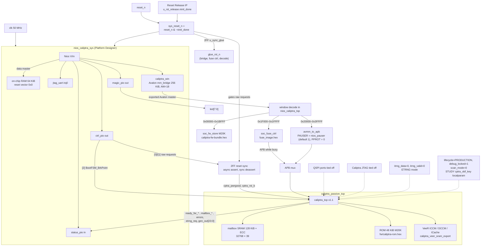
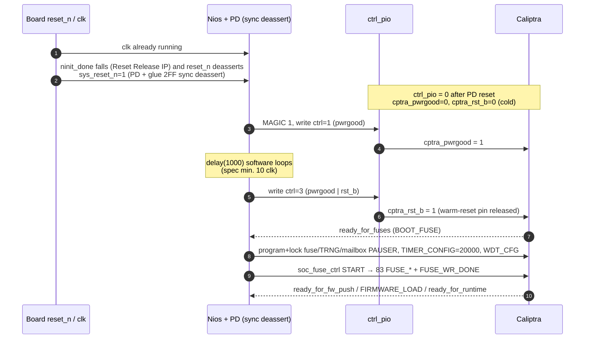

# Nios V ↔ Caliptra 1.x Integration Note

- **Project:** Caliptra 1.x (passive) on Intel Agilex 5 E **A5EC065BB32AE6S**, Nios V/m mailbox host (AXI4-lite → Avalon → APB).
- **Repo:** [pwilliam282/caliptra-a5e-quartus](https://github.com/pwilliam282/caliptra-a5e-quartus)
- **This document:** [`docs/NIOS_CALIPTRA_INTEGRATION.md`](https://github.com/pwilliam282/caliptra-a5e-quartus/blob/main/docs/NIOS_CALIPTRA_INTEGRATION.md)
- **RTL / spec version:** chipsalliance/caliptra-rtl **v1.1**, commit `5f85fb4bc95b753a2f7d042db7dc2644ca1e8c49` (same tree as release [rtl-20261101](https://github.com/pwilliam282/caliptra-a5e-quartus/releases/tag/rtl-20261101)). Official sources used for this audit: `docs/CaliptraIntegrationSpecification.md` and `docs/CaliptraHardwareSpecification.md` at that commit. **1.x has no `strap_ss_*` / AXI DMA / Caliptra-SS straps** — those belong to 2.x / Caliptra SS.
- **Glue RTL reviewed at:** glue RTL as of `ea96100` / `ea86b5c` (unchanged since; 2FF reset synchronizers, Reset Release IP gating, warm-reset DONE-only fuse path, PAUSER lock, TIMER_CONFIG, fatal recovery, generic_input tie-off). Verilator results in §13 were built from exactly this RTL; Quartus synthesis result is from `ea86b5c`. Earlier notes: first added in `7ba4ce5` (rev 1), re-audited in `238df80` (rev 2, docs-only).
- **Date:** 2026-11-10 (America/Chicago), revision 3 (design fixes for the rev-2 FAIL/OPEN items; checklist re-audited against the new RTL + v1.1 spec).
- **Scope:** FPGA study / production-flow *mimic*. STUDY keys, UDS, field entropy, and TRNG are **not** production secrets or a FIPS entropy source. xorshift TRNG, study UDS/FE/obf key, and the FPGA fuse-image stand-in remain **TEST-ONLY**.

This is the complete connection map and bring-up note for the Nios host design. It is based on the *actual* FPGA glue RTL, Platform Designer system, and Nios firmware, audited against the official v1.1 Integration and Hardware specifications.

### Corrections vs. revision 2 (`238df80`)

| Item | What changed in the design (and in this note) |
|---|---|
| M7 Reset synchronizers | `pwrgood_sync_async_assert` and `rst_sync_async_assert` (2FF) in `quartus_a5e_nios/rtl/reset_sync.sv`. Raw requests are `ctrl_pio[0/1] & sys_reset_n` (`sys_reset_n = reset_n & ~ninit_done`, see M11), then synchronized: `cptra_rst_b` async assert (to 0) / sync deassert (to 1); `cptra_pwrgood` async assert (to 1) / sync deassert (to 0), per Integration Spec Table 4. Verilator `+test=sync` **PASS**. SDC comments the 2FFs; `reset_n` remains an async false path; synchronizer *outputs* are timed to `clk`. |
| M10 Warm-reset fuse path | `soc_fuse_ctrl` CTRL bit 2 = `START_DONE` writes only `CPTRA_FUSE_WR_DONE=1`. Nios `caliptra_warm_reset()` holds pwrgood, pulses `rst_b`, re-locks TRNG/mailbox PAUSER (rst_b domain), then START_DONE and waits for `ready_for_runtime` (rom-1.1.1 `WarmResetFlow` resumes the existing FW; `FIRMWARE_LOAD` only if `ready_for_fw_push` asserts). Fuse PAUSER / TIMER / WDT persist (pwrgood-sticky). TB `+test=warm` **PASS**: warm `ready_for_fuses` 31 cycles after `rst_b` drop, START_DONE COUNT=1, back to `ready_for_runtime` at cycle 32,845,182 without `FIRMWARE_LOAD` (§13). |
| M1 `generic_input_wires` | Tied `64'b0`. Bit 0 (zeroization status) is 0; there is no zeroization source on this FPGA SoC. Bits 63:1 reserved, no flops. `magic_pio` drives only `led[7:0]`. |
| M12 `CPTRA_TIMER_CONFIG` | Nios / TB write `20000` (50 MHz period in picoseconds) after `ready_for_fuses`. Sticky on pwrgood; rewritten after warm reset as well (harmless). |
| M5 Error handling | Host polls `status_pio[5/6]` (no Qsys IRQ — see §12 open IRQ steps). Non-fatal: log and RW1C-clear `CPTRA_HW_ERROR_NON_FATAL` / `CPTRA_FW_ERROR_NON_FATAL`. Fatal: limited (`FATAL_RETRY_LIMIT=3`) `caliptra_pwrgood_cycle()` cold-reset recovery, then full cold boot. No more `fail()`-spin on the first fatal. TB `+test=fatal` **PASS** (forced fatal → pwrgood cycle → `ready_for_fuses` → full 84-word fuse push, cycle 24,065,266; §13). IRQ wiring remains **OPEN** (needs PD regen). |
| M2 / M3 PAUSER | After `ready_for_fuses`, firmware programs and locks **fuse**, **TRNG**, and **mailbox slot 0** to `HOST_PAUSER=1` (the value `avmm_to_apb` actually drives) before fuse START. Fuse PAUSER is pwrgood-sticky (skipped on warm reset). TRNG and mailbox locks reset on `rst_b` and are rewritten. TB `+test=pauser` **PASS**: mailbox and fuse writes from PAUSER=2 return `PSLVERR`; PAUSER=1 accepted. |
| M8 SRAM zeroization | Still **OPEN** for a pwrgood-time walk of TCB SRAM ports (not muxed). FPGA mitigation only: `quartus/syn_src/caliptra_sram.sv` (synthesis only) has an `initial` zero-fill, so the **mailbox SRAM** (the only `caliptra_sram` instance; 32768 × 39) is 0 in the configuration bitstream (QSF `VERILOG_CONSTANT_LOOP_LIMIT 65536` lets Quartus elaborate the loop). ICCM / DCCM / ICache use VeeR `el2_ram` and get no explicit init. This happens once at FPGA configuration — a later pwrgood cycle does **not** re-zero anything — so it is not the spec's pwrgood-time zeroization and not ASIC SRAM repair. Verilator uses the upstream `libs/rtl/caliptra_sram.sv` model, not this override. |
| M11 Reset Release IP / PLL | **FIXED (Reset Release); PLL N/A.** `quartus_a5e_nios/ip/rst_release.ip` = Agilex 5 **Reset Release Intel FPGA IP** (`altera_s10_user_rst_clkgate`, conduit `ninit_done`), instantiated as `u_rst_release` in `nios_caliptra_top.sv`. `sys_reset_n = reset_n & ~ninit_done` now drives the PD reset, the raw Caliptra pwrgood/rst_b requests, and a new glue 2FF (`u_sync_glue` → `glue_rst_n` for `avmm_to_apb`, `soc_fuse_ctrl`, window decode). Generated and synthesized with Quartus Pro 25.3. Verilator uses `sim/rst_release_stub.sv` (ninit_done=1 for 25 ns, like the vendor sim model). There is still no PLL (board 50 MHz direct); if one is added, AND `locked` into `sys_reset_n`. |

### Corrections vs. the first revision (`7ba4ce5`)

| Item | What changed |
|---|---|
| `CPTRA_HW_REV_ID` | Not a flat `0x0000_0011`. It is `{SOC_STEPPING_ID[15:0], CPTRA_GENERATION[15:0]}` with generation reset value `0x0011` (major 1, minor 1, patch 0). The host reads it *before* fuses, so `0x0000_0011` is correct at that moment. RTL continuously copies `FUSE_SOC_STEPPING_ID` into the stepping field, so after the image's stepping fuse (`0x1`) is written a later read can be `0x0001_0011`. |
| Reset synchronizers | The v1.1 Integration Spec RDC section *requires* the integrator to add external synchronizers: `cptra_pwrgood` and `cptra_rst_b` must already be synchronized to `clk` at the Caliptra boundary. The first revision treated this as a milder CDC note on `reset_n`. Rev 2 rated it **FAIL**; fixed in rev 3 (M7). |
| Warm reset vs fuses | First revision correctly said the host always does a cold-style fuse push, but did not audit `soc_fuse_ctrl` against the required warm-reset path (fuses persist; SoC must still **write `FUSE_WR_DONE` again** without re-writing locked fuses). Rev 2: the IP had no done-only mode; rev 3 adds `START_DONE` (M10). |
| Watchdog / fatal | Added a full WDT / NMI / `cptra_error_fatal` section. The fatal *output pin* clears on `cptra_rst_b` (internal `cptra_noncore_rst_b`); sticky logs and `CPTRA_WDT_CFG` persist across warm reset; the integration requirement to *recover* from a fatal is a power-good reset. WDT t2 specifically needs a **warm reset** to restart the timers. |
| `CPTRA_TIMER_CONFIG` | Was omitted. SoC-writable clock period in picoseconds (sticky on pwrgood, default 0). Rev 2: Nios never programmed it; rev 3 writes 20000 (M12). |
| 2.x names | There is no `cptra_bootfsm_bp` or `strap_ss` in 1.x. The breakpoint pin is `BootFSM_BrkPoint`. The NMI vector is an *internal register*, not a strap. |

---

## 1. Where the earlier connection-map docs live

There was **no** `docs/` tree and no single integration note in the repo before the first revision of this file. The Nios ↔ Caliptra map was spread across these documents (all still present):

| Document | What it covers | Status vs RTL at `32924ba` |
|---|---|---|
| [`quartus_a5e_nios/README.md`](https://github.com/pwilliam282/caliptra-a5e-quartus/blob/main/quartus_a5e_nios/README.md) | Closest earlier connection map: ASCII block diagram, Nios address map, straps, fuse-image summary | **Architecture / address-map / strap sections are mostly accurate.** The **Firmware** and **Not done** sections are stale (see §10). |
| [`README.md`](https://github.com/pwilliam282/caliptra-a5e-quartus/blob/main/README.md) | Top-level overview: fuse controller, ETRNG service, FIRMWARE_LOAD, MAGIC `0xCA11F00D` | Accurate at a high level. |
| [`sim/BOOT_NIOS_TOP_PROD.md`](https://github.com/pwilliam282/caliptra-a5e-quartus/blob/main/sim/BOOT_NIOS_TOP_PROD.md) | Verilator production-mimic boot and the rev-3 test list (prod PASS at cycle 24,064,900, 32 TRNG fills; warm/fatal/sync/pauser PASS) | Updated for rev 3; see §13. |
| [`STUDY.md`](https://github.com/pwilliam282/caliptra-a5e-quartus/blob/main/STUDY.md) | C10 GX / A5E fit study (ALMs, routing OOM) | Not a signal map. Notes a Quartus critical warning for a **missing Reset Release IP** on the related A5E build. The Nios project now instantiates it (M11). |

Official SoC-interface rules are in caliptra-rtl v1.1 `docs/CaliptraIntegrationSpecification.md` and `docs/CaliptraHardwareSpecification.md` at `5f85fb4`. Those files are *not* vendored in this git repo; get them with the RTL from release [rtl-20261101](https://github.com/pwilliam282/caliptra-a5e-quartus/releases/tag/rtl-20261101).

---

## 2. Block diagram



Text equivalent (for PDF / plain renderers):

```
 clk (50 MHz) + sys_reset_n = reset_n & ~ninit_done (Reset Release IP u_rst_release)
        |
        v
 nios_caliptra_sys (Platform Designer)
   Nios V/m --AXI4-lite--> interconnect
        +-- ram (64 KiB OCM, reset vector 0x0, init onchip_mem.hex)
        +-- jtag_uart (stdout, IRQ 0)     +-- cpu timer @ 0x80040, debug @ 0x90000
        +-- ctrl_pio  (out) --> cptra_pwrgood / cptra_rst_b / BootFSM_BrkPoint
        +-- status_pio(in)  <-- ready_for_* / mailbox_* / errors / etrng_req / gen_out[23:0]
        +-- magic_pio (out) --> led[7:0] only (generic_input_wires tied 0)
        +-- caliptra_win (256 KiB mm_bridge, exported Avalon master, 18-bit byte address)
                    |
                    v
        window decode in nios_caliptra_top.sv
           0x00000-0x1BFFF  soc_fw_store   (M20K, fw/caliptra-fw-bundle.hex)
           0x1F000-0x1FFFF  soc_fuse_ctrl  (MMIO + APB master; fw/fuse_image.hex)
           0x20000-0x3FFFF  avmm_to_apb    (PAUSER=nios_pauser, default 1) --+
                                soc_fuse_ctrl APB (when busy)  --+--> Caliptra APB
                                                                 |
                                                                 v
                                         caliptra_passive_top
                                           caliptra_top v1.1
                                           mailbox SRAM, ROM, ICCM/DCCM/ICache
                                           QSPI / Caliptra JTAG / iTRNG / scan tied off
```

The Agilex 5 **Reset Release IP** (`u_rst_release`, `ninit_done`) is instantiated; `sys_reset_n = reset_n & ~ninit_done` goes to the PD clock source reset, to the glue 2FF (`glue_rst_n`), and gates the raw Caliptra requests. There is **no** PLL (or PLL-lock AND into reset) and **no** ISSP. Caliptra `cptra_pwrgood` / `cptra_rst_b` are the 2FF-synchronized versions of `ctrl_pio[0/1] & sys_reset_n`.

---

## 3. Full signal connection table

Widths and official roles follow caliptra-rtl v1.1 `caliptra_top` / Integration Spec Tables 4–11. “FPGA source/sink” is what `nios_caliptra_top.sv` and `caliptra_passive_top.sv` actually wire.

### 3.1 Clocks and resets

| Caliptra port | W | FPGA source / sink | Notes |
|---|---:|---|---|
| `clk` | 1 | Board `clk` (top port). Shared by Nios, glue, and Caliptra. | SDC: 50 MHz (`period 20 ns`). **No PLL**, no on-die oscillator. Spec validates up to 400 MHz and requires an on-die oscillator for the threat model. The input clock is **ungated**; internal Caliptra clock gating is off until SoC writes `CPTRA_CLK_GATING_EN` (`0x3_00C0`, default 0, SoC-writable, resets on `cptra_rst_b`). Nios never writes it. Clock is running before Nios asserts `cptra_pwrgood`. |
| `cptra_pwrgood` | 1 | 2FF `u_sync_pwrgood` of `ctrl_pio[0] & sys_reset_n` | Active-high. PIO reset value 0 ⇒ Caliptra held unpowered until Nios writes bit 0. Board `reset_n` (or `ninit_done` during device init) also takes the raw request low (**cold reset**); the pin **deasserts synchronously** (2 clocks). Assert (0→1) is asynchronous, per Table 4. |
| `cptra_rst_b` | 1 | 2FF `u_sync_rst_b` of `ctrl_pio[1] & sys_reset_n` | Active-low warm-reset pin. Same raw AND, then 2FF: assert (1→0) asynchronous, deassert (0→1) synchronous. Official minimum: **≥ 10 clocks** after pwrgood before deasserting `cptra_rst_b`. Nios `delay(1000)` / TB 20 cycles meet that (and cover the 2FF). |

`sys_reset_n` (= `reset_n & ~ninit_done`) also resets the Platform Designer system (clock_source `resetSynchronousEdges DEASSERT` — this sync-deasserts the **Nios/PD** reset) and, through its own 2FF `u_sync_glue` (`glue_rst_n`, async assert / sync deassert), the glue (`avmm_to_apb`, `soc_fuse_ctrl`, window-decode flops, `nios_pauser`). Caliptra's two pins use the dedicated 2FFs, not the PD synchronizer. SDC: `set_false_path -from [get_ports reset_n]` and `set_false_path -from [get_keepers {*u_rst_release*}]` (async/quasi-static sources into the synchronizers' async pins and the PD); the synchronizer outputs are registers timed to `clk`.

See **§5** for cold vs warm reset, fuse persistence, and the sequence diagram.

### 3.2 APB (SoC mailbox / soc_ifc)

APB is 32-bit address, 32-bit data, 32-bit PAUSER (`CALIPTRA_APB_*_WIDTH` in `config_defines.svh`). Nios sees only an 18-bit window; `avmm_to_apb` zero-extends and forces 32-bit alignment.

| Caliptra port | W | FPGA source / sink | Notes |
|---|---:|---|---|
| `PADDR` | 32 | Mux: `soc_fuse_ctrl` while `busy`, else `avmm_to_apb` | Fuse controller uses `0x0003_0200 + 4*idx` then `0x0003_00B0`. Nios path uses the 18-bit Avalon byte address. |
| `PPROT` | 3 | `avmm_to_apb` constant `3'b000` | Fuse controller does **not** drive `PPROT`; the bridge constant remains during fuse push. |
| `PSEL`, `PENABLE`, `PWRITE`, `PWDATA` | 1 / 1 / 1 / 32 | Same mux | Standard APB3 SETUP then ACCESS until `PREADY`. |
| `PAUSER` | 32 | `avmm_to_apb` `pauser_i` = `nios_pauser` (default `32'h1`); `32'h1` while `soc_fuse_ctrl` owns the mux | This is the Nios AXI/APB user ID actually used. Default mailbox valid PAUSER in RTL is `CPTRA_DEF_MBOX_VALID_PAUSER = 0xFFFFFFFF`, so Nios programs and locks mailbox slot 0, TRNG, and fuse VALID/LOCK to 1 after `ready_for_fuses` (see §4.3 / M2/M3). The TB may force `nios_pauser` to a wrong ID to check `PSLVERR`. |
| `PREADY`, `PRDATA`, `PSLVERR` | 1 / 32 / 1 | Caliptra → bridge and fuse controller | Bridge reports `avs_response = 2'b10` on `PSLVERR` (mm_bridge `USE_RESPONSE` is not enabled, so the Nios CPU does not see AXI/Avalon error responses). |

### 3.3 Boot / mailbox notification and errors

| Caliptra port | W | FPGA source / sink | Notes |
|---|---:|---|---|
| `ready_for_fuses` | 1 | `status_pio[0]` and `soc_fuse_ctrl.ready_for_fuses` | Asserted in Boot FSM `BOOT_FUSE`. START is rejected if this is low. |
| `ready_for_fw_push` | 1 | `status_pio[1]` | Nios waits, then issues mailbox `FIRMWARE_LOAD`. Wired and used correctly. |
| `ready_for_runtime` | 1 | `status_pio[2]` | Success criterion; MAGIC `0xCA11F00D`. Wired and used correctly. |
| `mailbox_data_avail` | 1 | `status_pio[3]` | Level status reflecting the mailbox register. **Not** connected to a Nios IRQ. Polling is architecturally allowed (SoC is responsible for noticing data). |
| `mailbox_flow_done` | 1 | `status_pio[4]` | Same. |
| `cptra_error_fatal` | 1 | `status_pio[5]` | **Polled** (no Qsys IRQ in this PD; see open IRQ steps in §12). On fatal, `main.c` logs `CPTRA_HW_ERROR_FATAL` / `CPTRA_FW_ERROR_FATAL` and runs `caliptra_pwrgood_cycle()` (drop both pins, wait, re-release) up to three times, then a full cold boot. The pin itself is sticky until `cptra_rst_b` / `cptra_noncore_rst_b`; sticky *logs* clear only on pwrgood. Spec also: WDT t2 needs a **warm reset** to restart the timers — `caliptra_warm_reset()` is available for a host-initiated warm reset (not auto-selected by error type). |
| `cptra_error_non_fatal` | 1 | `status_pio[6]` | Polled in the boot/idle loops. Host logs and RW1C-clears `CPTRA_HW_ERROR_NON_FATAL` (`0x3_0004`) and `CPTRA_FW_ERROR_NON_FATAL` (`0x3_000C`). Same missing IRQ routing. |
| `BootFSM_BrkPoint` | 1 | `ctrl_pio[2]` | 1.x name is `BootFSM_BrkPoint` (there is no `cptra_bootfsm_bp` pin). Reset value 0 (do not halt Boot FSM after fuses). If set, the FSM goes `BOOT_FUSE` → `BOOT_WAIT` until SoC writes `CPTRA_BOOTFSM_GO.GO = 1` at `0x3_00B8`. Nios never sets the strap or writes GO. |

The only Platform Designer IRQ is `jtag_uart` at irqNumber 0. Caliptra status is **polled** and acted on (recovery / RW1C). Wiring the error pins as Nios IRQs needs a Qsys regen (OPEN, §12). See **§6** for WDT / NMI / fatal behavior.

### 3.4 TRNG

`CALIPTRA_INTERNAL_TRNG` is **commented out** in upstream `config_defines.svh`, so this build is **external-source (ETRNG) mode**. The 1.x RTL still *contains* entropy_src / CSRNG, but they are not instantiated without that define.

| Caliptra port | W | FPGA source / sink | Notes |
|---|---:|---|---|
| `etrng_req` | 1 | `status_pio[7]` | ROM/FW raise this; Nios `trng_service()` in `sw/app/main.c` polls it. |
| `itrng_data` | 4 | Tied `4'h0` | Unused in ETRNG mode. |
| `itrng_valid` | 1 | Tied `1'b0` | Forces ETRNG; no physical bitstream. |

There is **no** FPGA entropy IP, no ring oscillator, and no hardware LFSR. Servicing is done in **Nios C firmware**:

1. See `status_pio[7]`.
2. Write 12 words to `CPTRA_TRNG_DATA0`…`DATA11` (`0x30078`–`0x300A4`) from an **xorshift32** seeded with `0x1234ABCD`.
3. Write `CPTRA_TRNG_STATUS = 2` (`DATA_WR_DONE`).
4. Wait for `etrng_req` to drop.

The Verilator TB does the same with `$urandom`. After `ready_for_fuses` the host programs `CPTRA_TRNG_VALID_PAUSER=1` and `CPTRA_TRNG_PAUSER_LOCK=1` (rst_b domain — rewritten after a warm reset). The entropy itself remains TEST-ONLY xorshift.

This is **TEST-ONLY**. It is not NIST-compliant entropy. The Integration Spec requires a dedicated iTRNG (or, if the shared ETRNG API is used, **immutable SoC hardware gasket logic**, not mutable firmware) and recommends locking TRNG PAUSER. See §8.

### 3.5 Security straps, generic wires, scan, JTAG, QSPI

| Caliptra port | W | FPGA source / sink | Notes |
|---|---:|---|---|
| `cptra_obf_key` | 256 | Localparam `STUDY_PROD_MIMIC_OBF_KEY` in `nios_caliptra_top.sv` | Fixed study value, always driven. **Not** a product secret; visible in RTL/bitstream. Real silicon would ECO/PUF this and keep it off scan. Latched inside Caliptra on a power-good cycle (internal `pwrgood_toggle_hint`). |
| `security_state.device_lifecycle` | 2 | Hardwired `2'b11` (`DEVICE_PRODUCTION`) | Production-*flow mimic*, not a live SoC lifecycle strap. Captured inside Caliptra on the first cycle after internal non-core reset release (default latched value before capture is also PRODUCTION + debug locked). |
| `security_state.debug_locked` | 1 | Hardwired `1'b1` | Debug locked (HW spec: MSB of security_state). Because of this, rom-1.1.1 arms WDT1 from `CPTRA_WDT_CFG`. JTAG would not open. |
| `scan_mode` | 1 | Tied `1'b0` | Correct for this FPGA (no DFT). Spec: must be set to 1 *before* scan is enabled so secrets can be flushed. RDC analysis also assumes 0 for functional mode. |
| `generic_input_wires` | 64 | Tied `64'b0` | Integration Spec Table 12: bit 0 = fuse zeroization status (tied 0; this FPGA SoC has no zeroization source); bits 63:1 reserved, tied 0, no storage. `magic_pio` is **not** connected here; it only drives `led[7:0]`. |
| `generic_output_wires` | 64 | `[23:0]` packed into `status_pio[31:8]`; `[63:24]` not visible to Nios | ROM/FW character log in the TB uses bits `[8:0]` (bit 8 toggles, `[7:0]` is the char). |
| `jtag_tck/tms/tdi` | 1 | Tied 0 | Caliptra TAP not brought out. |
| `jtag_trst_n` | 1 | Tied 0 | Held in reset. Spec wants a TAP endpoint and `jtag_trst_n` deassert synchronized to `jtag_tck`. Acceptable for a debug-locked FPGA study; not a production TAP. |
| `jtag_tdo`, `jtag_tdoEn` | 1 | Unconnected | — |
| `qspi_clk_o`, `qspi_cs_no`, `qspi_d_o`, `qspi_d_en_o` | — | Unconnected in the wrapper | `CALIPTRA_INTERNAL_QSPI` is not enabled. |
| `qspi_d_i` | 4 | Tied `'0` | — |
| UART `uart_tx`/`uart_rx` | — | Not present | `CALIPTRA_INTERNAL_UART` undefined; ports compiled out. |

Nios has its **own** JTAG UART and debug module (Intel SLD / `altera_reserved_tck` in the SDC). That is unrelated to the Caliptra TAP.

Firmware image source is **`soc_fw_store`** (on-chip M20K, `fw/caliptra-fw-bundle.hex`, 109,000 bytes), a stand-in for SoC boot flash. There is no QSPI/flash controller in this design.

### 3.6 Memories (instantiated in `caliptra_passive_top`)

| Memory | Size / shape | Implementation | Notes |
|---|---|---|---|
| Mailbox SRAM | 128 KiB + 7-bit ECC, 32768 × 39 | `caliptra_sram` → M20K | Export from `caliptra_top`. |
| BootROM (imem) | 48 KiB, 6144 × 64 | `caliptra_rom_m20k`, `$readmemh("../fw/caliptra-rom.hex")` | caliptra-sw **rom-1.1.1**. Do not use a 2.x ROM. Path is relative to `quartus_a5e_nios/`. |
| VeeR ICCM | 128 KiB + ECC, 4 × 8192 × 39 | `caliptra_veer_sram_export` | Error injection tied to 0. |
| VeeR DCCM | 128 KiB + ECC, 4 × 8192 × 39 | same | same |
| ICache (data+tag) | ~16 KiB | same export | Spec notes I-Cache may be disabled/removed for synthesis; it is still instantiated. |
| SoC FW store | 28,672 × 32 (112 KiB) | `soc_fw_store` M20K | Not a Caliptra memory. |
| SoC fuse image | 83 × 32 | `$readmemh` array in `soc_fuse_ctrl` | FPGA stand-in for OTP; not non-volatile. |
| Nios OCM | 64 KiB | PD `intel_onchip_memory`, `onchip_mem.hex` | Host code/data. |

Spec also wants SRAM repair only on power-good, and SRAM contents **zeroed before `cptra_rst_b` deassert**. A true pwrgood-time walk would have to mux mailbox / ICCM / DCCM / ICache ports inside the TCB; that is **not** implemented (M8 OPEN). FPGA mitigation only: `quartus/syn_src/caliptra_sram.sv` (synthesis only) has an `initial` zero-fill, so the **mailbox SRAM** (the only `caliptra_sram` instance; 32768 × 39) is 0 in the configuration bitstream (QSF `VERILOG_CONSTANT_LOOP_LIMIT 65536` lets Quartus elaborate the loop). ICCM / DCCM / ICache use VeeR `el2_ram` and get no explicit init. This happens once at FPGA configuration — a later pwrgood cycle does **not** re-zero anything — so it is not the spec's pwrgood-time zeroization and not ASIC SRAM repair. Verilator uses the upstream `libs/rtl/caliptra_sram.sv` model, not this override.

---

## 4. Memory map as seen by Nios

From `qsys/nios_caliptra_sys.tcl` and generated `sw/bsp/system.h`. Data-master view:

| Base | Span | Block |
|---|---|---|
| `0x0000_0000` | 64 KiB | `ram` on-chip memory (code + data, init `onchip_mem.hex`) |
| `0x0004_0000` | 256 KiB | `caliptra_win` window (offsets below) |
| `0x0008_0000` | 8 B | `jtag_uart` |
| `0x0008_0010` | 16 B | `ctrl_pio` — bit 0 `cptra_pwrgood`, bit 1 `cptra_rst_b`, bit 2 `BootFSM_BrkPoint` (reset 0) |
| `0x0008_0020` | 16 B | `status_pio` — see bit table below |
| `0x0008_0030` | 16 B | `magic_pio` → `led[7:0]` only (not a Caliptra generic input) |
| `0x0008_0040` | 64 B | Nios V `timer_sw_agent` (mtime) — **Nios** timer, unrelated to Caliptra `CPTRA_TIMER_CONFIG` |
| `0x0009_0000` | 64 KiB | Nios V debug module |

### 4.1 Window at `0x0004_0000` (18-bit offset)

Decode in `nios_caliptra_top.sv`: `address[17]` selects Caliptra; `address[16:12] == 0x1F` selects the fuse controller; everything else in the low half is the FW store.

| Window offset | Nios address | Block |
|---|---|---|
| `0x0_0000`–`0x1_BFFF` | `0x0004_0000`–`0x0005_BFFF` | `soc_fw_store` (word-addressed firmware bundle, little-endian 32-bit) |
| `0x1_C000`–`0x1_EFFF` | — | **Hole:** decode still hits `soc_fw_store`, address clamped to word 0. Do not use. |
| `0x1_F000`–`0x1_FFFF` | `0x0005_F000` | `soc_fuse_ctrl` MMIO (4 KiB) |
| `0x2_0000`–`0x2_FFFF` | `0x0006_0000` | Caliptra `MBOX_CSR` (via APB) |
| `0x3_0000`–`0x3_FFFF` | `0x0007_0000` | Caliptra `soc_ifc` (via APB) |

### 4.2 `soc_fuse_ctrl` MMIO (base `0x0005_F000`)

| Offset | Access | Meaning |
|---|---|---|
| `0x00` ID | RO | `0x4655_5345` (`"FUSE"`) |
| `0x04` CTRL | WO | bit 0 START (83 fuse words + DONE), bit 1 CLEAR (clears DONE/ERR), bit 2 **START_DONE** (write only `CPTRA_FUSE_WR_DONE=1`, warm-reset path) |
| `0x08` STATUS | RO | bit 0 BUSY, bit 1 DONE, bit 2 ERR, bit 3 live `ready_for_fuses` |
| `0x0C` COUNT | RO | APB writes completed (84 = 83 fuse words + `FUSE_WR_DONE` on START; **1** on START_DONE) |
| `0x10` FW_BYTES | RO | `109000` — size of the bundle in `soc_fw_store` |
| `0x14` NUM_FUSES | RO | `83` |

UDS / field entropy in the on-chip image are **not** readable through this MMIO (Nios can only START and read status). After programming, Caliptra itself reads back `FUSE_UDS_SEED` / `FUSE_FIELD_ENTROPY` as 0 (write-only to the SoC), which the TB checks.

### 4.3 Selected Caliptra APB offsets (add to `0x0004_0000`)

| Offset | Register | Use in this host / notes |
|---|---|---|
| `0x2_0000` | `MBOX_LOCK` | Acquire before `FIRMWARE_LOAD` |
| `0x2_0004` | `MBOX_USER` | Must equal `1` (our PAUSER) |
| `0x2_0008` | `MBOX_CMD` | `0x46574C44` (`"FWLD"`) |
| `0x2_000C` | `MBOX_DLEN` | Bundle length in bytes |
| `0x2_0010` | `MBOX_DATAIN` | Word stream from `soc_fw_store` |
| `0x2_0018` | `MBOX_EXECUTE` | 1 to start, 0 to release |
| `0x2_001C` | `MBOX_STATUS` | 2 = CMD_COMPLETE, 3 = CMD_FAILURE |
| `0x3_0000` | `CPTRA_HW_ERROR_FATAL` | Sticky on pwrgood. Bit 0 ICCM ECC, bit 1 DCCM ECC, **bit 2 `nmi_pin` (0x4) = WDT t2**, bit 3 crypto. Writing 1 clears a bit in the *register* but **does not** deassert the `cptra_error_fatal` pin. Host logs this on fatal, then does a pwrgood cycle. |
| `0x3_0004` / `0x3_0008` / `0x3_000C` | `CPTRA_HW_ERROR_NON_FATAL` / `FW_ERROR_FATAL` / `FW_ERROR_NON_FATAL` | Non-fatal pair is RW1C-cleared by the host when `status_pio[6]` is set. |
| `0x3_003C` | `CPTRA_FLOW_STATUS` | Includes `ready_for_*` bits |
| `0x3_0048` / `0x3_005C` | `CPTRA_MBOX_VALID_PAUSER[0]` / `LOCK[0]` | Programmed to 1 / 1 after `ready_for_fuses`. Reset on `cptra_rst_b` — rewritten after warm reset. |
| `0x3_0070` / `0x3_0074` | `CPTRA_TRNG_VALID_PAUSER` / `LOCK` | Programmed to 1 / 1 after `ready_for_fuses`. Reset on `cptra_rst_b` — rewritten after warm reset. Default VALID reset value is `0xFFFFFFFF`. |
| `0x3_0078`–`0x3_00A4` | `CPTRA_TRNG_DATA[0..11]` | 12 ETRNG words (writes accepted only from the locked PAUSER once LOCK=1) |
| `0x3_00AC` | `CPTRA_TRNG_STATUS` | Write 2 = `DATA_WR_DONE` |
| `0x3_00B0` | `CPTRA_FUSE_WR_DONE` | Written by `soc_fuse_ctrl`, then checked by Nios. Sticky on **pwrgood**. |
| `0x3_00B4` | `CPTRA_TIMER_CONFIG` | Clock period in **picoseconds** (SoC RW, sticky on pwrgood, default 0). Used by Caliptra FW `get_cycle_count()` for MTIME. Nios / TB write **20000** (50 MHz). |
| `0x3_00B8` | `CPTRA_BOOTFSM_GO` | Write `GO=1` to leave `BOOT_WAIT` if `BootFSM_BrkPoint` was set. Unused (strap is 0). |
| `0x3_00C0` | `CPTRA_CLK_GATING_EN` | SoC-writable global enable for *internal* clock gating (default 0, resets on `cptra_rst_b`). Nios leaves it 0 (gating disabled). (HW spec table lists `0x300300bc`; the v1.1 register header / RDL address is `0x300300c0`.) |
| `0x3_00D4` | `CPTRA_HW_REV_ID` | `{SOC_STEPPING_ID, CPTRA_GENERATION}`. Generation reset value `0x0011`. Stepping is driven from `FUSE_SOC_STEPPING_ID`. Host reads this *before* fuses ⇒ `0x0000_0011`. After stepping fuse `0x1` is written, a later read can be `0x0001_0011`. |
| `0x3_00D8` / `0x3_00DC` | `CPTRA_FW_REV_ID0/1` | Read after `ready_for_runtime` |
| `0x3_00E4`…`0x3_0104` | `CPTRA_WDT_TIMER*` / `STATUS` | Caliptra-internal WDT programming and t1/t2 status. SoC is RO on the period/status. See §6. |
| `0x3_0108` / `0x3_010C` | `CPTRA_FUSE_VALID_PAUSER` / `LOCK` | Programmed to 1 / 1 on cold boot only (sticky on **pwrgood**; skipped after warm reset). |
| `0x3_0110` / `0x3_0114` | `CPTRA_WDT_CFG0/1` | SoC-provided 64-bit WDT1 timeout in cycles, sticky on **pwrgood**, default 0. Nios writes `100_000_000` / `0` after `ready_for_fuses`, before START. |
| `0x3_0200`–`0x3_0348` | `FUSE_*` | Written by `soc_fuse_ctrl`, not by Nios |

### 4.4 `status_pio` bits

| Bit | Signal |
|---|---|
| 0 | `ready_for_fuses` |
| 1 | `ready_for_fw_push` |
| 2 | `ready_for_runtime` |
| 3 | `mailbox_data_avail` |
| 4 | `mailbox_flow_done` |
| 5 | `cptra_error_fatal` |
| 6 | `cptra_error_non_fatal` |
| 7 | `etrng_req` |
| 31:8 | `generic_output_wires[23:0]` |

---

## 5. Reset and power-good

### 5.1 How the pins are generated (this FPGA)

```
reset_n (board, active-low, SDC false path)     u_rst_release.ninit_done (Reset Release IP)
   │                                                  │  1 until device init done, then 0
   └───────────── sys_reset_n = reset_n & ~ninit_done ┘
   │
   ├──► rst_sync_async_assert u_sync_glue (2FF) → glue_rst_n
   │      (avmm_to_apb, soc_fuse_ctrl, window decode, nios_pauser)
   │
   ├──► Platform Designer clock_source.clk_in_reset
   │      resetSynchronousEdges = DEASSERT
   │      ⇒ Nios, OCM, PIOs, mm_bridge get a sync-deasserted reset
   │      ctrl_pio reset value = 0
   │
   └──► raw_pwrgood = ctrl_pio[0] & sys_reset_n
        raw_rst_b   = ctrl_pio[1] & sys_reset_n
             │
             ├── pwrgood_sync_async_assert (2FF) → cptra_pwrgood
             │     async assert (0→1), sync deassert (1→0) to clk
             └── rst_sync_async_assert (2FF)     → cptra_rst_b
                   async assert (1→0), sync deassert (0→1) to clk
```

Present / not present for a real A5E kit bring-up:

- **Intel Reset Release IP / `ninit_done`: implemented** (`ip/rst_release.ip`, `u_rst_release`). Agilex 5 fabric is not guaranteed ready until `ninit_done` falls; until then `sys_reset_n` holds the PD, glue, and Caliptra requests in reset (M11).

- **PLL and PLL-lock.** The SDC assumes a 50 MHz input already at the `clk` port. There is no PLL-lock term in the reset qualifier.
- **ISSP** (In-System Sources and Probes) for debug-overriding resets: not instantiated.
- **External 2FF synchronizers** on `cptra_pwrgood` and `cptra_rst_b`: **implemented** in `rtl/reset_sync.sv` (`u_sync_pwrgood`, `u_sync_rst_b`). Verilator `+test=sync` checks async assert and 2- or 3-cycle sync deassert.

### 5.2 Official ordering (v1.1 Integration Spec)

- Clock must be running **before** `cptra_pwrgood` asserts. (Met: free-running board/`clk`.)
- **≥ 10 clocks** after `cptra_pwrgood` asserts before `cptra_rst_b` is deasserted. (Met in `main.c` / TB for the cold-boot path.)
- Assertions of `cptra_pwrgood` / `cptra_rst_b` may be asynchronous; **deassertions must be synchronous to `clk`**. The integrator **must add external reset synchronizers**; Caliptra assumes the pins are already synchronized at its boundary (RDC “Reset constraints and assumptions”).
- **`cptra_pwrgood` deasserted** = power cycle / **cold reset**. All resettable flops return to default, including sticky registers (fuses, `FUSE_WR_DONE`, `CPTRA_WDT_CFG`, error logs, `CPTRA_TIMER_CONFIG`, fuse PAUSER lock).
- **`cptra_rst_b` deasserted while pwrgood stays high** = **warm reset**. Resets all but sticky registers. Fuses and `FUSE_WR_DONE` **persist**. The SoC must still perform a write to `FUSE_WR_DONE` while the Boot FSM is in `BOOT_FUSE` (`fuse_wr_done_observed` is cleared on `cptra_noncore_rst_b` and must see a fresh `swmod` on the done register).
- `BootFSM_BrkPoint=1` stops the FSM after fuse download until `CPTRA_BOOTFSM_GO`.

Internal Boot FSM (v1.1 `soc_ifc_boot_fsm.sv`): `BOOT_IDLE` (held while `cptra_rst_b` is asserted) → `BOOT_FUSE` (`ready_for_fuses`, non-core reset already released so the APB fuse window works) → `BOOT_DONE` (or `BOOT_WAIT` if the breakpoint strap is set). `BOOT_DONE` deasserts `cptra_uc_rst_b` through a 2FF synchronizer. A firmware-update reset only pulses the VeeR reset (`BOOT_FW_RST`).

### 5.3 Sequence (intended cold boot — what `main.c` actually does)



A **board `reset_n` assertion** takes both raw requests low *and* resets Nios / `ctrl_pio`, so it is always a **Caliptra cold reset** (`rst_b` falls asynchronously; `pwrgood` falls after 2 clocks). A Nios write of `ctrl_pio = 1` (pwrgood held) then back to `3` is a **warm reset**; `caliptra_warm_reset()` in `main.c` and the TB `+test=warm` path do exactly that.

### 5.4 How Nios and Caliptra resets are related

| Event | Nios / PD | Caliptra |
|---|---|---|
| Board `reset_n` low | Reset (async assert, sync deassert in PD) | `rst_b` async to 0; `pwrgood` sync-deasserts after 2 clocks (cold) |
| Nios comes out of reset | Runs `main`, `ctrl_pio` still 0 | Still held in cold reset until software says otherwise |
| `main` writes pwrgood, then rst_b | Running | Official cold-boot sequence (10-cycle gap plus 2FF deassert) |
| Nios writes `ctrl_pio = 1` then `3` (`caliptra_warm_reset`) | Running | Warm reset; fuses persist; START_DONE, then ROM resumes existing FW → `ready_for_runtime` (no FIRMWARE_LOAD) |
| WDT t2 / `cptra_error_fatal` | Polled; `caliptra_pwrgood_cycle()` up to 3 times, then cold re-boot | Fatal pin clears on the pwrgood/rst_b cycle; sticky logs cleared by pwrgood. `caliptra_warm_reset()` is available if only a warm reset is wanted (WDT t2). |

### 5.5 `soc_fuse_ctrl` and warm reset

`fuse_wr_done_reg_write_observed` is cleared on `cptra_noncore_rst_b`. Advance from `BOOT_FUSE` requires `fuse_done && fuse_wr_done_observed`. After a warm reset, `CPTRA_FUSE_WR_DONE` is still 1 (sticky on pwrgood) but *observed* is 0, so the SoC must write the done register again.

`soc_fuse_ctrl` now has two start paths:

- CTRL bit 0 **START** — write all 83 `FUSE_*` words, then `FUSE_WR_DONE=1` (cold / pwrgood recovery). COUNT=84.
- CTRL bit 2 **START_DONE** — write only `CPTRA_FUSE_WR_DONE=1` (warm reset). COUNT=1.

`FUSE_WR_DONE.done.swwe` is `soc_req & ~done`, so after a warm reset (bit still 1) the write does not change the stored value. That does not matter: in the v1.1 generated register block, `hwif_out.CPTRA_FUSE_WR_DONE.done.swmod = decoded_reg_strb.CPTRA_FUSE_WR_DONE && decoded_req_is_wr` (`soc_ifc_reg.sv`), i.e. **any** APB write to `0x3_00B0` raises `swmod`, independent of `swwe`. `soc_ifc_top.sv` latches that into `fuse_wr_done_reg_write_observed` (reset on `cptra_noncore_rst_b`), and the Boot FSM leaves `BOOT_FUSE` on `fuse_done && fuse_wr_done_observed`. START_DONE issues exactly that one write, and the Verilator `+test=warm` run confirms the Boot FSM advances and the ROM reaches `ready_for_runtime` again.

After START_DONE the host re-programs TRNG and mailbox PAUSER/lock (those reset on `rst_b`). rom-1.1.1 `WarmResetFlow` then jumps to the **existing** firmware (data-vault entry point) if the previous cold boot completed; `ready_for_fw_push` / `FIRMWARE_LOAD` are not repeated. The host waits for `ready_for_runtime`. If the previous cold boot did not complete, `ready_for_fw_push` may still assert and the host loads FW as usual.

### 5.6 SDC / false paths

`quartus_a5e_nios/nios_caliptra.sdc`:

- `create_clock -period 20` on `clk` (50 MHz).
- `altera_reserved_tck` 40 ns, asynchronous to `clk`.
- `set_false_path -from [get_ports reset_n]` — board reset is asynchronous into the 2FF async pins and into the Nios PD.
- `set_false_path -from [get_keepers -nowarn {*u_rst_release*}]` — `ninit_done` is SDM-driven and quasi-static (falls once after configuration); it only reaches the same synchronizers. The Reset Release IP ships its own SDC for its internal clock. The **synchronized** `cptra_pwrgood` / `cptra_rst_b` are register outputs timed to `clk` and are not false-pathed onward into Caliptra.

There are no explicit constraints matching the official RDC false-path table (CPTRA_PWRGD vs other reset groups, etc.). The 2FFs provide the functional async-assert / sync-deassert the RDC analysis assumes at the Caliptra boundary.

---

## 6. Watchdog, NMI, and fatal errors

### 6.1 What exists in 1.x RTL

Caliptra contains a **two-stage WDT** (`wdt.sv`), independent of VeeR, documented in the Hardware Spec “Watchdog timer” section. There are **no SoC pins** for t1/t2 timeout. Visibility to the SoC is:

- `CPTRA_WDT_STATUS.t1_timeout` / `t2_timeout` (SoC RO, `0x3_0104`)
- `CPTRA_HW_ERROR_FATAL.nmi_pin` (bit 2, mask `0x4`) on t2 in cascade mode
- The `cptra_error_fatal` output pin

Default mode is **cascade** (Timer 2 enable = 0):

1. ROM/FW enable Timer 1. Timer 1 counts until it matches its period.
2. **t1 timeout** raises an *internal* error interrupt to VeeR (`error_wdt_timer1_timeout_sts`). Timer 2 starts. If FW services t1 before t2 expires, both timers restart.
3. **t2 timeout in cascade** asserts `nmi_intr` (`nmi_intr = t2_timeout && !timer2_en`), which is connected to VeeR's NMI input, sets `CPTRA_HW_ERROR_FATAL.nmi_pin`, and sets `cptra_error_fatal`. Hardware Spec: “A warm reset is required by the SoC to reset the timers when Timer 2 times out.”

If Timer 2 is enabled independently, t2 is just another error IRQ (no NMI / no fatal from this path).

Timeout periods (`CPTRA_WDT_TIMERn_TIMEOUT_PERIOD`, 64-bit, default `0xFFFF_FFFF_FFFF_FFFF`) are **Caliptra-only writable** and reset on `cptra_rst_b`. The SoC-visible knob is **`CPTRA_WDT_CFG[1:0]`** (`0x3_0110/0x114`): a 64-bit cycle count, SoC RW, sticky on **pwrgood**, default **0**. rom-1.1.1 `start_wdt()` runs only when `debug_locked=1`, reads that 64-bit value, **replaces 0 with 1 cycle**, and programs WDT1.

That is why a debug-locked boot with `WDT_CFG=0` produced `HW_ERROR_FATAL=0x4` (`nmi_pin`) at cycle 213,002, and why the host/TB now write `WDT_CFG0=100_000_000`, `WDT_CFG1=0` before fuses (~2.0 s at 50 MHz, ~250 ms at 400 MHz).

### 6.2 NMI vector

There is **no NMI-vector strap** in 1.x. `internal_nmi_vector` is an internal soc_ifc register; `nmi_vector` is driven to VeeR (`nmi_vec = nmi_vector[31:1]`). ROM/FW program it. The SoC does not.

### 6.3 SoC-side reaction in this design

- `cptra_error_fatal` / `non_fatal` are packed into `status_pio` and **polled** in `handle_errors()`. They are not Platform Designer IRQs (spec: both “shall be routed to SoC interrupt controller”). IRQ wiring is OPEN pending Qsys regen (§12).
- On **non-fatal**, the host logs and RW1C-clears `CPTRA_HW_ERROR_NON_FATAL` and `CPTRA_FW_ERROR_NON_FATAL`, then continues.
- On **fatal**, the host logs the sticky error registers and calls `caliptra_pwrgood_cycle()` (drop `ctrl_pio` to 0, delay to cover the 2FF, then cold release) up to `FATAL_RETRY_LIMIT` (3), then a full cold boot (PAUSER + TIMER + WDT + START + FIRMWARE_LOAD). It no longer `fail()`-spins on the first fatal.
- `caliptra_warm_reset()` is provided for a host-initiated warm reset (including WDT t2, which the Hardware Spec says needs a warm reset to restart the timers). The automatic fatal path uses a **pwrgood** cycle, which is the specified general fatal recovery and also clears sticky WDT_CFG / fuses (so they are reprogrammed on the following cold boot).
- `CPTRA_TIMER_CONFIG` is programmed to **20000** ps (50 MHz).

### 6.4 Verdict

WDT **inside** Caliptra is intact and the host's `WDT_CFG` programming is the right production-mimic fix for debug-locked ROM. The SoC now **reacts** to fatal (pwrgood recovery) and non-fatal (log/clear) via **polling**. Remaining gaps: no PD IRQ (OPEN), and the automatic path uses a cold/pwrgood cycle rather than a t2-specific warm reset (warm reset is available as `caliptra_warm_reset()`). Severity: **Medium (IRQ still OPEN; recovery path implemented and tested).**

---

## 7. Boot / bring-up sequence

This is what `quartus_a5e_nios/sw/app/main.c` does (same sequence as `sim/tb_nios_top_fw.sv`). MAGIC values are written to `magic_pio` (LED only). Throughout, `handle_errors()` polls fatal/non-fatal: non-fatal is logged and RW1C-cleared; fatal triggers a pwrgood recovery rather than an immediate spin.

1. **MAGIC `0x1` — alive.** Nios is out of reset. Caliptra is still in cold reset (`ctrl_pio=0`).
2. **Power-good.** Write `ctrl_pio = 1` (`cptra_pwrgood`, async assert through the 2FF). Clock is already running.
3. **Wait**, then **release `cptra_rst_b`.** Write `ctrl_pio = 3` (sync deassert through the 2FF). Official Boot FSM: at least 10 clocks between pwrgood and reset release; `delay(1000)` plus a short post-deassert delay cover the 2FF.
4. **Poll `ready_for_fuses`** (`status_pio[0]`), servicing ETRNG if it appears.
5. **MAGIC `0x2`.** Read `CPTRA_HW_REV_ID` (fail if 0 or all-ones). At this pre-fuse point expect `0x0000_0011`.
6. **Program and lock PAUSER**, then timer and WDT. Order: `FUSE_VALID_PAUSER`/`LOCK` = 1, `TRNG_VALID_PAUSER`/`LOCK` = 1, `MBOX_VALID_PAUSER0`/`LOCK0` = 1, `CPTRA_TIMER_CONFIG` = 20000, `CPTRA_WDT_CFG` = 100,000,000 / 0. **MAGIC `0x3`.**
7. **Fuse programming (hardware IP, not Nios writing `FUSE_*`).** Check fuse-ctrl ID `0x46555345`. Write `CTRL.START` (bit 0). IP waits for `ready_for_fuses` (else ERR), then writes all **83** `FUSE_*` words from `fw/fuse_image.hex` over APB starting at `0x3_0200`, then writes `CPTRA_FUSE_WR_DONE = 1`. Nios only polls `STATUS`. **MAGIC `0x4`.**
8. **ROM boot.** Boot FSM leaves `BOOT_FUSE`, releases `cptra_uc_rst_b`, and ROM runs (including `start_wdt()` because debug is locked). Nios **must** keep servicing `etrng_req` (xorshift stand-in). Poll `ready_for_fw_push`. **MAGIC `0x5`.**
9. **Mailbox `FIRMWARE_LOAD`.** Acquire `MBOX_LOCK`, check `MBOX_USER==1`, write CMD `"FWLD"`, `DLEN=FW_BYTES` (109000), stream words from `soc_fw_store`, set `EXECUTE=1`. **MAGIC `0x6`.** Poll `MBOX_STATUS`, still servicing TRNG. Complete (2) vs failure (3). Clear `EXECUTE`. **MAGIC `0x7`.**
10. **Poll `ready_for_runtime`.** Read `CPTRA_FW_REV_ID*`.
11. **MAGIC `0xCA11F00D`** (LED = `0x0D`). Idle loop continues to service runtime TRNG requests and poll errors.

**Warm reset** (`caliptra_warm_reset()`, TB `+test=warm`): hold pwrgood, pulse `rst_b`, wait `ready_for_fuses`, re-lock TRNG and mailbox PAUSER (skip fuse PAUSER), `CTRL.START_DONE` (bit 2). ROM `WarmResetFlow` resumes the existing firmware; the host waits for `ready_for_runtime` (and only repeats `FIRMWARE_LOAD` if `ready_for_fw_push` asserts).

**Fatal recovery:** pwrgood cycle, then the cold-boot sequence from step 2, up to three retries.

Simulation of this sequence (behavioral Nios host in `sim/tb_nios_top_fw.sv`, mirroring `main.c`) is in **§13 Verification**. The full Platform Designer Nios V CPU running `main.c` has **not** been simulated.

---

## 8. TRNG section (review)

**Mode:** External TRNG API (ETRNG). `CALIPTRA_INTERNAL_TRNG` is off; `itrng_valid` is tied 0, so the internal entropy_src / CSRNG path is not built, and no physical bitstream is provided.

**Who services it:** Nios firmware (`trng_service` in `main.c`), not a hardware gasket. Handshake is the official one: `etrng_req` → 12 words in `CPTRA_TRNG_DATA*` → `CPTRA_TRNG_STATUS.DATA_WR_DONE` → request drops. ROM/FW time out after 250,000 polls of DONE if the SoC is silent.

**Entropy source:** Software **xorshift32**, seed `0x1234ABCD`. Simulation uses `$urandom`. There is no FPGA TRNG, no ring-oscillator, no LFSR in RTL.

**Security:**

- Not a NIST SP 800-90B entropy source.
- Integration Spec: *“It is a requirement for FIPS compliance that this TRNG HW API is always handled by SoC hardware gasket logic (and not some SoC ROM or firmware code).”* This design violates that on purpose for bring-up.
- Spec also strongly prefers enabling `CALIPTRA_INTERNAL_TRNG` and wiring a physical PTRNG to `itrng_data` / `itrng_valid` (~50 kHz valid rate).
- TRNG PAUSER is now programmed to `1` and locked after `ready_for_fuses` (and again after a warm reset). API text says lock=0 means any APB agent can write TRNG DATA (and that matches this v1.1 RTL). A later “programming rules” row says unprogrammed lock means *no* agent is accepted — that row does not match this RTL. The TB confirms a write from PAUSER=2 is rejected (`PSLVERR` on mailbox/fuse; TRNG DATA writes from a wrong user are silently ignored).

**Verdict:** Wired correctly for an ETRNG *bring-up* hook, and enough for the ROM/FW boot that passed in Verilator. **Test-only. Do not treat boot measurements, IDevID, or any Caliptra-derived key as trustworthy on this FPGA image.**

---

## 9. Fuse section (review)

**Mechanism:** A **hardware fuse-controller soft IP** (`soc_fuse_ctrl.sv`), not Nios poking `FUSE_*` registers. This matches the Integration Spec rule “SoC shall write fuse registers and fuse done via immutable logic or ROM code” *in structure* (an FSM in RTL). It is still only an FPGA stand-in for OEM OTP + sequencer: the image is a `$readmemh` of `fw/fuse_image.hex` into on-chip storage, regenerated by `scripts/gen_fuse_image.py`. Anyone who can rebuild the bitstream can change UDS / field entropy / PK hashes.

**Sequencing (cold boot):** Nios waits for `ready_for_fuses`, programs and locks fuse/TRNG/mailbox PAUSER plus TIMER_CONFIG and WDT_CFG, then pulses START. The IP errors if `ready_for_fuses` is low. It writes 83 words at `0x3_0200 + 4*i`, then `CPTRA_FUSE_WR_DONE=1` at `0x3_00B0`. Fuses are one-time per **power-good**. After a **warm reset**, the host pulses CTRL `START_DONE` so only `FUSE_WR_DONE` is written (see §5.5). In v1.1, `FUSE_WR_DONE.done.swmod` is any SoC write to that register (even if the bit is already 1 and `swwe` is 0), which is what `fuse_wr_done_observed` needs.

**APB ownership:** While `busy`, the APB mux gives the fuse IP the bus. Nios is expected only to poll fuse-ctrl STATUS (a local slave, not Caliptra APB). There is no additional hardware interlock if software also issues a Caliptra-window access during the push.

**Fuse PAUSER:** `CPTRA_SET_FUSE_PAUSER_INTEG = 0` in upstream `soc_ifc_pkg.sv` (lock is a programmable register, not a compile-time harden). This host writes `CPTRA_FUSE_VALID_PAUSER=1` and `CPTRA_FUSE_PAUSER_LOCK=1` after `ready_for_fuses` on a cold boot (pwrgood-sticky). Fuse-controller APB writes use PAUSER=1. A TB write from PAUSER=2 after the lock is `PSLVERR`.

**Image contents** (`fw/fuse_image.hex`, 83 words, STUDY values only):

| Fuse | Value in this image |
|---|---|
| `FUSE_UDS_SEED[0..11]` | Deterministic STUDY words (`0x1F2E3D4C ^ 0x9E3779B9*(i+1)`). These are the words programmed into the fuse *registers* (the payload DOE consumes with `cptra_obf_key`). They are **not** documented as a real, provisioned, pre-obfuscated UDS, and they are **not** unique per device. |
| `FUSE_FIELD_ENTROPY[0..7]` | Deterministic STUDY words (`0xA7C3E519 ^ 0x85EBCA6B*(i+1)`). Same caveats. |
| `FUSE_KEY_MANIFEST_PK_HASH[0..11]` | SHA-384 of the vendor public-key descriptor in `fw/caliptra-fw-bundle.bin`, 12 big-endian words (caliptra-sw `bytes_to_be_words_48`). |
| `FUSE_KEY_MANIFEST_PK_HASH_MASK` | 0 (no vendor ECC key revoked) |
| `FUSE_OWNER_PK_HASH[0..11]` | SHA-384 of the owner public-key descriptor, same packing. |
| `FUSE_FMC_KEY_MANIFEST_SVN` | 0 (bundle FMC SVN is 0; ROM requires image SVN ≥ fuse SVN) |
| `FUSE_RUNTIME_SVN[0..3]` | 0 (bundle RT SVN is 0) |
| `FUSE_ANTI_ROLLBACK_DISABLE` | 0 |
| `FUSE_IDEVID_CERT_ATTR[0..23]` | 0 |
| `FUSE_IDEVID_MANUF_HSM_ID[0..3]` | 0 |
| `FUSE_LIFE_CYCLE` | `0x3` (Production), matches the `DEVICE_PRODUCTION` strap |
| `FUSE_LMS_VERIFY` / `FUSE_LMS_REVOCATION` | 0 |
| `FUSE_SOC_STEPPING_ID` | `0x00000001` (A0 test); also reflected in `CPTRA_HW_REV_ID[31:16]` after it is written |

Re-run `scripts/gen_fuse_image.py` if the FW bundle is re-signed. UDS/FE are never exposed through fuse-ctrl MMIO; Nios must not (and the boot ROM does not need to) read them back.

**Lifecycle straps vs fuses:** Both are Production (`2'b11` / fuse `0x3`) with debug locked. This is a hardwired mimic so ROM/FW take the production path (including WDT). It is not a real manufacturing/production lifecycle controller.

---

## 10. Review findings

Severities: **High** = security or correctness risk if this image were treated as more than a study; **Medium** = real mismatch or missing integration item that should be fixed before hardware bring-up / any hardening; **Low** = limitation or tidy-up.

### High — test-only / insecure if mistaken for production

| ID | Finding |
|---|---|
| H1 | **TRNG is a software xorshift** serviced by mutable Nios firmware over ETRNG registers. No iTRNG, no physical entropy, no hardware gasket. Official FIPS/threat-model requirements are not met. |
| H2 | **`cptra_obf_key` is a fixed study localparam** in RTL (and therefore in the bitstream and this repo). Not PUF/HSM provisioned, not protected from scan/debug as the spec requires. |
| H3 | **Fuse “OTP” is an on-chip hex image.** STUDY UDS and field entropy are deterministic and rebuildable. No manufacturing burn, no field-entropy API with anti-replay, no debug-path disable in PRODUCTION beyond what Caliptra already does for those two register files. |
| H4 | **Lifecycle is hardwired** to `DEVICE_PRODUCTION` + `debug_locked`. The SoC does not drive a real security-state strap. |

### Medium — mismatches, bugs, or missing required connections

| ID | Finding |
|---|---|
| M1 | **FIXED.** `generic_input_wires` is tied `64'b0`. Bit 0 (zeroization status) is 0; bits 63:1 reserved, no flops. `magic_pio` drives only `led[7:0]`. |
| M2 | **FIXED.** After `ready_for_fuses`, host writes `CPTRA_TRNG_VALID_PAUSER=1` and `LOCK=1`. Rewritten after warm reset (rst_b domain). Entropy is still TEST-ONLY xorshift (H1). |
| M3 | **FIXED (programmable lock).** `CPTRA_SET_FUSE_PAUSER_INTEG` is still 0 in upstream RTL. Host now programs `FUSE_VALID_PAUSER=1` and `LOCK=1` on cold boot (pwrgood-sticky). Wrong-user fuse writes `PSLVERR` in the TB. |
| M4 | **FIXED in this revision.** `quartus_a5e_nios/README.md` Firmware / Not-done / architecture sections match the current RTL (2FF, PAUSER, START_DONE, TIMER_CONFIG, error recovery). |
| M5 | **PARTIALLY FIXED.** Host polls `status_pio[5/6]`: non-fatal is logged and RW1C-cleared; fatal triggers a limited pwrgood-cycle recovery and cold re-boot (TB `+test=fatal` PASS through recovery to `ready_for_fuses` and a full fuse push; the rest of the cold boot is the `+test=prod` path). IRQ routing to a Nios interrupt is still **OPEN** (needs Qsys regen; steps in §12). Automatic path uses pwrgood (specified general fatal recovery); `caliptra_warm_reset()` is available for a t2-style warm reset. |
| M6 | **No hardware mutex** beyond the `fuse_busy` APB mux. Current FW is careful; a buggy host could overlap Nios APB with the fuse FSM. |
| M7 | **FIXED.** 2FF `u_sync_pwrgood` / `u_sync_rst_b` provide async assert and sync deassert to `clk`. Verilator `+test=sync` PASS. SDC: `reset_n` (and `u_rst_release`) are async false paths into the 2FF pins and the PD; synchronizer outputs are timed to `clk`. |
| M8 | **OPEN**, with FPGA mitigation. A pwrgood-time zeroization FSM would mux TCB-owned SRAM ports (mailbox, ICCM, DCCM, ICache); that mux is not added. `quartus/syn_src/caliptra_sram.sv` (synthesis only) has an `initial` zero-fill, so the **mailbox SRAM** (the only `caliptra_sram` instance; 32768 × 39) is 0 in the configuration bitstream (QSF `VERILOG_CONSTANT_LOOP_LIMIT 65536` lets Quartus elaborate the loop). ICCM / DCCM / ICache use VeeR `el2_ram` and get no explicit init. This happens once at FPGA configuration — a later pwrgood cycle does **not** re-zero anything — so it is not the spec's pwrgood-time zeroization and not ASIC SRAM repair. Verilator uses the upstream `libs/rtl/caliptra_sram.sv` model, not this override. |
| M9 | **Clock / pins:** 50 MHz board clock, no PLL, no on-die oscillator, almost all I/O still **virtual pins** (only `clk` and `reset_n` are real in the QSF). Not board-proven. |
| M10 | **FIXED.** CTRL bit 2 `START_DONE` writes only `FUSE_WR_DONE`. `caliptra_warm_reset()` and TB `+test=warm` hold pwrgood, pulse `rst_b`, re-lock rst_b-domain PAUSER, START_DONE, then wait for `ready_for_runtime` (ROM jumps to existing FW; no `FIRMWARE_LOAD` after a completed cold boot). v1.1 `swmod` fires on any write to that register even if the bit is already 1. `+test=warm` PASS (§13). |
| M11 | **FIXED (Reset Release IP); PLL not needed for the 50 MHz study clock.** `ip/rst_release.ip` (`altera_s10_user_rst_clkgate`, Agilex 5, conduit) → `u_rst_release.ninit_done`; `sys_reset_n = reset_n & ~ninit_done` feeds the PD, `u_sync_glue`, and the raw Caliptra requests. Quartus Pro 25.3 `quartus_ipgenerate` + `quartus_syn` include it. Board-level PLL-lock gating stays a board item (M9). |
| M12 | **FIXED.** Host / TB write `CPTRA_TIMER_CONFIG = 20000` after `ready_for_fuses` (exercised in every boot test, §13). |

### Low

| ID | Finding |
|---|---|
| L1 | Caliptra QSPI and UART are tied off / compiled out. Expected; firmware comes from `soc_fw_store`, not flash. |
| L2 | Caliptra JTAG TAP is tied off (`trst_n=0`). Nios JTAG UART/debug is separate and is connected. Fine for debug-locked study; not a TAP endpoint. |
| L3 | `generic_output_wires[63:24]` never reach Nios. |
| L4 | Window hole `0x1C000–0x1EFFF` aliases FW-store word 0. |
| L5 | ICache SRAMs are still in the VeeR export (area leftover; not a functional bug for this 1.x config). |
| L6 | `PSLVERR` is not propagated as an Avalon/AXI response to the Nios CPU (`USE_RESPONSE` off). Fuse IP *does* latch `PSLVERR` into its ERR bit. |
| L7 | Full Platform Designer Nios V + interconnect is not simulated; Verilator uses a behavioral host. |

### Doc vs RTL mismatches (summary)

- `quartus_a5e_nios/README.md` Firmware / Not-done / architecture: updated in this revision to match RTL (M4).
- Top-level `README.md` and `sim/BOOT_NIOS_TOP_PROD.md`: updated for the new tests and the 2FF / START_DONE / PAUSER / error-recovery path.
- Revision 2 of this note recorded M1/M2/M3/M5/M7/M10/M12 as FAIL or OPEN. Those design items are fixed or narrowed as in the table above; M11 is now fixed (Reset Release IP); M8 remains OPEN; H1–H4 and the TEST-ONLY TRNG/fuse/key items are unchanged on purpose.
- Official Integration Spec vs this FPGA glue (remaining): ETRNG-by-firmware, study key, soft OTP, no iTRNG, no Caliptra TAP, virtual pins, no SRAM pwrgood walk, no error IRQ — all called out above.

---

## 11. Spec compliance checklist

Requirements are from caliptra-rtl v1.1 Integration Spec (interface tables, Boot FSM, Fuses, RDC, Table 17 “SoC integration requirements”, error-recovery flow) and Hardware Spec (WDT, clock gating, security state), audited against the FPGA glue in the commit that lands this revision-3 text.

| Requirement | Spec ref | Our implementation | Status |
|---|---|---|---|
| Clock running before `cptra_pwrgood` | Integ Table 17, clocks | Free-running `clk` (50 MHz SDC) | **PASS** (study clock; see oscillator row) |
| ≥ 10 clocks from pwrgood to `rst_b` deassert | Integ Boot FSM | `delay(1000)` / TB 20 cycles | **PASS** (cold-boot FW path) |
| `cptra_pwrgood` / `cptra_rst_b` pre-synchronized to `clk`; deassert synchronous | Integ RDC constraints / Table 4 | 2FF `u_sync_pwrgood` (async assert 0→1, sync deassert) and `u_sync_rst_b` (async assert 1→0, sync deassert). `+test=sync` PASS | **PASS** |
| pwrgood deassert = cold reset; `rst_b` only = warm reset | Integ Interface rules | Wiring and firmware implement both. Board `reset_n` is a Caliptra cold reset (and resets Nios). `caliptra_warm_reset()` / `+test=warm` pulse only `rst_b`. | **PASS** |
| Fuses persist across warm reset; SoC must rewrite `FUSE_WR_DONE` in `BOOT_FUSE` | Integ Fuses / Boot FSM | RTL sticky as specified. `START_DONE` writes only DONE; v1.1 `swmod` fires on that write even if the bit is already 1. `+test=warm` PASS (back to `ready_for_runtime`). | **PASS** |
| Fuse writes + done via immutable logic or ROM | Integ Table 17 | `soc_fuse_ctrl` FSM (good structure) but image is a rebuildable hex in M20K | **TEST-ONLY** |
| UDS/FE come from OTP, no debug inject | Integ Table 17 | Hex image + STUDY values | **TEST-ONLY** |
| Security state driven from SoC security state | Integ Table 17 / HW Security state | Hardwired PRODUCTION + debug_locked | **TEST-ONLY** |
| `scan_mode` 0 in functional mode; 1 before scan | Integ DFT / RDC | Tied 0; no scan | **PASS** (FPGA functional) |
| `BootFSM_BrkPoint` / `CPTRA_BOOTFSM_GO` | Integ Interface rules | Strap wired to `ctrl_pio[2]`, default 0; GO unused | **PASS** |
| `ready_for_fuses` / `fw_push` / `runtime` connected and used | Integ Table 7 | `status_pio[2:0]`, polled by FW | **PASS** |
| `mailbox_data_avail` / `mailbox_flow_done` visible to SoC | Integ Table 7 | `status_pio[4:3]`, polled (no IRQ) | **PASS** (connectivity) |
| `cptra_error_fatal` / `non_fatal` routed to SoC interrupt controller | Integ error recovery / Table 17 | Visible on `status_pio[5/6]` and **polled** with recovery / RW1C. Not a PD IRQ (only `jtag_uart` is). | **OPEN** (IRQ; polling + recovery implemented) |
| Recover fatal via power-good reset; WDT t2 via warm reset | Integ Table 17; HW WDT | `caliptra_pwrgood_cycle()` + cold re-boot (tested). `caliptra_warm_reset()` for a host-initiated warm reset (including t2). | **PASS** (pwrgood recovery tested; warm API) |
| SoC programs `CPTRA_WDT_CFG` before debug-locked ROM starts WDT | HW WDT; rom-1.1.1 `start_wdt` | Writes 100,000,000 / 0 before fuses | **PASS** |
| t1/t2 timeout visible / handled | HW WDT | No t1/t2 pins (none in 1.x). t1 is an *internal* Caliptra interrupt serviced by Caliptra FW (no SoC action required). t2 (cascade) shows up as `cptra_error_fatal` + `HW_ERROR_FATAL.nmi_pin`, which the host polls and recovers with a pwrgood cycle; `CPTRA_WDT_STATUS` is SoC-readable. | **PASS** |
| NMI vector strap | (n/a in 1.x) | Internal register only; correctly not a pin | **PASS** (N/A as strap) |
| Input clock from on-die oscillator; defend clock attacks | Integ Table 17 | Board oscillator, 50 MHz, no PLL | **OPEN** (no on-die oscillator / clock-attack defence; study clock is TEST-ONLY) |
| SoC shall not independently power-gate Caliptra; clock gating is the `CPTRA_CLK_GATING_EN` + FW halt mechanism | Integ Table 17; HW Clock gating | Input clk ungated; `CLK_GATING_EN` left 0 | **PASS** |
| Program `CPTRA_TIMER_CONFIG` (ps period) if MTIME conversion is used | soc_ifc RDL / drivers | Written 20000 (50 MHz) after `ready_for_fuses` | **PASS** |
| TRNG: dedicated iTRNG, or ETRNG via immutable gasket; lock TRNG PAUSER | Integ TRNG API / Table 17 | ETRNG + Nios xorshift (TEST-ONLY, not FIPS). TRNG PAUSER now programmed and locked to 1. | **TEST-ONLY** (entropy; PAUSER lock itself PASS) |
| Mailbox PAUSER programmed/locked or set at integration | Integ MAILBOX PAUSER rules | Slot 0 = 1, locked in FW before mailbox use. Default remains `0xFFFFFFFF`. | **PASS** (FW path) |
| Fuse PAUSER locked or hardened at integration | Integ FUSE PAUSER rules | `FUSE_VALID_PAUSER`/`LOCK` written to 1 on cold boot. `CPTRA_SET_FUSE_PAUSER_INTEG` still 0 (programmable, not compile-time). | **PASS** |
| PAUSER driven correctly on APB | Integ Table 17 | `nios_pauser` default 1; fuse mux uses 1. Host programs locks to that same ID. | **PASS** |
| SRAM 1-cycle read, sized for SECDED | Integ SRAM / Table 17 | `caliptra_sram` / VeeR export, 39-bit mailbox | **PASS** (FPGA model) |
| SRAM zero + repair on pwrgood, before `rst_b` deassert | Integ Table 17 | No TCB port-mux sweep. Mailbox SRAM is zero in the bitstream only (config-time, not per pwrgood); ICCM/DCCM not initialized. | **OPEN** |
| `generic_input` bit 0 = zeroization status; 63:1 tied 0, no flops | Integ late-binding Table 12 | Tied `64'b0`; `magic_pio` is LED-only | **PASS** |
| Obfuscation key stable before reset, not a software value, off scan | Integ straps / Table 17 | Fixed study localparam in RTL | **TEST-ONLY** |
| Caliptra TAP as TAP endpoint; `jtag_trst_n` sync deassert | Integ Table 17 / JTAG | TAP tied off (`trst_n=0`) | **OPEN** (no TAP endpoint; tie-off is TEST-ONLY) |
| QSPI / UART only if defines enabled | Integ parameters | Defines off; QSPI tied off | **PASS** |
| No 2.x `strap_ss_*` required | 1.x `caliptra_top` ports | None present; none wired | **PASS** (N/A) |
| Agilex `ninit_done` / Reset Release before user logic | Intel A5E / Quartus warning | `u_rst_release` (Reset Release IP) → `sys_reset_n = reset_n & ~ninit_done` into PD, glue 2FF, and Caliptra request gating; synthesized in Quartus Pro 25.3 | **PASS** |

---

## 12. Open items

**Still OPEN from the checklist**

- **M8 — SRAM zero + repair on pwrgood, before `rst_b` deassert.** Not implemented as a walk of TCB SRAM ports (mailbox, ICCM, DCCM, ICache are owned by `caliptra_top` / the VeeR export; muxing them from SoC glue would be a TCB-adjacent change). FPGA mitigation only: `quartus/syn_src/caliptra_sram.sv` (synthesis only) has an `initial` zero-fill, so the **mailbox SRAM** (the only `caliptra_sram` instance; 32768 × 39) is 0 in the configuration bitstream (QSF `VERILOG_CONSTANT_LOOP_LIMIT 65536` lets Quartus elaborate the loop). ICCM / DCCM / ICache use VeeR `el2_ram` and get no explicit init. This happens once at FPGA configuration — a later pwrgood cycle does **not** re-zero anything — so it is not the spec's pwrgood-time zeroization and not ASIC SRAM repair. Verilator uses the upstream `libs/rtl/caliptra_sram.sv` model, not this override. ASIC-style repair is not applicable to M20K. A real fix is a pwrgood-triggered zeroization FSM muxed onto the mailbox / ICCM / DCCM ports ahead of `cptra_rst_b` release (glue would hold `ctrl_pio[1]` low until it finishes).
- **Error IRQs (remaining part of M5).** `cptra_error_fatal` / `cptra_error_non_fatal` (and optionally `etrng_req`, `mailbox_data_avail`) are not Platform Designer IRQs. To add them: in Platform Designer, add PIO (or irq) conduits for those status bits, connect them to the Nios `irq` interface with unique irqNumbers, regenerate the BSP (`niosv-bsp`) so `system.h` has the IRQ macros, and service them in `main.c` in addition to the existing poll/recovery path.
- **Input clock source.** Board 50 MHz oscillator straight in, no PLL, no on-die oscillator or clock-glitch/frequency monitoring. If a PLL is added, AND its `locked` into `sys_reset_n`.
- **Caliptra TAP.** JTAG is tied off (`jtag_trst_n=0`). Making it a real TAP endpoint needs board pins (or the SDM JTAG chain) and a synchronized `jtag_trst_n` deassert.

**Still TEST-ONLY (intentional, not closed by this revision)**

- Replace ETRNG xorshift with a **hardware entropy source** (preferably `CALIPTRA_INTERNAL_TRNG` + `itrng_*`, or an immutable ETRNG gasket). TRNG PAUSER is already locked.
- Replace `soc_fuse_ctrl`’s hex image with a real (or better FPGA-emulated) **OTP** and provision unique UDS/FE. Fuse PAUSER is already locked.
- Replace the study `cptra_obf_key` localparam with a protected / HSM-provisioned source; keep it off scan.
- Drive `security_state` from a real SoC lifecycle controller rather than a hardwired PRODUCTION + debug_locked mimic.

**Board / tool items**

- Finish Quartus **route + timing** on a ≥32 GB host (placement already succeeded on an earlier build; routing OOM’d at ~16 GB). Programming-file / `.sof` still depends on a valid **SW-AGILEX-5E** license that includes programming-file generation (Error 23714 was seen on a related project license).
- Assign a real **board pinout** and I/O standards.
- Simulate the **real PD Nios V** system (Questa + Quartus libs), and bring the design up on the A5E kit once a SOF exists.
- Manufacturing items not in scope here: IDevID certificate provisioning, field-entropy API, FIPS zeroization API, scandump exclusion for the obfuscation key.

### Checklist summary (revision 3)

Counted from the table in §11: **32** requirement rows, one primary status per row (when a cell mentions two, the worse one is primary: FAIL > OPEN > TEST-ONLY > PASS).

| Primary status | Count | Rows |
|---|---:|---|
| **PASS** | 23 | Clock before pwrgood; ≥10 clocks pwrgood→rst_b; 2FF pwrgood/rst_b sync; cold vs warm wiring; warm-reset `FUSE_WR_DONE` rewrite; `scan_mode`; BootFSM_BrkPoint; ready_for_* ; mailbox flags; fatal pwrgood recovery + warm API; `WDT_CFG` before ROM; t1/t2 visibility + recovery; NMI vector N/A; clock gating; `TIMER_CONFIG`; mailbox PAUSER lock; fuse PAUSER lock; PAUSER value on APB; SRAM shape; `generic_input_wires`; QSPI/UART tie-off; no 2.x straps; Agilex Reset Release IP. |
| **OPEN** | 4 | Error pins as a Nios **IRQ** (M5 remainder); input clock from an on-die oscillator / clock-attack defence; SRAM zero + repair on pwrgood (M8); Caliptra TAP endpoint (tied off). |
| **TEST-ONLY** | 5 | Fuse writes from a rebuildable hex image (soft OTP); STUDY UDS/FE; hardwired security state; ETRNG xorshift entropy (TRNG PAUSER lock itself PASS); study `cptra_obf_key` localparam. |
| **FAIL** | 0 | Every rev-2 **FAIL** (2FF sync, warm-reset fuse path, `generic_input_wires`, error handling, PAUSER) is fixed and covered by a passing Verilator test (§13). |

---

## 13. Verification

### 13.1 Simulation (Verilator 5.054, behavioral Nios host)

Testbench `sim/tb_nios_top_fw.sv` drives the real `nios_caliptra_top` glue (Reset Release stub, 2FF synchronizers, `avmm_to_apb`, `soc_fuse_ctrl`, `soc_fw_store`, window decode) plus the full caliptra-rtl v1.1 core, ROM `fw/caliptra-rom.hex` (rom-1.1.1) and the signed 1.x bundle `fw/caliptra-fw-bundle.hex` (109,000 bytes). The Nios V CPU is replaced by tasks that issue the same Avalon accesses as `main.c` (same register order, PAUSER/TIMER/WDT values, fuse START/START_DONE, ETRNG service, FIRMWARE_LOAD). Clock is 100 MHz in the TB (cycle counts are clock-independent). Runs were launched 2026-11-10 10:17 America/Chicago (CST) from the glue RTL named in the header (unchanged since `ea96100`).

| Test | What it checks | Result | Key cycles | Wall | Log (`sim/nios_top_fw_<x>.log`) |
|---|---|---|---|---|---|
| `+test=sync` | `cptra_pwrgood` async assert / sync deassert after 2 clocks; `cptra_rst_b` sync deassert after 2 clocks / async assert | **PASS** | done at 305 ns | <1 s | `sync` |
| `+test=pauser` | After fuse/TRNG/mailbox PAUSER = 1 + lock: mailbox write and fuse write with PAUSER=2 → `PSLVERR`; PAUSER=1 read of `HW_REV_ID` (`0x00000011`) accepted | **PASS** | done at ~1 µs | <1 s | `pauser` |
| `+test=prod` | Production cold boot: `ready_for_fuses` → HW_REV_ID `0x00000011`, `generic_input_wires == 0` → PAUSER/TIMER/WDT → full fuse push (COUNT=84, `FUSE_WR_DONE=1`) → ROM (debug-locked, WDT armed) → `ready_for_fw_push` → FIRMWARE_LOAD → `MBOX_STATUS=2` → `ready_for_runtime` | **PASS** | fuses done 355; `ready_for_fw_push` 3,449,128 (6 TRNG); FIRMWARE_LOAD issued 3,640,409; `MBOX_STATUS=2` 14,362,328; `ready_for_runtime` **24,064,900** (32 TRNG) | 2,668 s | `prod` |
| `+test=warm` | prod, then hold pwrgood and pulse `rst_b` only; re-lock TRNG/mailbox PAUSER; `soc_fuse_ctrl` START_DONE (COUNT=1); ROM `WarmResetFlow` resumes the existing FW | **PASS** | warm `ready_for_fuses` 24,064,931 (31 cycles); `FUSE_WR_DONE` still 1 before rewrite; START_DONE done 24,064,988; `ready_for_runtime` again **32,845,182** (49 TRNG total), no `ready_for_fw_push`/FIRMWARE_LOAD | 3,550 s | `warm` |
| `+test=fatal` | prod, then force `cptra_error_fatal`; host sees `status_pio[5]`, drops `ctrl_pio` (pwrgood cycle), cold re-release; fuses must be pushed again in full | **PASS** | fatal seen 24,064,904; `ready_for_fuses` after pwrgood cycle 24,064,956; full fuse push COUNT=84, `FUSE_WR_DONE=1` at **24,065,266** | 2,682 s | `fatal` |
| `+test=all` | sync → pauser → prod → warm → fatal in one run | **PASS** (`TB_ALL PASS`) | prod 24,064,936; warm 32,845,218; fatal 32,845,584 (49 TRNG) | 3,542 s | `all` |

All six runs exit 0. Cycle counts are the TB's `cyc` counter (posedge `clk` since time 0).

Limits of this verification:

- The **fatal** test forces the `cptra_error_fatal` output pin; it does not create a real Caliptra-internal fatal (e.g. a WDT t2 NMI). It proves the SoC reaction path (detect → pwrgood cycle → cold re-boot entry → full fuse push), not Caliptra's error generation. It stops after the fuse push; the rest of the re-boot is the same path as `+test=prod`.
- The behavioral host is not the Platform Designer Nios V/m running `main.c`; PD interconnect and BSP timing are not simulated.
- Verilator uses `sim/rst_release_stub.sv` for the Reset Release IP and upstream `caliptra_sram` (no FPGA `initial` zero-fill).
- The prod/warm/fatal logs were produced by a TB build that also printed a trailing `TB_ALL PASS` line in single-test runs (Verilator `$finish` completes the time step). The TB now prints `TB_ALL` only for `+test=all`; the sync/pauser logs were re-run with that build. This does not change any result.

Rerun: `sim/run_nios_top_fw.sh +test=<name>` (builds into `sim/obj_nios_top_fw/`, needs `external/caliptra-rtl-1x`: run `scripts/fetch_deps.sh` first). A full `+test=all` takes about an hour on this 15 GB box.

### 13.2 Synthesis (Quartus Prime Pro 25.3.0 Build 109, A5EC065BB32AE6S)

`quartus_a5e_nios/` at `ea86b5c` (with the Reset Release IP): **Successful**, logic utilization **138,715 / 222,400 ALMs (62 %)**, 145,784 dedicated logic registers, 47 DSP blocks (`quartus_a5e_nios/output_files/nios_caliptra_a5e.syn.summary`). Fit/route and timing were **not** run (needs ≥ 32 GB RAM; placement passed on an earlier build). No `.sof`: programming-file generation needs a license that includes it.

---

## 14. Source index

| Path | Role |
|---|---|
| `rtl/caliptra_passive_top.sv` | Caliptra 1.x wrapper, memories, QSPI tie-offs |
| `quartus_a5e_nios/rtl/nios_caliptra_top.sv` | Top: Reset Release gating, PD system, window decode, APB mux, 2FF reset requests + glue reset, generic_input tie-off, straps |
| `quartus_a5e_nios/rtl/avmm_to_apb.sv` | Avalon → APB3, `pauser_i` (default 1) |
| `quartus_a5e_nios/rtl/soc_fuse_ctrl.sv` | Fuse sequencer soft IP (START + START_DONE) |
| `quartus_a5e_nios/rtl/reset_sync.sv` | 2FF `pwrgood_sync_async_assert` / `rst_sync_async_assert` |
| `quartus_a5e_nios/rtl/soc_fw_store.sv` | FW-bundle M20K |
| `quartus_a5e_nios/qsys/nios_caliptra_sys.tcl` | Regeneratable PD system |
| `quartus_a5e_nios/sw/app/main.c` | Nios host: cold/warm boot, PAUSER locks, TIMER_CONFIG, WDT_CFG, fuse START/START_DONE, ETRNG, FW load, fatal/non-fatal handling |
| `quartus_a5e_nios/nios_caliptra.sdc` | 50 MHz `clk`, false paths on async `reset_n` and `u_rst_release` (2FF outputs timed to clk) |
| `quartus_a5e_nios/ip/rst_release.ip` | Agilex 5 Reset Release IP (`ninit_done`) |
| `sim/rst_release_stub.sv` | Verilator stand-in for the Reset Release IP |
| `scripts/gen_fuse_image.py` / `fw/fuse_image.hex` | STUDY OTP image |
| `fw/caliptra-rom.hex`, `fw/caliptra-fw-bundle.hex` | ROM 1.1.1 and signed 1.x bundle |
| `sim/tb_nios_top_fw.sv`, `sim/run_nios_top_fw.sh` | Verilator TB: `+test=prod\|sync\|pauser\|warm\|fatal\|all` |
| `sim/nios_top_fw_{sync,pauser,prod,warm,fatal,all}.log` | Rev-3 passing logs (§13) |
| caliptra-rtl v1.1 `5f85fb4` `docs/CaliptraIntegrationSpecification.md` | Official SoC interface, Boot FSM, RDC, Table 17 |
| caliptra-rtl v1.1 `docs/CaliptraHardwareSpecification.md` | WDT, clock gating, security state |
| caliptra-rtl v1.1 `src/soc_ifc/rtl/soc_ifc_boot_fsm.sv`, `wdt.sv`, `soc_ifc_top.sv` | Boot FSM, WDT/NMI/fatal, fuse sticky / observed |
