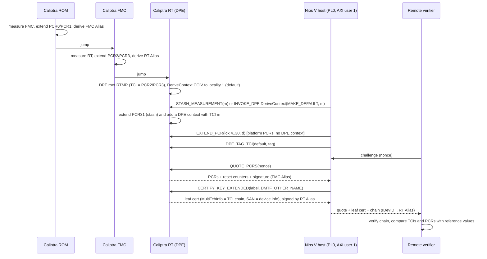
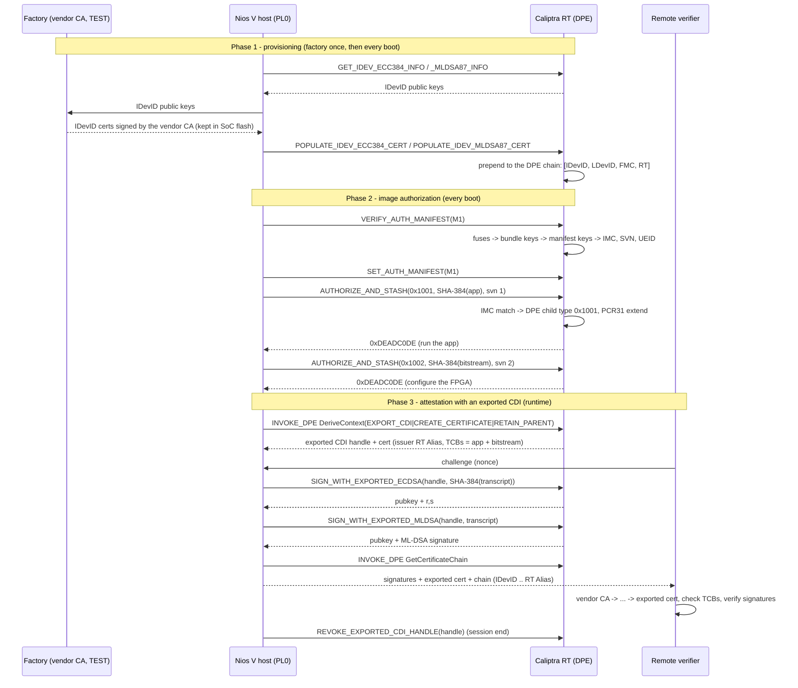

# DPE on Caliptra 2.x: a learner's guide (with real simulation output)

> **What this is.** A teaching document for engineers new to DICE Protection Environment (DPE) on Caliptra 2.x. It explains the concepts first, then walks through the 10 attestation/DPE mailbox commands that our `attest3` simulation exercises (Part 1, §1–§5) and the 8 provisioning, image-authorization and exported-CDI commands of `attest4` as one end-to-end use case (Part 2, §6–§8). For each command it covers why the command exists, when a real product uses it, its request and response fields, its preconditions and common errors, and a worked example taken from the real `attest3` emulator run.
>
> **Source of truth:** caliptra-sw `fw-2.1.4` (`runtime/src/*.rs`, `api/src/mailbox.rs`) and caliptra-dpe `f2b7121`. The run is `caliptra2x/sim_2x/attest/attest3_driver.py` against the `attest_emu` sw-emulator with our ROM, firmware bundle and fuses: **ATTEST3 PASS**, 95 commands, 128 checks; Part 2: `attest4_driver.py`, **ATTEST4 PASS**, 161 commands, 164 checks. See [SIMULATION_2X.md §11](SIMULATION_2X.md#11-attestation-exercise-3-pcrs-dpe-tagging-certifykey-extended-san-context-limits-disable) for run steps and the hand-verification commands. Files quoted below are in `caliptra2x/sim_2x/attest3_out/emu/` after a run. That folder is not committed, so re-run it to get them.
>
> TEST material only: labels, measurements and device-info strings are simulation values.

---

## 1. Why DPE exists

Caliptra's ROM and FMC build a DICE certificate chain: IDevID, LDevID, FMC Alias, RT Alias. Each layer measures the next and derives a new key from a secret (the CDI) mixed with that measurement. If any measured code changes, every later key changes too, so a verifier who checks the chain knows exactly what booted.

That chain stops at Caliptra's own runtime firmware. The SoC software (in our design, the Nios V application, and in a server, the BMC, BIOS or OS loaders) also wants to prove what it is running. It cannot hold DICE secrets itself, because it is not a root of trust. **DPE** is a service inside the Caliptra runtime that holds those secrets on the SoC's behalf. The SoC sends measurements in. DPE keeps a tree of measurement **contexts**, and on request derives keys and issues **leaf certificates** signed by the RT Alias key. The secrets never leave Caliptra. The SoC only gets handles, public keys, certificates and signatures.

The protocol is the TCG *DICE Protection Environment* specification. Caliptra carries DPE commands inside the mailbox command `INVOKE_DPE_ECC384` (`DPEC`) or `INVOKE_DPE_MLDSA87` (`DPEM`). Several Caliptra-specific mailbox commands, including most of the 10 below, are thin wrappers around DPE state.

## 2. Core concepts

### 2.1 Contexts and handles

A **context** is one node in DPE's measurement tree. It stores:

- **TCI** (TCB Component Identity): `tci_current` (the last measurement, 48 B) and `tci_cumulative` (a running hash of every measurement given to that context)
- `tci_type` (a 4-byte label), an SVN, a **locality**, flags (for example whether X.509 certs are allowed), and its parent and children

A **handle** is a 16-byte opaque name for an active context. Most DPE commands take a handle and return a fresh one, so a stolen old handle stops working (handle rotation). A handle of all zeros is the **default handle** (§2.4).

### 2.2 TCI: current and cumulative

When a context receives measurement *m*, DPE computes:

```
tci_cumulative = SHA-384(tci_cumulative || m)
tci_current    = m
```

A new context starts with `tci_cumulative` = 0⁴⁸, so after one measurement, `tci_cumulative` = SHA-384(0⁴⁸ ‖ m). Our run proves this. DeriveContext with M = SHA-384("Nios V application image v3 (attest3 TCI)") and then `DPE_GET_TAGGED_TCI` gave:

```
tci_current    (tci_a5e2_current.bin)    21a9db6f627488e382ac8000450596fab191b638bfef0ab22af8cf1f9bf87f4ba42df1929ba18c8fc03c259ef9d0467f   = M
tci_cumulative (tci_a5e2_cumulative.bin) 20e34a9c097b9b5fa59764417f22a9f9d0491f7d2f7a0836eed77566aef9fd7daef1749f23f92c3f96b64d0fe50dc5d8   = SHA-384(0^48 || M)
```

Both values also appear in every leaf certificate as FWIDs in the DICE **MultiTcbInfo** extension (OID `2.23.133.5.4.5`), one TcbInfo entry per context on the path from the root to the certified context. That is how a remote verifier sees the measurements.

### 2.3 Locality

Every context belongs to a **locality**, a 32-bit ID of who may use it. On Caliptra, the locality of a mailbox command is the **AXI user** (PAUSER) of the sender. In our design the Nios uses AXI user `0x1` (`HOST_AXI_USER` in `main.c`). Caliptra's own contexts use locality `0xFFFFFFFF`. A command can only touch contexts in its own locality, which separates different SoC agents from one another.

The firmware manifest names one locality as **PL0** (privilege level 0, `pl0_pauser`). Every other locality is PL1. Our bundle has `pl0_pauser = 1`, so the Nios is PL0. `FW_INFO` in the run shows `pl0_pauser=1` (step 000). Several commands below are PL0 only.

### 2.4 Default context

A locality can have one **default context**, addressed with the all-zero handle. This suits simple hosts like ours: the Nios never needs to track handles. The rule is strict: if a locality has a default context, it must be the **only** active context in that locality. At boot the runtime creates the default context for the PL0 locality. It is the `CCIV` context, which holds a hash of Caliptra's configured initialization values, and its parent is the `RTMR` root.

### 2.5 Derived children and retained parents

`DeriveContext` creates a child of a context with a new measurement. Its important flags (DPE `DeriveContextFlags`) are:

| Flag | Bit | Meaning |
|---|---|---|
| `RETAIN_PARENT_CONTEXT` | 29 | Keep the parent active. Without it, the parent is **retired**: it stays in the tree as history but can no longer be used. |
| `MAKE_DEFAULT` | 28 | The child becomes the locality's default context (all-zero handle) |
| `CHANGE_LOCALITY` | 27 | The child belongs to `target_locality`. Caliptra uses this at boot to hand `CCIV` to PL0. |
| `ALLOW_NEW_CONTEXT_TO_EXPORT` | 26 | The child may export CDIs |
| `INPUT_ALLOW_X509` | 25 | The child may get X.509 certificates. Without it, only CSRs are allowed. |
| `RECURSIVE` | 24 | Extend this context's own TCI instead of creating a child |
| `EXPORT_CDI` / `CREATE_CERTIFICATE` | 23 / 22 | Export a CDI handle (§2.6), optionally with a certificate |

A typical boot chain on a default-context host is: each stage calls `DeriveContext(MAKE_DEFAULT, data = hash of the next stage)`. The previous default is retired, and the chain grows by one TcbInfo entry. Our run did this 7 times. The final leaf lists `RMTR, VICC, NIO3, F000, F001, F002, F003, F004, F999` (see quirk §5.4 for why the first two look reversed).

A **retained** context is useful when one parent must spawn several independent children, for example one per VM or per tenant, each with its own handle. That needs non-default contexts, because a default context must be alone in its locality.

### 2.6 Export-CDI

Some SoC agents run their own DICE layer, for example an OS kernel that issues certificates to its own apps. `DeriveContext` with `EXPORT_CDI` makes a child whose CDI is placed in an **exported CDI slot** inside Caliptra. The caller gets a handle to the slot, never the secret. Caliptra then signs on its behalf with `SIGN_WITH_EXPORTED_ECDSA` or `SIGN_WITH_EXPORTED_MLDSA`, and `REVOKE_EXPORTED_CDI_HANDLE` frees the slot. The `attest4` run exercises this whole path: see §6.4 for the use cases and lifecycle and §7.6–§7.8 for the commands.

### 2.7 Context limits

DPE has 64 context slots. The runtime splits them into a **PL0 limit** and a **PL1 limit**, 32 and 32 by default (`PL0_DPE_ACTIVE_CONTEXT_DEFAULT_THRESHOLD`). A `DeriveContext` that would exceed the caller's limit is refused with `0x000E0037` (PL0) or `0x000E0038` (PL1). Retired contexts still count, because they hold history. `REALLOCATE_DPE_CONTEXT_LIMITS` (§4.9) moves slots between PL0 and PL1. In passive mode, PL0 starts with 2 contexts in use: the `RTMR` root and `CCIV`. The run measured this as 3 after adding `NIO3`.

## 3. PCRs and DPE: the measurement flow

PCRs (Platform Configuration Registers) are 32 hardware registers of 48 B each in Caliptra's PCR bank. Each extend computes PCR = SHA-384(PCR ‖ data). They are reset only by a cold reset. `QUOTE_PCRS_ECC384`/`_MLDSA87` returns all 32 values, the 32 **reset counters** and the caller's nonce, signed by Caliptra. In our runs the signature verifies with the **FMC Alias** key.

| PCR | Who extends it | Contents |
|---|---|---|
| 0, 1 | ROM | FMC "current" and "journey" measurement (`PCR_ID_FMC_CURRENT`/`_JOURNEY`) |
| 2, 3 | FMC | runtime firmware "current" and "journey" (`RT_FW_CURRENT_PCR`/`RT_FW_JOURNEY_PCR`) |
| 4–30 | SoC through `EXTEND_PCR` | free for the platform |
| 31 | runtime, on `STASH_MEASUREMENT` | SoC measurements reported to Caliptra (`PCR_ID_STASH_MEASUREMENT`) |

PCRs and DPE are two views of the same boot:



- The DPE root context `RTMR` mirrors PCR2/PCR3: its `tci_current` = PCR2 and `tci_cumulative` = PCR3. The runtime checks this at every boot. If they differ, it runs `DISABLE_ATTESTATION` by itself (`check_dpe_rt_pcrs_unchanged`).
- `STASH_MEASUREMENT` does both jobs: it extends PCR31 and adds a DPE context. Our §8 run showed PCR31 = SHA-384(0⁴⁸ ‖ M) and the measurement in the next DPE leaf.
- `EXTEND_PCR` touches **only** a PCR. It creates no DPE context and changes no certificate. Use it for platform measurements that a quote-based verifier reads, such as a TPM-style event log.

## 4. The 10 commands

Each section has: why the command exists, when a product uses it, its fields (all u32 little-endian; every request starts with the 4-byte checksum and every response with checksum + FIPS status, 8 B), its preconditions, a worked example from `attest3_out/emu`, and its errors. In the `req_NNN.hex` files the first line is the command ID, the second the byte length, then little-endian 32-bit words starting with the checksum.

### 4.1 `EXTEND_PCR` (`0x50435245`, "PCRE")

**Why:** It lets the SoC record its own measurements in hardware PCRs that only a cold reset clears, without creating DPE contexts.
**When:** Recording the boot stages of the SoC software (bootloader, OS, configuration blobs) for a verifier that uses PCR quotes, for example a TPM-like attestation flow or an SPDM `MEASUREMENTS` response built from PCR values. Also for recording security events, such as "debug was enabled", that must survive a warm reset.

| Request | Response |
|---|---|
| `pcr_idx` u32, `data` [48] | header only |

**Preconditions:** PL0 caller. The index must be 4–31.

**Worked example (req 006):** extend PCR10 with `pcr_extend_d1.bin` (`18887eb2f7828a9349d8bca616b4a987…`):

```
req_006.hex: 50435245 00000038 ffffe5ba 0000000a b27e8818 938a82f7 ...
             cmd      len=56   checksum idx=10  data (LE words)
resp_006:    status 1, 8 bytes, fwerr 00000000
```

After D1, D2 into PCR10 and D3 into PCR4, the quote showed:

```
PCR10 before 000000…00 → after 8e6e277dfa666999bd6477761ee3e22a6db4a2feb0523bf889e8b72ef84b8b879920df95ed3de9710d81ceb4e9a9b7bd
PCR4  after  3236506890408fd44c593f43df0c3699d5ff56262eb6d8635de3a5f60419053e750456e05afb598b1194b5a4b48ee2f6
```

and by hand:

```
$ cat pcr10_before.bin pcr_extend_d1.bin | openssl dgst -sha384 -binary > t1.bin
$ cat t1.bin pcr_extend_d2.bin | openssl dgst -sha384 -binary | cmp - pcr10_after.bin && echo "PCR10 extend OK"
PCR10 extend OK
$ openssl pkeyutl -verify -pubin -inkey fmc_alias_ecc384_pub.pem -in quote_ext_digest.bin -sigfile quote_ext_sig.der
Signature Verified Successfully
```

**Errors:** PCR0–3 `0x000E003C` (`PCR_RESERVED`); index 32–255 `0x000E003D` (`PCR_INVALID_INDEX`); index > 255 `0x000E0009`; wrong length `0x000E0003` (`INSUFFICIENT_MEMORY`, quirk); non-PL0 `0x000E0016`.

### 4.2 `INCREMENT_PCR_RESET_COUNTER` (`0x50435252`, "PCRR")

**Why:** A PCR value alone cannot show that it was "logically reset" and rebuilt, for example when the SoC reloads a component without a Caliptra cold reset. A per-PCR counter in every quote makes this visible.
**When:** The SoC re-measures a subsystem after a warm restart or a firmware update of that subsystem. It increments the counter so the verifier knows the event log was restarted, and the verifier rejects replayed old quotes whose counters are lower.

| Request | Response |
|---|---|
| `index` u32 (0–31) | header only |

**Preconditions:** none beyond a valid index (no PL0 check and **no reserved-PCR check**).

**Worked example (req 019–022):** two increments of PCR10 and one of PCR31:

```
req_019.hex: 50435252 00000008 fffffebf 0000000a      (index 10)
quote reset_ctrs: [0,0,0,0,0,0,0,0,0,0, 2 ,0, …, 0, 1]   (ctr10 0→2, ctr31 0→1)
```

PCR values did not change: the counter is separate from the PCR value.

**Errors:** index ≥ 32 `0x000E0009`. `0x000E0036` (`INCREMENT_PCR_RESET_MAX_REACHED`) if a counter would wrap. The run also showed that PCR0 is accepted (0→1), unlike `EXTEND_PCR`.

### 4.3 `DPE_TAG_TCI` (`0x54514754`)

**Why:** DPE handles are opaque and rotate. A verifier-facing agent, for example the BMC answering SPDM, needs a stable name for "the context that holds the OS measurement". A tag is that stable 32-bit name.
**When:** A boot stage tags its context once (for example `"BIOS"` or `"OS00"`). Later, the attestation agent reads that context's TCI by tag (§4.4) without knowing its handle.

| Request | Response |
|---|---|
| `handle` [16], `tag` u32 | header only |

**Preconditions:** the handle is an active context in the caller's locality, the context has no tag yet, and the tag is unused.

> **ID quirk:** `api/src/mailbox.rs` comments this command as `"TAGT"`, but the value is **`0x54514754`** (ASCII `TQGT`). Sending ASCII `TAGT` (`0x54414754`) returns `0x000E0002` (unimplemented). The run checks this (req 026).

**Worked example (req 028):** tag the default context `A5E1`:

```
req_028.hex: 54514754 00000018 fffffdd4 00000000 00000000 00000000 00000000 31453541
             cmd      len=24   checksum  handle = default (16 × 00)            tag "A5E1"
resp_028:    status 1, fwerr 0
```

**Errors:** context already tagged `0x000E0020`; tag already in use `0x000E001F` (checked first, even for a bad handle); unknown handle `0x000E001E`.

### 4.4 `DPE_GET_TAGGED_TCI` (`0x47544744`, "GTGD")

**Why:** It reads a context's measurements by tag, so the attestation agent can build evidence such as an SPDM measurement block or an event-log entry.

| Request | Response |
|---|---|
| `tag` u32 | `tci_cumulative` [48], `tci_current` [48], `svn` u32 |

**Worked example (req 029):** read `A5E1` (the `CCIV` context):

```
resp_029 (108 B): 0cd2ffff 00000000 | 7533746d81a2f36b2858f7ca4165b550… (cumulative) | 0c10074f98db85d2ca992692854cac0f… (current) | 00000000 (svn 0)
check: cumulative == SHA-384(0^48 || current)  → PASS
```

After DeriveContext(M, svn 3) and tagging the child `A5E2`, `GET_TAGGED_TCI(A5E2)` returned current = M, cumulative = SHA-384(0⁴⁸ ‖ M) and svn = 3 (§2.2). The retired parent `A5E1` stayed readable with unchanged values. The tag survives retirement.

**Errors:** unknown tag `0x000E001E`.

### 4.5 `CERTIFY_KEY_EXTENDED_ECC384` (`0x434B4558`, "CKEX")

**Why:** DPE `CertifyKey` issues a leaf certificate for a key derived from a context. The *extended* mailbox form adds Caliptra options to it, mainly `DMTF_OTHER_NAME`, which puts the SAN set by §4.8 into the cert.
**When:** SPDM device identity. A responder (our Nios, or a BMC) needs a certificate for its attestation key. The key is derived inside Caliptra from the measured context, so a firmware change gives a new key. The verifier validates the chain IDevID → LDevID → FMC Alias → RT Alias → DPE leaf, and then reads the TCIs from the leaf.

| Request | Response |
|---|---|
| `flags` u32 (bit31 `DMTF_OTHER_NAME`), `certify_key_req` [72] = DPE CertifyKey: `handle` [16], `flags` u32 (0), `format` u32 (0 = X.509, 1 = CSR), `label` [48] | `size` u32, then the DPE response: `DPER` magic, status, profile (12 B), `new_context_handle` [16], `derived_pubkey_x` [48], `derived_pubkey_y` [48], `cert_size` u32, cert or CSR |

**Preconditions:** PL0. The context must allow X.509 (`INPUT_ALLOW_X509`) for format 0. The **label** selects the key: the same context and label always give the same key.

**Worked example (req 037):** X.509 for the default context with label = SHA-384("attest3 certify-key label"):

```
resp_037 (1317 B): 9f30feff 00000000 | 19050000 (size 1305) | 52455044 ("DPER") 00000000 (ok) 04000000 (P-384) | 00…00 (handle) | 58bde07e631d126b… (x) …
```

```
$ openssl x509 -in ckx_ecc_x509.pem -noout -subject -issuer -nameopt RFC2253
subject=serialNumber=340D899D600E9C3B23FF80717956CC55832BAEECDBA85731B17751F1C8A451DB,CN=DPE Leaf
issuer=serialNumber=E61EC4C252064A0AF7A10408DDD6D291F9F1666A5C24E76F4522F2B911F86627,CN=Caliptra 2.1 Ecc384 Rt Alias
$ openssl verify -partial_chain -CAfile rt_alias_ecc384.pem ckx_ecc_x509.pem
ckx_ecc_x509.pem: OK
```

Extensions: Basic Constraints `CA:FALSE` (critical), Key Usage `Digital Signature` (critical), EKU `2.23.133.5.4.100.9` (tcg-dice-kp-attestLoc), AKI = RT Alias SKI `E6:1E:C4:…:66:6A`, DICE UEID (`2.23.133.5.4.4`) and MultiTcbInfo (`2.23.133.5.4.5`). The driver parses MultiTcbInfo and finds 3 entries, `RMTR`, `VICC` and `NIO3`. `NIO3` has svn 3 and fwid M:

```
$ hex ckx_ecc_x509.der | grep -q $(hex tci_measurement.bin) && echo "M is in the ECC leaf MultiTcbInfo"
M is in the ECC leaf MultiTcbInfo
```

**CSR format (`format` = 1):** used when an external CA (for example the owner's PKI) must issue the device certificate. The response is a **CMS SignedData** (`ckx_ecc_csr.p7b`, 1203 B), signed by the RT Alias key, around a PKCS#10 CSR for the derived key. The CMS signature lets the CA confirm that a genuine Caliptra produced the CSR.

```
$ openssl req -inform DER -in ckx_ecc_csr.der -verify -noout
Certificate request self-signature verify OK
$ openssl dgst -sha384 -verify rt_alias_ecc384_pub.pem -signature ckx_ecc_csr_sig.bin ckx_ecc_csr.der
Verified OK
```

> **CMS quirk:** the SignerInfo `sid` is `80 16 04 14 <SKI>` (`[0] { OCTET STRING }`) instead of `80 14 <SKI>`, so `openssl cms -verify` reports *signer certificate not found*. Extract eContent and the signature and check them directly, as above. The driver does this.

**Errors:** every DPE failure (bad format, unknown handle, X.509 not allowed) returns `0x000E0040` (`CERTIFY_KEY_EXTENDED_FAILED`). The DPE error code itself goes to the firmware extended-error register, not to `FW_ERROR_NON_FATAL`. Non-PL0 gives `0x000E0016`.

### 4.6 `CERTIFY_KEY_EXTENDED_MLDSA87` (`0x434B584D`, "CKXM")

**Why and when:** the same as §4.5 but with an ML-DSA-87 key and signature, for post-quantum attestation (CNSA 2.0). A product usually issues both and lets the verifier choose.

| Request | Response |
|---|---|
| `flags` u32 (bit31 `DMTF_OTHER_NAME`, bit30 `EXTERNAL_AXI_RESPONSE`), `axi_response` {addr_lo, addr_hi, max_size} [12], `certify_key_req` [72] | the same, with `pubkey` [2592] in place of x, y |

**Worked example (req 038):** an 8199 B ML-DSA leaf. It verifies against `rt_alias_mldsa87.pem` (`OK`), the cert key equals the returned 2592 B public key, and its MultiTcbInfo has the same `NIO3` entry. The ML-DSA CSR (`ckx_mldsa_csr.p7b`, 12751 B) is checked with:

```
$ openssl pkeyutl -verify -pubin -inkey rt_alias_mldsa87_pub.pem -rawin -in ckx_mldsa_csr.der -sigfile ckx_mldsa_csr_sig.bin
Signature Verified Successfully
```

**Errors:** `EXTERNAL_AXI_RESPONSE` (write the response by DMA to an AXI address) exists only in subsystem mode. In our passive design it gives `0x000E0009` (req 043). DPE failures give `0x000E0040`.

### 4.7 `CERTIFY_KEY_CHUNKS` (`0x434B4348`, "CKCH")

**Why:** an ML-DSA CertifyKey response is about 10.8 KB. Some SoC mailbox paths, MCU mailboxes and bridges cannot take a response that large. This command returns the same response in pieces.
**When:** a host with a small receive buffer, for example an MCU with a 4 KiB SRAM window or a mailbox proxied over I3C/MCTP, fetches a leaf cert piece by piece.

| Request | Response |
|---|---|
| `flags` u32 (bit31 `USE_MLDSA`), `reserved` u32, `max_size` u32 (0 means 15 KiB), `offset` u32, `certify_key_req` [72] | `context_handle` [16], `chunk_len` u32, `remaining` u32, `chunk` [chunk_len] |

Each call runs the whole CertifyKey again and returns `[offset, offset+chunk_len)` of the DPE response. This works because Caliptra's signatures are deterministic, so every call produces the same bytes. A caller loops with `offset += chunk_len` until `remaining == 0`.

**Worked example (req 044–050):** ECC with `max_size` 256:

```
req_044.hex: 434b4348 0000005c ffffe779 00000000 00000000 00000100 00000000 | handle… format label
resp_044:  handle 00…00, chunk_len 256, remaining 1049   (first 4 B of the chunk = 52455044 "DPER")
...
resp_049:  chunk_len 25, remaining 0                       (6 chunks, 1305 B total)
$ cmp chunks_ecc_resp.bin ckx_ecc_single_resp.bin && echo "ECC chunks == single shot"
ECC chunks == single shot
```

ML-DSA with `max_size` 4096 took 3 chunks (10,823 B) and was also byte-identical to the single-shot response. An offset past the end returns `chunk_len 0, remaining 0` with status OK.

**Errors:** a DPE failure gives `0x000E0040`. X.509 from a non-PL0 caller gives `0x000E0016` (CSR is allowed from PL1).

### 4.8 `ADD_SUBJECT_ALT_NAME` (`0x414C544E`, "ALTN")

**Why:** SPDM 1.3 (DMTF DSP0274) defines a device-identity **otherName** for certificates, OID `1.3.6.1.4.1.412.274.1`, with the value `"manufacturer:product:serial"`. It binds the attestation cert to a specific board or serial number, an owner-visible identity that measurements alone cannot give.
**When:** at provisioning or each boot, the host tells Caliptra its identity string, for example from a serial-number EEPROM or owner configuration. It then requests leaf certs with `DMTF_OTHER_NAME`. Fleet management systems match the SAN with their inventory.

| Request | Response |
|---|---|
| `dmtf_device_info_size` u32 (≤ 128), `dmtf_device_info` [size] ASCII | header only |

**Preconditions:** ASCII only, with **exactly two** `:`. The value is kept in RAM until reset, and a later call replaces it. It appears only in certs requested with flag bit 31.

**Worked example (req 058–061):**

```
req_058.hex: 414c544e 0000002c fffff547 00000024 65746e49 35413a6c ...  (size 36, "Intel:A5EC065BB32AE6S:NIOSV-A5E-0001")
$ openssl x509 -in san_ecc_dmtf.pem -noout -ext subjectAltName
X509v3 Subject Alternative Name: 
    othername: 1.3.6.1.4.1.412.274.1:Intel:A5EC065BB32AE6S:NIOSV-A5E-0001
$ openssl x509 -in san_ecc_noflag.pem -noout -ext subjectAltName
No extensions in certificate
```

The SAN is UTF8String and not critical. The ML-DSA cert carries it too. After a second call with `…-0002`, the next cert showed `…-0002`.

**Errors:** one or three colons, non-ASCII, or empty: `0x000E003E` (`DMTF_DEVICE_INFO_VALIDATION_FAILED`). Size > 128: `0x000E0009`. A rejected call keeps the old value (checked by req 067).

### 4.9 `REALLOCATE_DPE_CONTEXT_LIMITS` (`0x52435458`, "RCTX")

**Why:** the default 32/32 split may not suit every platform. A system where PL0 (for example the BMC) builds a deep measurement chain needs more PL0 slots. A system with many PL1 tenants needs more PL1 slots.
**When:** early in boot, by the PL0 agent, before the contexts are used. It is set once per boot policy.

| Request | Response |
|---|---|
| `pl0_context_limit` u32 | `new_pl0_context_limit` u32, `new_pl1_context_limit` u32 (= 64 − pl0) |

**Preconditions:** PL0 caller, 2 ≤ pl0 ≤ 64, and neither new limit below the contexts that side already uses.

**Worked example (req 070–083):**

```
REALLOCATE 1   → 0x000E0070 (PL0_LESS_THAN_MIN)
REALLOCATE 65  → 0x000E0071 (PL0_GREATER_THAN_MAX)
REALLOCATE 8   → resp_072: c0ffffff 00000000 08000000 38000000   (PL0 8, PL1 56)
DeriveContext ×5 OK, 6th → 0x000E0037 (PL0_USED_DPE_CONTEXT_THRESHOLD_REACHED)
REALLOCATE 7   → 0x000E0072 (PL0_LESS_THAN_USED)      8 in use
REALLOCATE 8   → 8 / 56;  64 → 64 / 0;  32 → 32 / 32;  DeriveContext OK again
```

So PL0 had 3 contexts before the fill (`RTMR` root, `CCIV`, `NIO3`). The leaf certified after the fill lists the whole chain in MultiTcbInfo.

**Errors:** `0x000E0070`–`0x000E0073` as above, and non-PL0 `0x000E0016`.

### 4.10 `DISABLE_ATTESTATION` (`0x4453424C`, "DSBL")

**Why:** this is a kill switch. If the SoC detects that the platform is no longer trustworthy (a failed secure-boot check, debug unlocked in production, tamper), it can make Caliptra's DPE identity useless until the next cold reset, so the device cannot prove a healthy state it no longer has. The runtime calls it on its own if the RT PCRs do not match the DPE root.
**When:** in a security-event handler, or as policy when a measurement check fails. It is one-way per cold boot.

| Request | Response |
|---|---|
| none | header only |

**What happens (`runtime/src/disable.rs`):** the RT CDI and the RT ECC and ML-DSA keys are erased. The CDI and the exported-CDI slot are set to a KDF of a zero key (`"zero_cdi"`), new RT keys are derived from that, and `attestation_disabled` = 1. The flag survives an update reset.

**Worked example (req 085–094):**

```
FW_INFO before: pl0_pauser=1 attestation_disabled=0  → after: attestation_disabled=1
RT Alias certs (GET_RT_ALIAS_*_CERT): byte-identical to before
CERTIFY_KEY_EXTENDED ECC/ML-DSA: status 0, but a new derived key, and:
$ openssl verify -partial_chain -CAfile rt_alias_ecc384.pem disabled_ecc.pem
error 20 at 0 depth lookup: unable to get local issuer certificate
error disabled_ecc.pem: verification failed
$ openssl x509 -in disabled_ecc.pem -noout -issuer -nameopt RFC2253
issuer=serialNumber=77B3C86489657796CD9A9A5716DE37CD51EC8D0DCA4E0AEF779D76986A922380,CN=Caliptra 2.1 Ecc384 Rt Alias
```

The leaf now names an issuer key (`77B3…`) for which no certificate exists, so a verifier rejects it. The DPE leaf is still issued, but it is worthless. Still working after disable: `QUOTE_PCRS` (signed by the FMC Alias key, PCRs and counters kept), `DPE_GET_TAGGED_TCI`, and a second `DISABLE_ATTESTATION` (accepted).

**Errors:** non-PL0 `0x000E0016`.

## 5. Practical notes

### 5.1 Error-code cheat sheet (seen in the run)

| Code | Name | Typical cause |
|---|---|---|
| `0x000E0002` | `UNIMPLEMENTED_COMMAND` | wrong command ID (for example `TAGT` instead of `0x54514754`) |
| `0x000E0003` | `INSUFFICIENT_MEMORY` | request length does not match the struct |
| `0x000E0009` | `MAILBOX_INVALID_PARAMS` | index out of range, SAN size > 128, AXI response in passive mode |
| `0x000E0016` | `INCORRECT_PAUSER_PRIVILEGE_LEVEL` | PL0-only command from PL1 |
| `0x000E001E` / `1F` / `20` | `TAGGING_FAILURE` / `DUPLICATE_TAG` / `CONTEXT_ALREADY_TAGGED` | tag problems |
| `0x000E0037` | `PL0_USED_DPE_CONTEXT_THRESHOLD_REACHED` | DeriveContext above the PL0 limit |
| `0x000E003C` / `3D` | `PCR_RESERVED` / `PCR_INVALID_INDEX` | EXTEND_PCR on PCR0–3 or index ≥ 32 |
| `0x000E003E` | `DMTF_DEVICE_INFO_VALIDATION_FAILED` | SAN string not `a:b:c` ASCII |
| `0x000E0040` | `CERTIFY_KEY_EXTENDED_FAILED` | any DPE error inside CertifyKey (extended/chunks) |
| `0x000E0070`–`73` | `REALLOCATE_DPE_CONTEXTS_*` | limit out of range or below the contexts in use |

### 5.2 Nios host-side usage

The Nios talks to the Caliptra mailbox through the registers already used by `load_firmware()` in `caliptra2x/quartus_a5e_2x_nios/sw/app/main.c` (`MBOX_LOCK`, `MBOX_CMD`, `MBOX_DLEN`, `MBOX_DATAIN`, `MBOX_DATAOUT`, `MBOX_EXECUTE`, `MBOX_STATUS`). Below is a minimal, **illustrative** helper (not yet in `main.c`) for any of the 10 commands, followed by a `DPE_TAG_TCI` call. The checksum is the one the driver computes: 0 − (sum of the 4 command-ID bytes + sum of all payload bytes).

```c
static uint32_t mbox_chksum(uint32_t cmd, const uint8_t *p, uint32_t n)
{
    uint32_t s = (cmd & 0xFF) + ((cmd >> 8) & 0xFF) + ((cmd >> 16) & 0xFF) + (cmd >> 24);
    for (uint32_t i = 0; i < n; i++) s += p[i];
    return 0u - s;
}

/* payload excludes the checksum word; resp gets the full response incl. checksum + fips header */
static int mbox_exec(uint32_t cmd, const uint8_t *payload, uint32_t n,
                     uint8_t *resp, uint32_t resp_max, uint32_t *resp_len)
{
    uint32_t t = 0, st, w;
    while (CPTRA(MBOX_LOCK) & 1u) { trng_service(); if (++t > 10000000u) return ERR_TIMEOUT; }
    CPTRA(MBOX_CMD)  = cmd;
    CPTRA(MBOX_DLEN) = 4u + n;
    CPTRA(MBOX_DATAIN) = mbox_chksum(cmd, payload, n);
    for (uint32_t i = 0; i < n; i += 4) {                 /* little-endian words, zero padded */
        w = 0;
        for (uint32_t b = 0; b < 4 && i + b < n; b++) w |= (uint32_t)payload[i + b] << (8 * b);
        CPTRA(MBOX_DATAIN) = w;
    }
    CPTRA(MBOX_EXECUTE) = 1u;
    while (((st = CPTRA(MBOX_STATUS)) & 0xFu) == 0) trng_service();   /* TRNG requests keep coming */
    *resp_len = 0;
    if ((st & 0xFu) == MBOX_ST_DATA_READY) {
        uint32_t len = CPTRA(MBOX_DLEN);
        for (uint32_t i = 0; i < len; i += 4) {
            w = CPTRA(MBOX_DATAOUT);
            for (uint32_t b = 0; b < 4 && i + b < len && i + b < resp_max; b++) resp[i + b] = w >> (8 * b);
        }
        *resp_len = len;
    }
    CPTRA(MBOX_EXECUTE) = 0u;
    if ((st & 0xFu) == MBOX_ST_CMD_FAILURE) {
        puthex("mbox fail, FW_ERROR_NON_FATAL=", CPTRA(CPTRA_FW_ERROR_NON_FATAL));  /* e.g. 000E0020 */
        return ERR_FAIL;
    }
    return ERR_OK;
}

/* DPE_TAG_TCI on the default context, tag 'A5E1' (stored little-endian, reads "A5E1") */
uint8_t req[20] = {0};                          /* handle = 16 zero bytes */
req[16] = 'A'; req[17] = '5'; req[18] = 'E'; req[19] = '1';
uint8_t r[16]; uint32_t rl;
mbox_exec(0x54514754u /* DPE_TAG_TCI, not "TAGT" */, req, sizeof req, r, sizeof r, &rl);
```

On the Nios, `CERTIFY_KEY_EXTENDED_MLDSA87` returns about 8–11 KB, which must fit the receive buffer. With a smaller buffer, use `CERTIFY_KEY_CHUNKS` with `max_size` set to that buffer size and loop on `offset`. Clear `FW_ERROR_NON_FATAL` after reading it (write the value back, as `handle_errors()` does). In the simulator the same request bytes are written to `req_NNN.hex` by `attest3_driver.py`, so `attest3_out/emu/req_*.hex` are ready-made test vectors for the C code.

### 5.3 A typical product flow

1. **Boot:** for each stage it loads, the Nios calls `DeriveContext(MAKE_DEFAULT | INPUT_ALLOW_X509, data = SHA-384(image), svn)`, or `STASH_MEASUREMENT` if it also wants PCR31. Platform events go to `EXTEND_PCR` on PCR4–30.
2. **Provisioning:** `ADD_SUBJECT_ALT_NAME("vendor:product:serial")`. Optionally `REALLOCATE_DPE_CONTEXT_LIMITS` if the chain is deep.
3. **Tag:** `DPE_TAG_TCI` on the final context, so the attestation agent can find it.
4. **Identity:** `CERTIFY_KEY_EXTENDED_*` with `DMTF_OTHER_NAME` (or `CERTIFY_KEY_CHUNKS` for small buffers). Cache the leaf with the chain from `GET_*_CERT` / DPE `GetCertificateChain`. Use the CSR format if the owner's CA re-issues the cert.
5. **Each SPDM challenge:** `QUOTE_PCRS` with the verifier's nonce, `DPE_GET_TAGGED_TCI` for measurement blocks, and DPE `Sign` with the certified key.
6. **On a security event:** `DISABLE_ATTESTATION`. After a component restart: `INCREMENT_PCR_RESET_COUNTER` on that component's PCR, then re-measure it.

### 5.4 Quirks to remember (fw-2.1.4)

1. `DPE_TAG_TCI` is `0x54514754`, not ASCII `TAGT`.
2. A wrong request length gives `0x000E0003`, not `0x000E0009`.
3. `INCREMENT_PCR_RESET_COUNTER` accepts PCR0–3.
4. `tci_type` is written little-endian into MultiTcbInfo, so Caliptra's `RTMR` and `CCIV` read as `RMTR` and `VICC`. Pass your own types little-endian (the driver's `tt("NIO3")`) to read them naturally.
5. The DPE CSR's CMS `sid` is double-wrapped, so `openssl cms -verify` cannot find the signer. Verify eContent directly.
6. CertifyKey errors all appear as `0x000E0040`.
7. After `DISABLE_ATTESTATION`, CertifyKey still returns status 0. Only verifying the chain shows that attestation is off.
8. A retired context keeps its tag.

### 5.5 Where to go next

- Run it: [SIMULATION_2X.md §11.3](SIMULATION_2X.md#113-run-it-step-by-step), and §11.3.1 for every hand check.
- The boot-time attestation chain, `STASH_MEASUREMENT` and quotes: [SIMULATION_2X.md §8](SIMULATION_2X.md#8-rom-boot-firmware-load-attestation-and-dpe-in-simulation).
- IDevID population, authorization manifests and export-CDI: Part 2 below (§6–§8), run steps in [SIMULATION_2X.md §12](SIMULATION_2X.md#12-attestation-exercise-4-idevid-provisioning-soc-image-authorization-exported-cdi-signing).
- Specs: TCG *DICE Protection Environment* and *DICE Attestation Architecture* (TcbInfo/MultiTcbInfo), DMTF DSP0274 (SPDM, device-info otherName), and the Caliptra runtime README in caliptra-sw.

---

# Part 2: provisioning, image authorization and exported CDIs (`attest4`)

Part 2 covers the 8 commands in the `attest4` run (`caliptra2x/sim_2x/attest/attest4_driver.py`, **ATTEST4 PASS**, 161 commands, 164 checks). See [SIMULATION_2X.md §12](SIMULATION_2X.md#12-attestation-exercise-4-idevid-provisioning-soc-image-authorization-exported-cdi-signing) for the run steps and the hand checks. Files quoted below are in `caliptra2x/sim_2x/attest4_out/emu/` after a run. Fields are u32 little-endian unless stated otherwise. Every request starts with the 4-byte checksum, and every response starts with checksum + FIPS status (8 B).

## 6. Concepts for Part 2

### 6.1 IDevID provisioning: why the vendor CA endorses the device

The **IDevID** (Initial Device Identity) key is derived by the Caliptra ROM from the device's unique secret (UDS) on every boot. The device itself can only prove "I hold this key". It cannot prove "I am a genuine Agilex 5 part made by the vendor". That proof comes from the **vendor's manufacturing CA**: in the factory, the vendor reads the IDevID public key (`GET_IDEV_ECC384_INFO` / `GET_IDEV_MLDSA87_INFO`, or the IDevID CSR) and issues a certificate for it. That certificate is the root of every later attestation:

```
vendor CA (trust anchor the verifier already has)
  └─ IDevID cert            issued by the vendor CA in the factory    ← POPULATE_IDEV_*_CERT stores this
      └─ LDevID cert        issued by the IDevID key (ROM, each boot)
          └─ FMC Alias      issued by the LDevID key (ROM)
              └─ RT Alias   issued by the FMC Alias key (FMC)
                  └─ DPE leaf / exported-CDI cert   issued by RT Alias (runtime, on request)
```

A verifier that trusts only the vendor CA can check the whole chain down to a DPE leaf and learn both "genuine device" (the top) and "this firmware and these measurements" (the DICE layers). Without the IDevID cert, the chain ends at the LDevID with nothing to anchor it.

Caliptra has no flash to keep the cert. It rebuilds the IDevID cert each boot only if given the TBS and signature (`GET_IDEV_*_CERT`), and DPE's `GetCertificateChain` returns only the certs it holds. `POPULATE_IDEV_*_CERT` hands the factory cert to the runtime once per boot (the SoC keeps it in its own flash), and the runtime **prepends** it to the DPE cert chain. From then on, a host that asks DPE for "the chain" gets the full chain up to the vendor CA in one call.

In the run, the vendor CA is a TEST CA (`attest/testca/`, CN `TEST Mfg CA ECC`). The IDevID cert's subject is the LDevID's issuer name, and its subject key identifier is the LDevID's authority key identifier (`B6:5D:CB:FD:…`), so the chain links by name and by key ID.

### 6.2 The SoC auth manifest: structure, vendor keys and owner keys

Caliptra's own firmware is authorized by the keys hashed into the fuses. The **SoC auth manifest** extends that trust to other SoC images (here, the Nios application and an FPGA bitstream) without new fuses. It is a signed list of "FW ID → expected SHA-384". Caliptra keeps the list and answers "may I run this image?" with `AUTHORIZE_AND_STASH`.

Two parties sign it. The **vendor** (the silicon or module maker) and the **owner** (the customer who deploys the device) each have ECC P-384 and ML-DSA-87 keys. Neither party's manifest keys are in the fuses directly. Instead, they are endorsed by the keys that *are* fuse-anchored: the vendor and owner keys of the Caliptra firmware bundle.

```
fuses: FUSE_VENDOR_PK_HASH ──► bundle vendor FW key 0 (ECC + ML-DSA) ──endorses──► manifest vendor keys ──sign──► IMC
       CPTRA_OWNER_PK_HASH ──► bundle owner FW key   (ECC + ML-DSA) ──endorses──► manifest owner keys  ──sign──► IMC
```

`ATM2` layout (fw-2.1.4, `auth-manifest/types`), offsets from the run's `manifest_m1.bin`:

| Offset | Size | Field | Signed by |
|---|---|---|---|
| 0 | 4 | marker `ATM2` (`0x324D5441`) | – |
| 4 | 4 | preamble size = 24,292 | – |
| 8 | 4 / 4 / 4 | version (2), SVN, flags (bit 0 `VENDOR_SIGNATURE_REQUIRED`, bit 1 `DEBUG_IMAGE`) | vendor endorsement |
| 20 | 2688 | manifest vendor keys (ECC 96 B + ML-DSA 2592 B) | vendor endorsement |
| 2708 / 2804 | 96 / 4628 | vendor endorsement signatures (ECC r‖s, ML-DSA) by **bundle vendor key** over bytes 8–2708 | – |
| 7432 | 2688 | manifest owner keys | owner endorsement |
| 10120 / 10216 | 96 / 4628 | owner endorsement signatures by **bundle owner key** over the owner keys | – |
| 14844 / 14940 | | IMC signatures by the **manifest vendor keys** | – |
| 19568 / 19664 | | IMC signatures by the **manifest owner keys** | – |
| 24292 | 4 + 80 × 80 | **IMC** (image metadata collection): `entry_count`, then 80 fixed slots | vendor + owner IMC signatures |

Each 80-byte IMC entry is `fw_id`, `component_id`, `classification`, `flags` (bits 1:0 image source, bit 2 `ignore_auth_check`), load address (8 B), staging address (8 B) and the 48-byte digest. The entry with `fw_id` `0xFFF` is not an image. It binds the manifest to one device: its "digest" holds the 17-byte device UEID, and a manifest for another device is rejected (`0x000E00B4`).

The ECC values are stored in Caliptra's "hardware" byte order: each 4-byte word of r, s, x and y is byte-swapped. ML-DSA values are raw. The driver converts them before handing them to OpenSSL.

**Rules the firmware enforces, in order:** marker, preamble size, SVN (against the SoC-manifest SVN fuses; in Production with `soc_manifest_max_svn` = 0 the SVN must be 0), vendor endorsement (ECC then ML-DSA), the flags, owner endorsement, IMC entry count (1–80), IMC vendor signatures (only if flag bit 0 is set), IMC owner signatures (always), duplicate FW IDs, then the UEID. The first failing check sets the error, which is why a tampered SVN reports an SVN error and not a signature error.

**`VERIFY` vs `SET`:** both run the same checks. `VERIFY_AUTH_MANIFEST` stops there, so the SoC can test a manifest before committing to it. `SET_AUTH_MANIFEST` also replaces the stored IMC. A failed `SET` leaves the old IMC in force.

### 6.3 `AUTHORIZE_AND_STASH` vs `STASH_MEASUREMENT`

Both put a SoC measurement into DPE (a new default context with `tci_type` = the 4-byte ID) and extend PCR31. The difference is **who vouches for the measurement**:

| | `STASH_MEASUREMENT` | `AUTHORIZE_AND_STASH` |
|---|---|---|
| Input | any 48 B the SoC sends | FW ID + digest (or an address for Caliptra to hash) |
| Check | none: Caliptra records what it is told | digest must match the signed manifest entry for that FW ID |
| Output | DPE status | `IMAGE_AUTHORIZED` / `NOT_AUTHORIZED` / `HASH_MISMATCH`; stash only if authorized |
| Meaning in a cert | "the SoC reported this" | "the SoC reported this **and** the vendor and owner approved it" |
| Reserved IDs | FW ID 2 (MCU RT) refused, `0x000E00B0` | may use the reserved ID |
| PL1 | allowed | only with `SKIP_STASH` (PL1 can ask, but not measure) |

The run shows both: `STASH_MEASUREMENT` accepted an arbitrary digest with type `UNVF` (req 081), while `AUTHORIZE_AND_STASH` refused a bitstream whose digest was not in the manifest (req 067, `0x8BFB95CB`) and stashed nothing.

`SKIP_STASH` turns `AUTHORIZE_AND_STASH` into a pure policy query, which is useful when an image is checked before it is loaded and measured later, or when the caller is PL1.

### 6.4 Exported CDIs: use cases and the revocation lifecycle

A normal DPE context keeps its CDI inside DPE, and the SoC can only ask for certs and `Sign` through DPE commands, one context at a time. An **exported CDI** is for a SoC component that acts as its **own DICE layer or signing service** and needs a long-lived key bound to the measured state, without managing DPE contexts:

- an SPDM responder or TLS endpoint on the Nios that signs every session transcript (the run's scenario)
- a SoC-side DICE layer that issues certs for its own children: the exported cert is `CA:TRUE` with `keyCertSign` and the TCG ECA extended key usage `2.23.133.5.4.100.12`
- an attestation key handed to a separate security subsystem

The lifecycle is:

```
DeriveContext(EXPORT_CDI | CREATE_CERTIFICATE [| RETAIN_PARENT])  ──►  32-byte handle + cert (issuer RT Alias)
      │ the CDI = f(parent's TCI chain); the handle is random; one slot only
      ▼
SIGN_WITH_EXPORTED_ECDSA / _MLDSA (handle, data)   … any number of times …
      │
      ▼
REVOKE_EXPORTED_CDI_HANDLE(handle)  ──►  slot erased; the handle is dead for good; a new export may follow
```

Key facts from the run:

- **One slot.** A second export while one is active fails (DPE `0x02000007`, `Crypto(DuplicateCdi)`). Revoke first.
- **The key is a function of the measurements, the handle is not.** Re-exporting from the same context gives the same key (E1 and E2), even with different `DeriveContext` data, but a new random handle. A revoked handle never comes back.
- **One CDI, two algorithms.** The ECC key uses the label `"Exported ECC"` and the ML-DSA key `"Exported ML-DSA"`. Either sign command accepts a handle from either export.
- **`RETAIN_PARENT` matters for a default-context host.** Without it, the export consumes the default context, and PL0 cannot certify or stash anything more until reset (DPE `0x81`).
- **Revocation is local.** It stops Caliptra from signing. A verifier who already holds the exported cert still needs a policy for it, for example short-lived session use or a nonce in every signed message.

---

## 7. The 8 commands

### 7.1 `POPULATE_IDEV_ECC384_CERT` (`0x49444550`, "IDEP")

**Why:** gives the runtime the vendor-signed IDevID cert so that DPE's cert chain reaches the vendor CA (§6.1).
**When:** early in every boot, before the first attestation. The SoC reads the factory cert from its own flash and sends it once.

| Request | Response |
|---|---|
| `cert_size` u32, `cert` [1024] (DER, zero padded) | header only |

**Preconditions:** PL0. Room in the 4096 B ECC chain buffer.

**Worked example (req 024–031, 049):** `GET_IDEV_ECC384_CERT` first proved that Caliptra rebuilds the vendor-CA cert byte for byte (583 B). Then:

```
req_029.hex: 49444550 0000024f ffff3d76 00000247 43028230 ...
             cmd      len=591  checksum size=583 cert (30 82 02 43 …, LE words)
resp_029:    status 1, fwerr 00000000
GetCertificateChain ECC: before [LDevID, FMC, RT] 2586 B → after [IDevID, LDevID, FMC, RT] 3169 B
$ cmp idevid_ecc384_vendor_ca.der dpe_ecc_chain_after_0.der && echo "IDevID is chain[0]"
IDevID is chain[0]
$ openssl verify -show_chain -CAfile vendor_ca_ecc384.pem -untrusted fullchain_ecc_untrusted.pem leaf_ecc_provisioned.pem
leaf_ecc_provisioned.pem: OK
depth=0: CN=DPE Leaf ...
depth=4: CN=Caliptra 2.1 Ecc384 IDevID, serialNumber=465F2680...
depth=5: O=TEST ONLY Nios-A5E Mfg, CN=TEST Mfg CA ECC
```

**Errors:** `cert_size` > 1024 `0x000E0009`; request longer than the struct `0x000E0003`; chain full `0x000E001C`; non-PL0 `0x000E0016`. **Quirk:** there is no "already populated" check. A second call is accepted and the chain then contains the IDevID twice (req 157–159: 5 certs, 3752 B). Send it exactly once per boot.

### 7.2 `POPULATE_IDEV_MLDSA87_CERT` (`0x49444D50`, "IDMP")

**Why / when:** the same for the post-quantum chain. A verifier that requires ML-DSA (CNSA 2.0) checks this chain.

| Request | Response |
|---|---|
| `cert_size` u32, `cert` [8192] | header only |

**Worked example (req 030, 033–048, 050):**

```
req_030.hex: 49444d50 00001d34 fff1efc1 00001d2c 281d8230 ...   size = 7468
GetCertificateChain ML-DSA: 23,658 B → 31,126 B (read in 2 KiB pieces: 12 → 16 reads)
openssl verify (vendor_ca_mldsa87.pem … leaf_mldsa_provisioned.pem): OK, depth 0–5
```

**Errors:** `cert_size` > 8192 `0x000E0009`; chain buffer (32 KiB) full `0x000E001C`. In the run the second ML-DSA populate (31,126 + 7,468 B) gave `0x000E001C`. The buffer, not a guard, stopped it.

### 7.3 `VERIFY_AUTH_MANIFEST` (`0x4154564D`, "ATVM")

**Why:** checks a manifest against the fuses and the signatures without changing anything. It tells the SoC whether a new manifest (for example one shipped with a firmware update) would be accepted before it commits.
**When:** in an update flow, before `SET`. Or in manufacturing test, to check a manifest against a device's fuses and UEID.

| Request | Response |
|---|---|
| `manifest_size` u32, `manifest` [≤ 34 KiB] | header only |

**Preconditions:** PL0. The manifest keys must be endorsed by the bundle keys that match the fuses (§6.2).

**Worked example (req 052, 083–112):**

```
req_052.hex: 4154564d 000077f0 ffce0432 000077e8 324d5441 00005ee4 00000002 00000000 00000001 ...
             cmd      len      checksum size     'ATM2'   preamble version  svn=0    flags=1
             manifest_size = 0x77e8 = 30,696 B
resp_052:    status 1
$ openssl dgst -sha384 -verify fw_vendor_ecc_key0.pem -signature m1_vendor_endorse_ecc.sig.der m1_vendor_endorse_ecc.msg
Verified OK
$ openssl pkeyutl -verify -pubin -inkey man_owner_mldsa.pem -rawin -in m1_imc_owner_mldsa.msg -sigfile m1_imc_owner_mldsa.sig
Signature Verified Successfully
```

After this `VERIFY`, `AUTHORIZE_AND_STASH` for the app still returned `0x21523F21` (req 053): VERIFY stores nothing.

**Errors (all seen in the run):**

| Code | Name | Cause in the run |
|---|---|---|
| `0x000E0045` | `INVALID_AUTH_MANIFEST_MARKER` | marker byte flipped |
| `0x000E0046` | `AUTH_MANIFEST_PREAMBLE_SIZE_MISMATCH` | preamble size field changed |
| `0x000E004B` | `AUTH_MANIFEST_PREAMBLE_SIZE_LT_MIN` | manifest cut at 24,000 B |
| `0x000B002C` | `IMAGE_VERIFIER_ERR_FIRMWARE_SVN_GREATER_THAN_MAX_SUPPORTED` | SVN 1 > fuse maximum 0 (tampered or properly re-signed) |
| `0x000E0047` | `AUTH_MANIFEST_VENDOR_ECC_SIGNATURE_INVALID` | flags, vendor keys, IMC digest, IMC vendor ECC signature, truncated IMC, vendor keys endorsed by the wrong key |
| `0x000E0065` | `AUTH_MANIFEST_MLDSA_VENDOR_SIG_INVALID` | vendor ML-DSA endorsement or IMC signature |
| `0x000E0049` | `AUTH_MANIFEST_OWNER_ECC_SIGNATURE_INVALID` | owner key, IMC owner ECC signature, owner keys endorsed by a non-owner key |
| `0x000E0068` | `AUTH_MANIFEST_MLDSA_OWNER_SIG_INVALID` | owner ML-DSA endorsement or IMC signature |
| `0x000E004D` | `..._INVALID_ENTRY_COUNT` | entry count 0 or 81; an empty manifest |
| `0x000E0053` | `..._DUPLICATE_FIRMWARE_ID` | two entries for `0x1001` |
| `0x000E00B4` | `AUTH_MANIFEST_UEID_MISMATCH` | `0xFFF` entry for another device |
| `0x000E00B2` | `AUTH_MANIFEST_DEBUG_IMAGE_NOT_ALLOWED` | flags 3 (debug) in passive mode |
| `0x000E00B3` | `AUTH_MANIFEST_INVALID_FLAGS` | flags 2 (debug without vendor signature) |
| `0x000E0009` | `MAILBOX_INVALID_PARAMS` | `manifest_size` > 34 KiB or > the bytes sent |

### 7.4 `SET_AUTH_MANIFEST` (`0x41544D4E`, "ATMN")

**Why:** installs the manifest that `AUTHORIZE_AND_STASH` will use. It is kept in Caliptra's persistent data until the next cold reset.
**When:** once per boot, before the first image is authorized, and again when the image set changes (a firmware update with a new manifest).

| Request | Response |
|---|---|
| same as `VERIFY_AUTH_MANIFEST` | header only |

**Worked example (req 054–055, 113–120):** `SET` M1 passed. In passive mode it created no `SOMV`/`SOMO` contexts (the next leaf still had 2 TCB entries). Then the replacement rules:

```
113 SET tampered M1 (IMC owner ECC sig)   → 000e0049
114 ATSH app                              → deadc0de   (M1 still in force)
115 SET M2 (only bitstream rev B)         → pass
116 ATSH app                              → 21523f21   (M2 replaced M1 entirely)
117 ATSH bitstream rev A                  → 8bfb95cb
118 ATSH bitstream rev B                  → deadc0de
119 SET M1                                → pass       (a manifest can be set again; SVN 0 = 0)
120 ATSH app                              → deadc0de
```

**Errors:** the same as `VERIFY` (§7.3), and non-PL0 `0x000E0016`.

### 7.5 `AUTHORIZE_AND_STASH` (`0x41545348`, "ATSH")

**Why:** a secure-boot gate for SoC images. The SoC asks Caliptra whether an image is approved by the vendor and the owner, and in the same step measures it into DPE and PCR31 (§6.3).
**When:** for every image the Nios loads (its application, an FPGA bitstream, a peripheral firmware), **before** running or configuring it. Stop if the answer is not `0xDEADC0DE`.

| Request | Response |
|---|---|
| `fw_id` [4], `measurement` [48], `context` [48] (not used in fw-2.1.4), `svn`, `flags` (bit 0 `SKIP_STASH`, bits 2:1 manifest source: 0 vendor+owner, 1 owner-only), `source` (1 InRequest, 2 LoadAddress, 3 StagingAddress), `image_size` | `auth_req_result` u32 |

`auth_req_result`: `0xDEADC0DE` authorized, `0xC0DEDEAD` authorized by the owner-only collection, `0x21523F21` FW ID not found, `0x8BFB95CB` digest mismatch. The mailbox status is **1 (success) in all of these cases**: the caller must check the result word.

With source 1, `measurement` is the digest. With source 2 or 3, Caliptra reads `image_size` bytes by DMA from the entry's load or staging address and hashes them. The source comes from the request. The image-source bits in the IMC entry's `flags` are not compared in fw-2.1.4 (`authorize_and_stash.rs`).

**Worked example (req 056–061, 077–080):**

```
req_057.hex: 41545348 00000078 ffffc85f 00001001 dfba144e fd52e3ca ...  svn=1 flags=0 source=1 size=0
             cmd      len=120  checksum fw_id    D_app = 4e14badf… (LE words)
resp_057:    00000001 0000000c fffffcd7 00000000 deadc0de       → IMAGE_AUTHORIZED
PCR31  000000…00 → 17992fd603e364ed219897bc97ff0fc28da379b6d176d7cc2791dca0d1203859d4e417609a902e89566fec746e949808
       = SHA-384(0^48 || D_app)                              (python check: True)
leaf_ecc_after_app: MultiTcbInfo gains type 01100000 (fw_id 0x1001 LE), fwid D_app, svn 1
DPE_TAG_TCI(default,'AUTH') + DPE_GET_TAGGED_TCI: current = D_app, cumulative = 17992fd6… (= PCR31)
req 077 bitstream (svn 2): PCR31 → d76daf3462308a4280d4bb20487a4030c635a842224094ae13f6530d3dedb344cad085dcb0c7a0482da3918aafc6443c
$ openssl asn1parse -in leaf_ecc_after_bit.pem | grep -c -i <D_bit>
1
```

The negative paths, all returning status 1 with a result word unless a code is shown:

| Req | Request | Result |
|---|---|---|
| 051 | app before any manifest | `0x21523F21` |
| 062 | bitstream, `SKIP_STASH` | `0xDEADC0DE`, PCR31 and DPE unchanged |
| 067 | bitstream rev B digest | `0x8BFB95CB`, nothing stashed |
| 068 / 069 | FW ID `0x2000` / `0xFFF` | `0x21523F21` |
| 071 | `0x1003` (`ignore_auth_check`), arbitrary digest | `0xDEADC0DE` |
| 072 | `0x1004`, LoadAddress, `image_size` 0 | `0xDEADC0DE` (SHA-384 of zero bytes, no DMA) |
| 073 | manifest source owner-only (none loaded) | `0x21523F21` |
| 074 / 075 / 076 | source bits = 2 / image source 0 / short request | `0x000E0009` / `0x000E004E` / `0x000E0003` |

**Errors:** also `0x000E0016` for PL1 without `SKIP_STASH`, and `RUNTIME_AUTH_AND_STASH_MEASUREMENT_DPE_ERROR` if the DPE stash fails (the DPE code then goes to the extended-error register). **Not testable here:** the LoadAddress/StagingAddress DMA with a non-zero size. On the passive-mode emulator it panics the emulator (`LoadAccessFault`), because there is no AXI image behind the address.

### 7.6 `SIGN_WITH_EXPORTED_ECDSA` (`0x53574545`, "SWEE")

**Why:** lets a SoC component sign with a P-384 key bound to its measured state (§6.4), while the key never leaves Caliptra.
**When:** for each SPDM `CHALLENGE_AUTH` / `MEASUREMENTS` signature or TLS handshake signature made by the component that owns the exported CDI.

| Request | Response |
|---|---|
| `exported_cdi_handle` [32], `tbs` [48] (a SHA-384 digest) | `derived_pubkey_x` [48], `_y` [48], `signature_r` [48], `_s` [48] |

**Preconditions:** PL0. A live handle from an `EXPORT_CDI` `DeriveContext`.

**Worked example (req 121–128):**

```
DeriveContext 0x08 (flags 0x20c00000 = RETAIN_PARENT|EXPORT_CDI|CREATE_CERTIFICATE, type 'EXPC')
resp_122: handle ffff…ff (no new context), parent 0000…00 (default kept), exported_cdi eacd9bd2c0ca7478…, cert 1212 B
exported_ecc_1.pem: subject CN=DPE Exported CDI, issuer CN=Caliptra 2.1 Ecc384 Rt Alias, CA:TRUE, EKU 2.23.133.5.4.100.12
challenge_tbs.bin (152 B): "attest4 SPDM-style challenge | verifier nonce=0600f1f6… | responder=Nios V on A5E | transcript v1"
req_127.hex: 53574545 00000054 ffffdb40 d29bcdea 7874cac0 ...   handle (LE words) + SHA-384(challenge)
resp_127: pub = exported cert key, r = 98e9e42a496343e8…, s = 3bc4bb9121aa0784…
$ openssl verify -partial_chain -CAfile rt_alias_ecc384.pem exported_ecc_1.pem
exported_ecc_1.pem: OK
$ openssl dgst -sha384 -verify exported_ecc_1_pub.pem -signature swee_e1.sig.der challenge_tbs.bin
Verified OK
```

The second signature over the same digest had the same r and s: the signing is deterministic. The verifier gets the exported cert plus the chain from DPE, which ends at the vendor CA (depth 6 in the run).

**Errors:** unknown or revoked handle `0x000E0057` (`SIGN_WITH_EXPORTED_ECDSA_KEY_DERIVIATION_FAILED`, spelled this way in the source); wrong length `0x000E0009`; non-PL0 `0x000E0016`.

### 7.7 `SIGN_WITH_EXPORTED_MLDSA` (`0x53574D4C`, "SWML")

**Why / when:** the same for ML-DSA-87, for post-quantum SPDM (1.4) or TLS.

| Request | Response |
|---|---|
| `exported_cdi_handle` [32], `sign_type` (0 = mu, 1 = raw message), `tbs_size`, `tbs` [1024] | `derived_pubkey` [2592], `signature` [4627] (+ pad) |

With `sign_type` 1, Caliptra signs the message itself (pure ML-DSA, empty context). With `sign_type` 0, the host computes the 64-byte **mu** = SHAKE256(SHAKE256(pk, 64) ‖ 00 00 ‖ message, 64) and sends only that. This lets a message longer than 1024 B be signed, and the result is the same pure ML-DSA signature over the full message.

**Worked example (req 143–151):**

```
DeriveContext via INVOKE_DPE_MLDSA87 → exported_mldsa_3.pem (issuer CN=Caliptra 2.1 MlDsa87 Rt Alias), handle b5f9b3ad…
req_144.hex: 53574d4c 0000042c ffffbc1d <handle> 00000001 00000098 <tbs…>   sign_type 1, 152 B
resp_144: pub (2592 B) = exported cert key, sig 4627 B
$ openssl pkeyutl -verify -pubin -inkey exported_mldsa_3_pub.pem -rawin -in challenge_tbs.bin -sigfile swml_e3_raw.sig
Signature Verified Successfully
req 145 sign_type 0, mu = f0a494266e0cf4ec… (64 B):
$ openssl pkeyutl -verify -pubin -inkey exported_mldsa_3_pub.pem -rawin -in challenge_tbs.bin -sigfile swml_e3_mu.sig
Signature Verified Successfully
```

**Errors:** unknown or revoked handle `0x000E009C`; `sign_type` 2, mu with `tbs_size` ≠ 64, `tbs_size` > 1024: `0x000E0009`; non-PL0 `0x000E0016`.

### 7.8 `REVOKE_EXPORTED_CDI_HANDLE` (`0x52564348`, "RVCH")

**Why:** ends the life of an exported CDI. The secret is erased, the handle stops working, and the single slot is free for a new export.
**When:** at session end, before handing the component to a new owner or tenant, when the component is restarted or re-measured (its new state needs a new export), or on a security event.

| Request | Response |
|---|---|
| `exported_cdi_handle` [32] | header only |

**Worked example (req 133–142):**

```
133 REVOKE E1                         status 1
134 SWEE E1 / 135 SWML E1             000e0057 / 000e009c   (the handle is dead)
136 REVOKE E1 again                   000e0060
137 REVOKE never-issued handle        000e0060
138 REVOKE 1 B short                  000e0009
139 export E2                         pass: new handle, same key as E1 (same TCI chain)
141 SWEE with the old E1 handle       000e0057   (still dead after re-export)
142 REVOKE E2                         status 1
```

**Errors:** unknown or already revoked handle `0x000E0060` (`REVOKE_EXPORTED_CDI_HANDLE_NOT_FOUND`); wrong length `0x000E0009`; non-PL0 `0x000E0016`.

---

## 8. The full use case

### 8.1 Sequence



What the verifier learns from one exported cert plus its chain: the device is genuine (vendor CA → IDevID), Caliptra's ROM, FMC and runtime are the expected ones (LDevID → FMC → RT Alias), and the Nios application and bitstream are the vendor- and owner-authorized ones (their digests are TCB entries in the exported cert: `RMTR, VICC, 0x1001, 0x1002, UNVF` in the run). It also learns that the signer holds the key bound to exactly that state.

### 8.2 A typical product flow (adds to §5.3)

1. **Factory:** read the IDevID public keys (or CSRs), have the vendor CA issue the certs, and store them with the device. Store the device UEID in the owner's manifest tooling.
2. **Each boot, before anything else:** `POPULATE_IDEV_ECC384_CERT` and `_MLDSA87_CERT` (once each).
3. **Each boot:** `SET_AUTH_MANIFEST` with the stored manifest (check the status). In an update flow, `VERIFY_AUTH_MANIFEST` the new manifest first.
4. **Before each image is used:** `AUTHORIZE_AND_STASH` with the image's digest. Continue only on `0xDEADC0DE`. Stash the images in the order they run, with their SVNs.
5. **Before serving attestation:** export one CDI with `RETAIN_PARENT` and cache the exported cert and the chain.
6. **Per challenge:** `SIGN_WITH_EXPORTED_*`. **At the end of the session, or on any re-measurement:** `REVOKE_EXPORTED_CDI_HANDLE`, then export again.

### 8.3 Error-code cheat sheet (Part 2)

| Code | Name | Command: cause |
|---|---|---|
| `0x000E0003` | `INSUFFICIENT_MEMORY` | POPULATE request too long, ATSH request too short |
| `0x000E0009` | `MAILBOX_INVALID_PARAMS` | sizes over the limits, bad `sign_type`/mu size, short SWEE/RVCH, ATSH source bits = 2 |
| `0x000E0016` | `INCORRECT_PAUSER_PRIVILEGE_LEVEL` | PL1 calling any of the 8 (ATSH only without `SKIP_STASH`); from the source, not testable here |
| `0x000E001C` | `IDEV_CERT_POPULATION_FAILED` | DPE chain buffer full |
| `0x000E0045`–`4D`, `53`, `65`, `68`, `B2`–`B4` | `AUTH_MANIFEST_*` | see §7.3 |
| `0x000B002C` | `FIRMWARE_SVN_GREATER_THAN_MAX_SUPPORTED` | manifest SVN above the fuse maximum |
| `0x000E004E` | `AUTH_AND_STASH_UNSUPPORTED_IMAGE_SOURCE` | image source 0 |
| `0x000E00B0` | `STASH_MEASUREMENT_RESERVED_FW_ID` | `STASH_MEASUREMENT` with FW ID 2 |
| `0x000E0057` / `0x000E009C` | `SIGN_WITH_EXPORTED_{ECDSA,MLDSA}_KEY_DERIVIATION_FAILED` | unknown or revoked handle |
| `0x000E0060` | `REVOKE_EXPORTED_CDI_HANDLE_NOT_FOUND` | unknown or already revoked handle |
| DPE `0x3` | `InvalidArgument` | export without `CREATE_CERTIFICATE`, or with `CHANGE_LOCALITY` |
| DPE `0x81` | `InvalidLocality` | no context left at PL0 (after an export without `RETAIN_PARENT`) |
| DPE `0x02000007` | `Crypto(DuplicateCdi)` | second export while one is active |
| result `0x21523F21` / `0x8BFB95CB` | not authorized / hash mismatch | ATSH (status 1!) |

### 8.4 Quirks to remember (Part 2, fw-2.1.4)

1. `POPULATE_IDEV_*` has no "already populated" guard. A second ECC populate duplicates the IDevID in the chain.
2. The DPE leaf's `tcg-dice-Ueid` holds the CertifyKey label. Read the device UEID from the FMC or RT Alias cert.
3. The IMC signature covers all 80 slots: always send the full 30,696 B manifest.
4. A changed SVN fails with an SVN error (`0x000B002C`) before any signature check.
5. `AUTHORIZE_AND_STASH` reports denials with status 1. Always check the result word.
6. LoadAddress with `image_size` 0 is authorized without DMA. A non-zero size crashes the passive-mode emulator.
7. The export `DeriveContext` data is not measured. The exported key depends only on the parent's TCI chain.
8. One exported CDI serves both algorithms, and either sign command accepts either handle.
9. An export without `RETAIN_PARENT` removes the PL0 default context until reset.
10. The `context` field of `AUTHORIZE_AND_STASH` is not used by fw-2.1.4.
