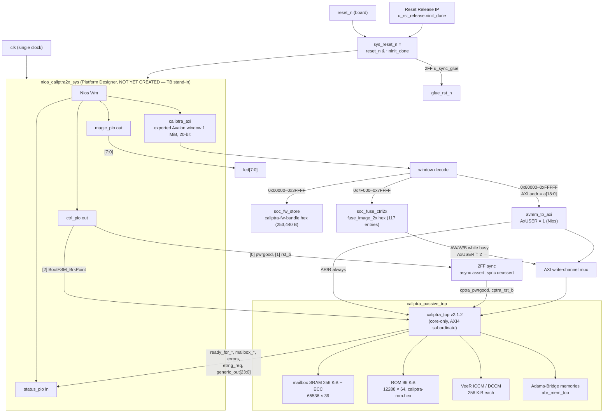
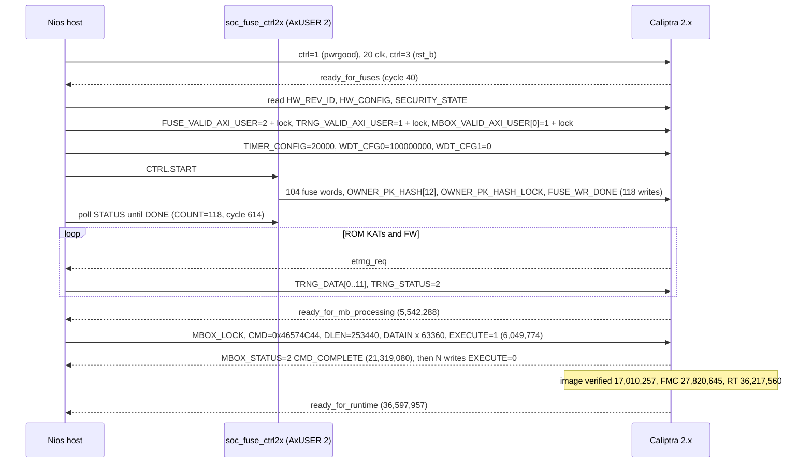

# Nios V ↔ Caliptra 2.x Integration Guide (passive / core-only)

> **Where the files are (published copy).** This guide was written in the local Caliptra 2.x design tree. In this repo, the 2.x sources it names live under [`caliptra2x/`](../../caliptra2x/):
> - `rtl_2x/`, `sim_2x/`, `sim/rst_release_stub.sv`, `fw_2x/`, `scripts/gen_fuse_image_2x.py` and `quartus_a5e_2x/` → `caliptra2x/…`
> - `docs/P1_FIT_RESULT_2X_A5E.md` and `docs/CALIPTRA_2X_INTEGRATION_PLAN.md` → this folder
> - The 1.x guide `docs/NIOS_CALIPTRA_INTEGRATION.md` is [`../NIOS_CALIPTRA_INTEGRATION.md`](../NIOS_CALIPTRA_INTEGRATION.md)
>
> caliptra-rtl and caliptra-sw are not vendored.

- **Project:** Caliptra 2.x in passive (core-only) mode on Intel Agilex 5 E **A5EC065BB32AE6S**, with a Nios V/m mailbox host (Avalon → AXI4).
- **RTL:** chipsalliance/caliptra-rtl **v2.1.2**, commit `49370266d12cb0c4a8f71b3a0ff7e54ba7d4866e`. `CALIPTRA_MODE_SUBSYSTEM` is **not** defined (core-only), and `CALIPTRA_INTERNAL_TRNG` is **not** defined (external TRNG).
- **Firmware:** caliptra-sw `dd1e79d5bf55a9bd5bdb05915757eaf34844145d`, which carries tags `rom-2.1.3-1` and `fw-2.1.4`. See [FIRMWARE_AND_KEYS_2X.md](FIRMWARE_AND_KEYS_2X.md).
- **Simulation:** Verilator 5.054, one cold boot to `ready_for_runtime`, **PASS**. See [SIMULATION_2X.md](SIMULATION_2X.md).
- **Companion docs:** [docs/P1_FIT_RESULT_2X_A5E.md](P1_FIT_RESULT_2X_A5E.md) (Quartus fit gate), [docs/CALIPTRA_2X_INTEGRATION_PLAN.md](CALIPTRA_2X_INTEGRATION_PLAN.md) (1.x → 2.x delta and phased plan). The 1.x guide this one is modelled on is `docs/NIOS_CALIPTRA_INTEGRATION.md` (rev 3).
- **Date:** 2026-11-10 (America/Chicago).

> **Status.** This is a *design study*. The 2.x glue RTL and the boot flow are verified in Verilator. The design **does not fit** the A5E 065: synthesis estimates 279,685 / 222,400 ALMs (126 %) (§14). Every key, seed and entropy value is a **TEST/STUDY value**: the obfuscation key, CSR HMAC key, UDS, field entropy, the test-signed firmware, and the simulated TRNG data. The firmware is signed with caliptra-sw's **public fake keys**. See [FIRMWARE_AND_KEYS_2X.md §6](FIRMWARE_AND_KEYS_2X.md).

**What exists and what doesn't (2.x tree):**

| Item | State |
|---|---|
| `rtl_2x/nios_caliptra2x_top.sv`, `avmm_to_axi.sv`, `soc_fuse_ctrl2x.sv`, `soc_fw_store.sv`, `reset_sync.sv`, `caliptra_passive_top.sv` | Written; simulated (Verilator) |
| `scripts/gen_fuse_image_2x.py` → `fw_2x/fuse_image_2x.hex` | Written; output used in the PASS run (regeneration is byte-identical) |
| `fw_2x/` ROM + FW bundle (+ `build_rom.sh`, `SHA256SUMS`) | Built from caliptra-sw `dd1e79d` |
| Platform Designer system `nios_caliptra2x_sys` (Nios V + PIOs + 1 MiB window) | **Not created yet.** The TB uses a behavioral stand-in with the same ports |
| Nios C firmware for 2.x (`main.c` port) | **Not ported yet.** The 1.x `quartus_a5e_nios/sw/app/main.c` is unchanged. The TB host model defines the 2.x sequence (§11) |
| Quartus project for the full Nios + 2.x top | **Not created.** `quartus_a5e_2x/` synthesizes only the Caliptra core wrapper (fit gate) |

---

## 1. Source files

| File | Role |
|---|---|
| `rtl_2x/nios_caliptra2x_top.sv` | FPGA top: Reset Release gate, PD system, SoC window decode, Avalon→AXI bridge, fuse controller, AXI write-channel mux, 2FF reset syncs, straps, status PIO |
| `rtl_2x/caliptra_passive_top.sv` | Core-only wrapper around `caliptra_top`: flattens the AXI subordinate to ports, ties off the AXI manager (DMA) and all `ss_*` straps, instantiates the mailbox SRAM, ROM, VeeR ICCM/DCCM and Adams-Bridge memories |
| `rtl_2x/avmm_to_axi.sv` | Avalon-MM agent → AXI4 manager, single beat, 1 outstanding, AxUSER = `user_i` |
| `rtl_2x/soc_fuse_ctrl2x.sv` | SoC fuse sequencer (stand-in for OTP + fuse controller); replays `fw_2x/fuse_image_2x.hex` over AXI with AxUSER 2 |
| `rtl_2x/soc_fw_store.sv` | Read-only M20K store holding `fw_2x/caliptra-fw-bundle.hex` (stand-in for boot flash) |
| `rtl_2x/reset_sync.sv` | `rst_sync_async_assert` / `pwrgood_sync_async_assert` (async assert, 2FF sync deassert) |
| `rtl_2x/caliptra_veer_sram_export.sv` | VeeR ICCM/DCCM SRAM export |
| `sim/rst_release_stub.sv` | Verilator stand-in for the Agilex 5 Reset Release IP (`ninit_done` high for 25 ns) |
| `scripts/gen_fuse_image_2x.py` | Builds the fuse image from the FW bundle |
| `fw_2x/` | ROM, FW bundle, hex files, `SHA256SUMS`, `build_rom.sh`, `fuse_image_2x.hex` |
| `sim_2x/` | `boot2x.f`, `tb_nios2x_top_fw.sv`, `run_nios2x_top_fw.sh`, `BOOT_NIOS2X.md`, `nios2x_top_fw_run.log` |

---

## 2. Block diagram

---

## 3. Port and signal tables

### 3.1 `nios_caliptra2x_top` parameters and ports

| Parameter | Default | Meaning |
|---|---|---|
| `ROM_INIT_FILE` | `"../fw_2x/caliptra-rom.hex"` | Caliptra ROM image (`$readmemh`, 64-bit words) |
| `FW_INIT_FILE` | `"../fw_2x/caliptra-fw-bundle.hex"` | FW bundle for `soc_fw_store` (32-bit LE words) |
| `FUSE_IMAGE` | `"../fw_2x/fuse_image_2x.hex"` | Fuse image for `soc_fuse_ctrl2x` |
| `FW_BYTES` | `253440` | Bundle size reported by fuse ctrl MMIO `0x10` (used as `MBOX_DLEN`) |
| `NUM_FUSES` | `117` | Image entries (104 fuse words + 12 owner-hash words + 1 lock) |
| `NIOS_AXI_USER` | `32'h1` | AxUSER driven on every Nios access |
| `FUSE_AXI_USER` | `32'h2` | AxUSER driven by the fuse controller |

| Port | Dir | Width | Connection |
|---|---|---|---|
| `clk` | in | 1 | Single clock for Nios, glue and Caliptra |
| `reset_n` | in | 1 | Board reset, active low; ANDed with `~ninit_done` |
| `led` | out | 8 | `magic_pio[7:0]` |

### 3.2 Internal glue signals

| Signal | Source → sink | Notes |
|---|---|---|
| `ninit_done` | `rst_release` → gate | Agilex 5 Reset Release IP (sim: `sim/rst_release_stub.sv`) |
| `sys_reset_n` | `reset_n & ~ninit_done` | PD reset; also gates the raw pwrgood/rst_b requests |
| `glue_rst_n` | `rst_sync_async_assert` (2 stages) | Resets decode, bridge, fuse ctrl |
| `ctrl_out[0]` | ctrl PIO → `raw_pwrgood = ctrl_out[0] & sys_reset_n` → `pwrgood_sync_async_assert` → `cptra_pwrgood` | Reset value 0 = Caliptra unpowered |
| `ctrl_out[1]` | ctrl PIO → `raw_rst_b = ctrl_out[1] & sys_reset_n` → `rst_sync_async_assert` → `cptra_rst_b` | Warm reset = drop only this bit |
| `ctrl_out[2]` | ctrl PIO → `BootFSM_BrkPoint` | Default 0 |
| `status_in` | → status PIO | See §3.3 |
| `fuse_busy` | `soc_fuse_ctrl2x.busy` | 1 in NEXT/SEND/RESP: fuse ctrl owns AW/W/B |
| `bridge_idle` | `avmm_to_axi.idle` | Exported for a warm-reset quiesce; **not yet used** in the top |
| `nios_axi_user` | register, reset/load `NIOS_AXI_USER` | A register (not an assign) so the TB can `force` a wrong ID |
| `generic_input_wires` | `64'b0` | IS Table 13: bit 0 = zeroization status; no source → 0 |

### 3.3 `status_pio` bits (same positions as 1.x)

| Bit | Signal | 1.x name |
|---|---|---|
| 0 | `ready_for_fuses` | same |
| 1 | `ready_for_mb_processing` | `ready_for_fw_push` |
| 2 | `ready_for_runtime` | same |
| 3 | `mailbox_data_avail` | same |
| 4 | `mailbox_flow_done` | same |
| 5 | `cptra_error_fatal` | same |
| 6 | `cptra_error_non_fatal` | same |
| 7 | `etrng_req` | same |
| 31:8 | `generic_output_wires[23:0]` | same (ROM/FW log byte on `[7:0]`, strobe toggle on `[8]`) |

### 3.4 `caliptra_passive_top` / `caliptra_top` connections

Widths come from `config_defines.svh`: `CALIPTRA_AXI_DATA_WIDTH` = 32, `CALIPTRA_AXI_USER_WIDTH` = 32, `CALIPTRA_AXI_ID_WIDTH` = 8. The SoC-interface address width is `CALIPTRA_SLAVE_ADDR_WIDTH(SOC_IFC)` = **19** bits (base `0x3000_0000`, mask `0x3007_FFFF`).

**Clocks, resets, straps, keys**

| `caliptra_top` port | Width | Driven by (`nios_caliptra2x_top` → wrapper) | Status |
|---|---|---|---|
| `clk` | 1 | `clk` | |
| `cptra_pwrgood` | 1 | 2FF-synced `ctrl_out[0]` | |
| `cptra_rst_b` | 1 | 2FF-synced `ctrl_out[1]` | |
| `cptra_obf_key` | 256 | `STUDY_PROD_MIMIC_OBF_KEY` = `31358e8a_f34d6a45_…_b2c3b8d5` (localparam) | **TEST-ONLY** |
| `cptra_csr_hmac_key` | 16 × 32 (`CLP_CSR_HMAC_KEY_DWORDS` = 16) | `{16{32'h5A3C_96E1}}` | **TEST-ONLY** |
| `security_state.device_lifecycle` | 2 | `2'b11` = DEVICE_PRODUCTION | **TEST-ONLY** (hardwired) |
| `security_state.debug_locked` | 1 | `1'b1` | **TEST-ONLY** (hardwired) |
| `cptra_obf_field_entropy_vld` / `cptra_obf_field_entropy` | 1 / 256 | `0` / `'0` | Passive: tie 0 (IS Table 12) |
| `cptra_obf_uds_seed_vld` / `cptra_obf_uds_seed` | 1 / 512 | `0` / `'0` | Passive: tie 0 |
| `BootFSM_BrkPoint` | 1 | `ctrl_out[2]` | |
| `scan_mode` | 1 | `1'b0` | |
| `jtag_tck/tms/tdi/trst_n` | 1 each | `0` (TAP held in reset) | OPEN (no TAP endpoint) |
| `jtag_tdo`, `jtag_tdoEn` | 1 each | unconnected | |

**AXI4 subordinate (`s_axi_w_if`, `s_axi_r_if`), flattened in the wrapper**

| Channel | Signals | Driven by |
|---|---|---|
| AW | `awaddr[18:0]`, `awburst`, `awsize`, `awlen`, `awuser[31:0]`, `awid[7:0]`, `awlock`, `awvalid` / `awready` | Mux: fuse ctrl while `fuse_busy`, else bridge. `awburst/awsize/awlen/awid/awlock` always come from the bridge (constants INCR / 2 / 0 / 0 / 0) |
| W | `wdata[31:0]`, `wstrb`, `wuser`, `wvalid` / `wready`, `wlast` | Mux for `wdata/wvalid/wuser`; `wstrb=4'hF`, `wlast=1` from bridge |
| B | `bresp`, `bid`, `buser`, `bvalid` / `bready` | `bresp/bvalid` to both; `bready` muxed; `bid/buser` unconnected |
| AR | `araddr`, `arburst`, `arsize`, `arlen`, `aruser`, `arid`, `arlock`, `arvalid` / `arready` | Bridge only |
| R | `rdata`, `rresp`, `rid`, `ruser`, `rlast`, `rvalid` / `rready` | Bridge only; `rid/ruser/rlast` unconnected |

**AXI manager (DMA), subsystem straps and other ports, all tied off in the wrapper**

| Port group | Tie-off | Reason |
|---|---|---|
| `m_axi_w_if`, `m_axi_r_if` | `awready/wready/arready/bvalid/rvalid = 0`, data/resp/id/user = 0 | Passive: DMA AXI manager must not reach the SoC |
| `strap_ss_caliptra_base_addr`, `strap_ss_mci_base_addr`, `strap_ss_recovery_ifc_base_addr`, `strap_ss_external_staging_area_base_addr`, `strap_ss_otp_fc_base_addr`, `strap_ss_uds_seed_base_addr`, `strap_ss_key_release_base_addr`, `strap_ss_key_release_key_size`, `strap_ss_prod_debug_unlock_auth_pk_hash_reg_bank_offset`, `strap_ss_num_of_prod_debug_unlock_auth_pk_hashes`, `strap_ss_caliptra_dma_axi_user`, `strap_ss_strap_generic_0..3` | `'0` | IS Table 11: subsystem only; tie 0 in passive |
| `ss_debug_intent` | `1'b0` | Subsystem only |
| `ss_ocp_lock_en` | `1'b0` (constant) | OCP LOCK needs subsystem; the runtime log confirms `[rt] OCP LOCK Unsupported` |
| `recovery_data_avail`, `recovery_image_activated` | `1'b0` | Subsystem recovery interface |
| `ss_dbg_manuf_enable`, `ss_soc_dbg_unlock_level`, `ss_generic_fw_exec_ctrl` | unconnected outputs | |
| `trace_rv_*` | unconnected | |
| `itrng_data[3:0]`, `itrng_valid` | `4'h0`, `1'b0` | Internal TRNG not compiled in |
| `generic_input_wires[63:0]` | `64'b0` | |
| `generic_output_wires[63:0]` | `[23:0]` → `status_pio[31:8]` | Log channel |

**Status and interrupts**

| Port | Width | To |
|---|---|---|
| `ready_for_fuses`, `ready_for_mb_processing`, `ready_for_runtime` | 1 each | `status_pio[0..2]`; `ready_for_fuses` also to the fuse ctrl |
| `mailbox_data_avail`, `mailbox_flow_done` | 1 each | `status_pio[3..4]` (polled, no IRQ) |
| `cptra_error_fatal`, `cptra_error_non_fatal` | 1 each | `status_pio[5..6]` (polled, no IRQ) |
| `etrng_req` | 1 | `status_pio[7]` |

**Memories (instantiated inside `caliptra_passive_top`)**

| Memory | Shape | Module |
|---|---|---|
| Mailbox SRAM | `CPTRA_MBOX_DEPTH` × `CPTRA_MBOX_DATA_AND_ECC_W` = 65536 × 39 (256 KiB data + 7-bit ECC; passive size) | `caliptra_sram` |
| ROM (imem) | `CALIPTRA_IMEM_DEPTH` × 64 = 12288 × 64 (96 KiB, `CALIPTRA_IMEM_BYTE_SIZE` = 98304) | `caliptra_rom_m20k`, `$readmemh(ROM_INIT_FILE)` |
| VeeR ICCM / DCCM | 256 KiB each | `caliptra_veer_sram_export` |
| Adams-Bridge (ML-DSA / ML-KEM) | 10 memories via `abr_mem_if` | `abr_mem_top` |

---

## 4. AXI user IDs (AxUSER)

| Agent | AxUSER | Where set | Programmed into |
|---|---|---|---|
| Nios (bridge) | `0x0000_0001` | `NIOS_AXI_USER` → `nios_axi_user` → `avmm_to_axi.user_i` (AWUSER, WUSER, ARUSER) | `CPTRA_MBOX_VALID_AXI_USER[0]` + lock; `CPTRA_TRNG_VALID_AXI_USER` + lock |
| Fuse controller | `0x0000_0002` | `FUSE_AXI_USER` → `soc_fuse_ctrl2x.axi_user` (AWUSER, WUSER) | `CPTRA_FUSE_VALID_AXI_USER` + lock |
| *(reserved)* | `0xFFFF_FFFF` | never driven | IS Table 19: "CANNOT use value 0xFFFFFFFF". It is also the RTL default `CPTRA_DEF_MBOX_VALID_AXI_USER` |

- The IDs are unique per agent and non-zero, as IS Table 19 recommends.
- The RTL integration parameters are left at upstream defaults: `CPTRA_SET_MBOX_AXI_USER_INTEG = 0`, `CPTRA_SET_FUSE_AXI_USER_INTEG = 0`. The IDs are therefore *programmed and locked* by the host on every cold boot (§11, step 4), not hardened at compile time.
- **Fuse range gating.** In `soc_ifc_arb.sv`, SoC requests to `0x30200–0x305FF` (`SOC_IFC_FUSE_START_ADDR`..`_END_ADDR`) are routed only if `valid_fuse_user` is set. Once `CPTRA_FUSE_AXI_USER_LOCK` = 1, that means AxUSER == `CPTRA_FUSE_VALID_AXI_USER` (= 2). So **the Nios (user 1) can neither write nor read fuse registers**. This explains the `FUSE_PQC_KEY_TYPE readback=00000000` seen in the sim (§9.3).
- `CPTRA_OWNER_PK_HASH[12]` (`0x30140`) and `CPTRA_OWNER_PK_HASH_LOCK` (`0x30170`) are **outside** the fuse range. Any SoC requester can write them until the lock is set. In this design the fuse controller writes and locks them. Note that the Nios could also write them before the lock (see checklist, §13).
- The sim's `+test=axiuser` checks: a mailbox write with AxUSER 3 gives SLVERR; a fuse write with AxUSER 3 gives SLVERR; a fuse write with AxUSER 1 (Nios) gives SLVERR; a `HW_REV_ID` read with AxUSER 1 is accepted (`TB_AXIUSER PASS`).

---

## 5. Memory map

### 5.1 Nios SoC window (20-bit, 1 MiB) — decode in `nios_caliptra2x_top`

The window base in the Nios address space is set by the (not yet created) Platform Designer system. Offsets below are **window offsets** (`cl_address[19:0]`).

| Window offset | Decode (RTL) | Target |
|---|---|---|
| `0x00000–0x3FFFF` | `!a[19] && !a[18]` | `soc_fw_store`: 65536 × 32-bit words (256 KiB), read-only, 1-cycle read. The 2.x bundle uses 63,360 words (253,440 B) |
| `0x40000–0x7EFFF` | — | Unmapped: no waitrequest; read data is not meaningful |
| `0x7F000–0x7FFFF` | `!a[19] && a[18:12]==7'h7F` | `soc_fuse_ctrl2x` MMIO (§7.2) |
| `0x80000–0xFFFFF` | `a[19]` | Caliptra AXI subordinate; **AXI address = `a[18:0]`** |

> The RTL comment in `nios_caliptra2x_top.sv` says "0x80000-0xBFFFF … AXI addr = cl_address[17:0]". The actual decode is `sel_cptra = cl_address[19]`, and the bridge takes `cl_address[AXI_AW-1:0]` with `AXI_AW` = 19. So the whole upper half maps through. Caliptra's targets all sit below AXI `0x40000` for the SoC (see 5.2), so the narrower comment is harmless, but this table follows the RTL.

### 5.2 Caliptra 2.x SoC AXI map (from `caliptra_reg_defines.svh` / `soc_ifc_pkg.sv`, v2.1.2)

Internal addresses are `0x3000_0000 + AXI address` (`SOC_IFC_REG_OFFSET`).

| AXI address | Nios window offset | Block | SoC access |
|---|---|---|---|
| `0x20000–0x20FFF` | `0xA0000` | `mbox_csr` | Valid mailbox AxUSERs |
| `0x21000–0x21FFF` | `0xA1000` | SHA512 accelerator CSR | Only the `SS_CALIPTRA_DMA_AXI_USER` → not usable by the Nios in passive mode |
| `0x22000–0x22FFF` | `0xA2000` | AXI DMA registers | Present in RTL; DMA unused in passive mode |
| `0x30000–0x3FFFF` | `0xB0000` | `soc_ifc` registers | Any requester except the fuse range |
| `0x30200–0x305FF` | `0xB0200` | Fuse registers (subset of `soc_ifc`) | Only `CPTRA_FUSE_VALID_AXI_USER` once locked |

### 5.3 Registers used by the host (verified against `caliptra_reg_defines.svh`)

| Register | AXI | Window | Use |
|---|---|---|---|
| `MBOX_LOCK` | `0x20000` | `0xA0000` | Read to acquire (bit 0 = 0 → acquired) |
| `MBOX_USER` | `0x20004` | `0xA0004` | Expect `0x1` |
| `MBOX_CMD` | `0x20008` | `0xA0008` | `0x46574C44` = FIRMWARE_LOAD |
| `MBOX_DLEN` | `0x2000C` | `0xA000C` | 253,440 |
| `MBOX_DATAIN` | `0x20010` | `0xA0010` | Full-word writes only |
| `MBOX_DATAOUT` | `0x20014` | `0xA0014` | (not used for FW load) |
| `MBOX_EXECUTE` | `0x20018` | `0xA0018` | 1 = execute, 0 = release |
| `MBOX_STATUS` | `0x2001C` | `0xA001C` | `[3:0]` 2 = CMD_COMPLETE |
| `CPTRA_HW_ERROR_FATAL` / `_NON_FATAL` | `0x30000` / `0x30004` | `0xB0000` / `0xB0004` | RW1C |
| `CPTRA_FW_ERROR_FATAL` / `_NON_FATAL` | `0x30008` / `0x3000C` | `0xB0008` / `0xB000C` | RW1C |
| `CPTRA_BOOT_STATUS` | `0x30038` | `0xB0038` | |
| `CPTRA_FLOW_STATUS` | `0x3003C` | `0xB003C` | |
| `CPTRA_SECURITY_STATE` | `0x30044` | `0xB0044` | Sim read `0x00000007` = Production + debug locked |
| `CPTRA_MBOX_VALID_AXI_USER[0]` / `CPTRA_MBOX_AXI_USER_LOCK[0]` | `0x30048` / `0x3005C` | `0xB0048` / `0xB005C` | 1 / 1 |
| `CPTRA_TRNG_VALID_AXI_USER` / `CPTRA_TRNG_AXI_USER_LOCK` | `0x30070` / `0x30074` | `0xB0070` / `0xB0074` | 1 / 1 |
| `CPTRA_TRNG_DATA[0..11]` | `0x30078–0x300A4` | `0xB0078–0xB00A4` | 12 entropy words |
| `CPTRA_TRNG_CTRL` | `0x300A8` | `0xB00A8` | (not used) |
| `CPTRA_TRNG_STATUS` | `0x300AC` | `0xB00AC` | Write 2 = `DATA_WR_DONE` |
| `CPTRA_FUSE_WR_DONE` | `0x300B0` | `0xB00B0` | Written 1 by the fuse ctrl (its `FUSE_WR_DONE` parameter `32'h0003_00B0`) |
| `CPTRA_TIMER_CONFIG` | `0x300B4` | `0xB00B4` | 20000 (ps period for 50 MHz) |
| `CPTRA_BOOTFSM_GO` | `0x300B8` | `0xB00B8` | (only with `BootFSM_BrkPoint`=1) |
| `CPTRA_HW_REV_ID` | `0x300D4` | `0xB00D4` | Sim read `0x00000212` |
| `CPTRA_HW_CONFIG` | `0x300E0` | `0xB00E0` | Sim read `0x00000010` (`iTRNG_en`=0, `SUBSYSTEM_MODE_en`=0) |
| `CPTRA_FUSE_VALID_AXI_USER` / `CPTRA_FUSE_AXI_USER_LOCK` | `0x30108` / `0x3010C` | `0xB0108` / `0xB010C` | 2 / 1 |
| `CPTRA_WDT_CFG[0]` / `[1]` | `0x30110` / `0x30114` | `0xB0110` / `0xB0114` | 100,000,000 / 0 |
| `CPTRA_OWNER_PK_HASH[0..11]` | `0x30140–0x3016C` | — | Written by the fuse ctrl |
| `CPTRA_OWNER_PK_HASH_LOCK` | `0x30170` | `0xB0170` | Written 1 by the fuse ctrl |

---

## 6. `avmm_to_axi` bridge

- **Avalon side:** waitrequest + readdatavalid agent, with no bursts and no pipelining. `avs_byteenable` is ignored because Caliptra SoC registers are 32-bit.
- **AXI side:** single beat, `AxLEN=0`, `AxSIZE=2` (32-bit), `AxBURST=INCR` (`2'b01`), `AxLOCK=0`, `AxID=0`, `WSTRB=4'hF`, `WLAST=1`. `AWUSER = WUSER = ARUSER = user_i`. The address is word-aligned (`{a[AW-1:2],2'b00}`).
- **One outstanding transaction.** States: `IDLE → WADDR → WRESP → DONE` for writes and `IDLE → RADDR → RDATA → DONE → RESP` for reads. AW and W are issued together, and each drops on its own handshake.
- **Avalon handshake:** `avs_waitrequest` is low for exactly one cycle (`DONE`) to accept. Read data comes one cycle later with `avs_readdatavalid` (`RESP`).
- **Errors:** `BRESP`/`RRESP` ≠ OKAY sets `err_q`, so `avs_response = 2'b10` (SLVERR) for the last transaction. The TB reads `u_bridge.err_q` directly for the AxUSER test. Firmware would read the Avalon response, if the PD interconnect forwards it.
- **Spec fit (IS "Unsupported features"):** single outstanding, in order, no narrow writes to `mbox_datain` / `TRNG_DATA`. AxCACHE/PROT/REGION/QOS are not driven.
- **`idle` output:** high in `IDLE`, intended for warm-reset quiescing. It is not yet used by the top.

---

## 7. `soc_fuse_ctrl2x` — fuse sequencer

### 7.1 Image format (`fw_2x/fuse_image_2x.hex`)

- Each line is one `$readmemh` 64-bit word, `{AXI byte address[31:0], data[31:0]}`, for example the first line `00030200811944f5` (`FUSE_UDS_SEED[0]`) and the last line `0003017000000001` (`CPTRA_OWNER_PK_HASH_LOCK` = 1). Addresses are explicit because the 2.x fuse map has holes.
- The controller truncates the address to `AW` = 19 bits.
- 117 entries: 104 fuse words, then 12 `CPTRA_OWNER_PK_HASH` words, then `CPTRA_OWNER_PK_HASH_LOCK = 1`. The controller then appends `CPTRA_FUSE_WR_DONE = 1` itself (`addr = FUSE_WR_DONE = 0x300B0`). That makes **118 AXI writes**.

### 7.2 MMIO (window `0x7F000`, 4 KiB, word registers)

| Offset | Name | Access | Bits |
|---|---|---|---|
| `0x00` | ID | RO | `0x4655_5345` ("FUSE") |
| `0x04` | CTRL | WO | bit0 **START**, bit1 **CLEAR** (clears DONE/ERR), bit2 **START_DONE** |
| `0x08` | STATUS | RO | bit0 BUSY, bit1 DONE, bit2 ERR, bit3 READY_FOR_FUSES |
| `0x0C` | COUNT | RO | AXI writes completed (118 after a full START) |
| `0x10` | FW_BYTES | RO | `FW_BYTES` parameter (253,440) |
| `0x14` | NUM_FUSES | RO | `NUM_FUSES` parameter (117) |

### 7.3 Behaviour

- **START** (cold boot) replays entries 0..116, then `FUSE_WR_DONE`.
- **START_DONE** (warm reset) starts with `idx = NUM_FUSES`, which is "last", so it writes **only** `FUSE_WR_DONE = 1`. Fuse registers and `CPTRA_OWNER_PK_HASH*` are pwrgood-domain and persist across a warm reset. START wins if both bits are set.
- START or START_DONE while `ready_for_fuses` = 0 leads to `ERR`, with no writes.
- Any write with `BRESP` ≠ OKAY leads to `ERR`, and the sequence stops (`COUNT` shows how far it got).
- While `busy` is set (NEXT/SEND/RESP), the top muxes AW/W/B to the fuse controller. The Nios only polls the fuse ctrl STATUS (a local slave) meanwhile, so the bridge is idle. The read channels always belong to the bridge.
- Measured in sim: START issued just after cycle 136, `STATUS=00000002 COUNT=118` at cycle 614, so about 4 cycles per write.

---

## 8. Fuse map decode (what `gen_fuse_image_2x.py` writes)

Offsets are verified against `caliptra_reg_defines.svh` (`CLP_SOC_IFC_REG_*`, minus `0x3000_0000`). The access column is from `soc_ifc_fuse_reg.rdl` / `soc_ifc_external_reg.rdl`.

| AXI addr | Register | Words | Value written | Notes |
|---|---|---:|---|---|
| `0x30200` | `FUSE_UDS_SEED[0..15]` | 16 | STUDY: `0x1F2E3D4C ^ (0x9E3779B9·(i+1))` → `811944f5 2340ce3e … fc59a6dc` | **512-bit** in 2.x (384 in 1.x). Caliptra: no access; SoC: WL-S (write-only). **TEST-ONLY** |
| `0x30240` | `FUSE_FIELD_ENTROPY[0..7]` | 8 | STUDY: `0xA7C3E519 ^ (0x85EBCA6B·(i+1))` → `22282f72 ac1471cf … 889db641` | 256-bit. **TEST-ONLY** |
| `0x30260` | `FUSE_VENDOR_PK_HASH[0..11]` | 12 | SHA-384(`preamble.vendor_pub_key_info`) as 12 big-endian words → `30399676 a17e3e97 3677b3ff 862f4bf2 d1932d88 4778453c 376fe00d c93fb8aa 0770f3eb f3411a08 53e9c57e ce8a2980` | Hash of the ECC + PQC key *descriptors* (1,736 B). ROM rejects an all-zero value |
| `0x30290` | `FUSE_ECC_REVOCATION` | 1 | 0 | 4-bit field |
| `0x302B4` | `FUSE_FMC_KEY_MANIFEST_SVN` | 1 | 0 | |
| `0x302B8` | `FUSE_RUNTIME_SVN[0..3]` | 4 | 0 | Bundle header SVN must be ≥ fuse SVN; the bundle SVN is 0 |
| `0x302C8` | `FUSE_ANTI_ROLLBACK_DISABLE` | 1 | 0 | |
| `0x302CC` | `FUSE_IDEVID_CERT_ATTR[0..23]` | 24 | 0 | |
| `0x3032C` | `FUSE_IDEVID_MANUF_HSM_ID[0..3]` | 4 | 0 | |
| `0x30340` | `FUSE_LMS_REVOCATION` | 1 | 0 | |
| `0x30344` | `FUSE_MLDSA_REVOCATION` | 1 | 0 | |
| `0x30348` | `FUSE_SOC_STEPPING_ID` | 1 | 1 | Test value |
| `0x3034C` | `FUSE_MANUF_DBG_UNLOCK_TOKEN[0..15]` | 16 | 0 | Debug unlock is subsystem-only |
| `0x3038C` | `FUSE_PQC_KEY_TYPE` | 1 | **1** = manifest `pqc_key_type` | RDL: 2-bit, "one-hot", bit0 = MLDSA, bit1 = LMS. The ROM compares it with `FwVerificationPqcKeyType::from_u8()` (MLDSA = 1, LMS = 3). Skipped only when Unprovisioned |
| `0x30390` | `FUSE_SOC_MANIFEST_SVN[0..3]` | 4 | 0 | Unused in passive |
| `0x303A0` | `FUSE_SOC_MANIFEST_MAX_SVN` | 1 | 0 | |
| `0x303C0` | `FUSE_HEK_SEED[0..7]` | 8 | 0 | OCP LOCK; unused (`ss_ocp_lock_en`=0) |
| | **Fuse words subtotal** | **104** | | Holes at `0x294–0x2B0` and `0x3A4–0x3BC` are skipped |
| `0x30140` | `CPTRA_OWNER_PK_HASH[0..11]` | 12 | SHA-384(`preamble.owner_pub_keys`) → `48afdb07 3c5e0d4e e4649046 8ef81f2c f57249b6 e76a28f5 fca4de69 6a7d3e2e d3efc4e6 77431854 3e95307a 54988bd7` | **Not a fuse in 2.x.** Architectural register, `resetsignal = cptra_pwrgood`, SoC RWL-S |
| `0x30170` | `CPTRA_OWNER_PK_HASH_LOCK` | 1 | 1 | RW1-S; reset only by power cycle |
| `0x300B0` | `CPTRA_FUSE_WR_DONE` | (1) | 1 | Appended by the controller, not in the image |

**Owner key and entropy, in plain words:**
- The **owner key hash is provisioned**, written to `CPTRA_OWNER_PK_HASH` and locked. The sim read back `[0]=48afdb07` and `LOCK=1`. The ROM then verified the image against it.
- **UDS and field entropy are provisioned** with STUDY values (not secrets). The SoC cannot read them back (write-only), and the Nios can't access the fuse range anyway.
- There is no `FUSE_LIFE_CYCLE` in 2.x. Lifecycle comes only from the `security_state` straps (Production, debug locked).

---

## 9. TRNG (external, serviced by the host)

### 9.1 Hardware path

- `CALIPTRA_INTERNAL_TRNG` is not defined. `CPTRA_HW_CONFIG.iTRNG_en` = 0. `itrng_*` are tied 0.
- When Caliptra firmware wants entropy, it raises `etrng_req` (`status_pio[7]`).
- The host writes 12 words to `CPTRA_TRNG_DATA[0..11]` (`0x30078–0x300A4`), then writes `CPTRA_TRNG_STATUS = 2` (`DATA_WR_DONE`, `0x300AC`).
- Writes must come from `CPTRA_TRNG_VALID_AXI_USER` (= 1, locked). `DATA_WR_DONE` is hardware-cleared when Caliptra FW clears `DATA_REQ` (`soc_ifc_top.sv`).

### 9.2 Entropy source — **TEST-ONLY**

- **Sim:** the TB host model writes `$urandom` values. In the 1.x Nios firmware, `main.c` uses `xorshift32` seeded `0x1234ABCD`. The 2.x Nios firmware port would keep that (it isn't ported yet).
- Neither source is a real entropy source. IS §TRNG: *"It is a requirement for FIPS compliance that this TRNG HW API is always handled by SoC hardware gasket logic (and not some SoC ROM or firmware code)."*
- **Production options:** a hardware ETRNG gasket fed by a physical noise source, or `CALIPTRA_INTERNAL_TRNG` with a PTRNG on `itrng_data/itrng_valid`.

### 9.3 Sim numbers

- **217** requests serviced in one boot.
- The first was at cycle 379,157.
- 21 had been serviced by `ready_for_mb_processing`.
- The TB fails if `etrng_req` stays high for 100,000 cycles after `DATA_WR_DONE`; that never happened.

---

## 10. Reset, power-good, watchdog, errors

### 10.1 Resets

| Event | How | Effect |
|---|---|---|
| FPGA configuration | Reset Release IP holds `ninit_done`=1 → `sys_reset_n`=0 | Nios, glue and Caliptra requests all held |
| Board reset | `reset_n`=0 | Same as above; also a Caliptra **cold** reset (pwrgood/rst_b requests gated by `sys_reset_n`) |
| Caliptra cold reset | Host clears `ctrl[0]` (and `[1]`), then sets `ctrl=1` → wait → `ctrl=3` | pwrgood-domain state cleared (fuses, owner hash + lock, AxUSER locks) → full fuse push needed |
| Caliptra warm reset | Host clears only `ctrl[1]`, then sets it again | Fuses/owner hash persist; host must issue fuse ctrl **START_DONE** in `BOOT_FUSE`. **Not simulated in 2.x** |

- Both Caliptra resets use `reset_sync.sv` cells: asynchronous assertion, 2-stage synchronous deassertion, `SYNCHRONIZER_IDENTIFICATION FORCED_IF_ASYNCHRONOUS`. This meets IS Table 4 / the RDC rules.
- In the sim, pwrgood is raised and then `rst_b` follows 20 cycles later (`cold_release()`). That is above IS Table 19's 10-clock minimum.

### 10.2 Watchdog

- The host writes `CPTRA_WDT_CFG[0] = 100,000,000` and `CPTRA_WDT_CFG[1] = 0` before fuses.
- The debug-locked ROM uses them: the log shows `[state] Starting the WD Timer 100000000 cycles` at cycles 384,577 and 450,858.
- There are no WDT pins. A cascaded timeout shows up as `cptra_error_fatal`.

### 10.3 Errors

- `cptra_error_fatal` / `_non_fatal` are polled on `status_pio[5:6]`.
- The TB host clears non-fatal errors by RW1C (`HW/FW_ERROR_NON_FATAL`), and treats any fatal as a test FAIL. It dumps BOOT/FLOW status and the error registers.
- **The spec rule is to recover from a fatal error only by a pwrgood cycle.** The 1.x firmware does this (≤3 retries). The 2.x TB does **not** exercise fatal recovery.
- At `ready_for_runtime`, every HW/FW fatal and non-fatal register was 0, and `CPTRA_FLOW_STATUS = b8000000`.

---

## 11. Boot sequence

**Host sequence, step by step.** This is the TB behavioral host `nios_caliptra2x_sys`, which is the reference for the future `main.c` port.

1. Wait until the Reset Release IP releases `sys_reset_n`.
2. `ctrl = 1` (pwrgood), wait 20 clk, `ctrl = 3` (rst_b).
3. Poll `status[0]` (`ready_for_fuses`). Read `HW_REV_ID` (expect `0x212`), `HW_CONFIG` (expect `iTRNG_en=0`, `SUBSYSTEM_MODE_en=0`) and `CPTRA_SECURITY_STATE` (expect `7`).
4. Program and lock the AxUSERs: `FUSE_VALID_AXI_USER=2` + lock, `TRNG_VALID_AXI_USER=1` + lock, `MBOX_VALID_AXI_USER[0]=1` + lock. Then `TIMER_CONFIG=20000` and `WDT_CFG0=100,000,000`, `WDT_CFG1=0`.
5. Fuse ctrl: check ID `0x46555345`, write `CTRL=1` (START), poll `STATUS` until !BUSY and (DONE|ERR). Expect `COUNT=118`, then confirm `FUSE_WR_DONE=1` and `OWNER_PK_HASH_LOCK=1`.
6. Throughout steps 6–9: service `etrng_req` (§9), RW1C-clear non-fatal errors, and stop on fatal.
7. Poll `status[1]` (`ready_for_mb_processing`). Read `FW_BYTES` from fuse ctrl `0x10`.
8. Poll `MBOX_LOCK` until bit 0 = 0, and check `MBOX_USER = 1`. Write `MBOX_CMD=0x46574C44` and `MBOX_DLEN=253440`. Then for each of 63,360 words: read `soc_fw_store[i]` and write `MBOX_DATAIN`. Then write `MBOX_EXECUTE=1`.
9. Poll `MBOX_STATUS[3:0]` until non-zero, expect 2 (CMD_COMPLETE), then write `MBOX_EXECUTE=0`.
10. Poll `status[2]` (`ready_for_runtime`), then write magic `0xCA11F00D` (on the LEDs: `0x0D`).

The magic/LED codes the TB uses are 1 = start, 2 = ready_for_fuses, 3 = AxUSER programmed, 4 = fuses done, 5 = ready_for_mb_processing, 6 = FW_LOAD issued, 7 = mailbox complete, `0xCA11F00D` = runtime.

**Note on clocks.** The TB clock is 100 MHz (`#5`), but `TIMER_CONFIG=20000` ps assumes 50 MHz. This only affects Caliptra's MTIME scaling, not the boot result. Set `TIMER_CONFIG` to match the real board clock.

---

## 12. Changes vs. the 1.x design

| Area | 1.x (rev 3) | 2.x (this design) |
|---|---|---|
| Bus | APB, 18-bit, PAUSER | AXI4, 19-bit, AxUSER (32-bit) |
| Bridge | `avmm_to_apb` | `avmm_to_axi` |
| Window | 256 KiB (18-bit) | 1 MiB (20-bit) |
| Requester IDs | One shared PAUSER = 1 | Nios = 1, fuse ctrl = 2 (unique) |
| Fuses | 83 words, data-only image | 104 words + 12 owner hash + lock, address/data image, 117 entries |
| Owner PK hash | Fuse `FUSE_OWNER_PK_HASH` | Register `CPTRA_OWNER_PK_HASH[12]` + `_LOCK` (pwrgood) |
| Lifecycle | `FUSE_LIFE_CYCLE` + straps | Straps only |
| Ready signal | `ready_for_fw_push` | `ready_for_mb_processing` (same PIO bit 1) |
| Mailbox | 128 KiB | 256 KiB |
| ROM / ICCM / DCCM | 48 / 128 / 128 KiB | 96 / 256 / 256 KiB |
| PQC | LMS optional | ML-DSA-87 (Adams-Bridge) or LMS, selected by `FUSE_PQC_KEY_TYPE` |
| New tie-offs | — | `strap_ss_*`, `ss_debug_intent`, `ss_ocp_lock_en`, obf UDS/FE, recovery, DMA AXI manager, `cptra_csr_hmac_key` (new strap) |
| FW bundle | 109,000 B | 253,440 B |

---

## 13. Compliance checklist vs. caliptra-rtl v2.1.2 Integration Specification

References: IS Table 4 (clocks/resets), Table 5 (AXI), Tables 11–13 (straps, generic wires), §TRNG, Table 19 (SoC integration requirements), and `soc_ifc` RDL. The status reflects the **2.x RTL glue plus the TB host sequence**. The Nios firmware for 2.x is not ported yet.

| Requirement | Spec ref | Implementation | Status |
|---|---|---|---|
| Clock running before / ≥10 clk around `cptra_pwrgood` | Table 19 Resets and Clocks | Free-running clk; TB 20 clk pwrgood→rst_b | **PASS** (sim) |
| Async assert / sync deassert of pwrgood, rst_b | Table 4 / RDC | `reset_sync.sv` 2FF cells | **PASS** |
| Agilex Reset Release before user logic | Intel A5E | `rst_release` gates `sys_reset_n` | **PASS** (stub in sim) |
| AXI single outstanding, in order, no narrow `mbox_datain`/`TRNG_DATA` | IS Unsupported features | `avmm_to_axi` single-beat, `WSTRB=F` | **PASS** |
| Drive AxUSER on all requests; never `0xFFFFFFFF` | Table 19 AXI USER | Nios 1, fuse 2 | **PASS** |
| AxUSER unique per agent, non-zero | Table 19 AXI USER | 1 vs 2 | **PASS** |
| Mailbox AxUSER programmed + locked before use | Table 19 MAILBOX rules | Step 4, before any mailbox access | **PASS** (sim; ideally done by immutable SoC ROM) |
| TRNG AxUSER programmed + locked | Table 19 TRNG rules | Step 4 | **PASS** |
| Fuse AxUSER locked or hardened | Table 19 FUSE rules | Programmed + locked to 2; `CPTRA_SET_FUSE_AXI_USER_INTEG=0` | **PASS** (programmable; hardening optional) |
| Fuse writes + `FUSE_WR_DONE` by immutable logic or ROM | Table 19 Fuses | `soc_fuse_ctrl2x` FSM, but the image is a rebuildable hex in FPGA RAM | **TEST-ONLY** |
| UDS/FE from OTP, no debug inject path | Table 19 Fuses | STUDY values in a hex image | **TEST-ONLY** |
| Debug read paths for fuses disabled in Production | Table 19 Fuses | Fuse range gated to user 2; UDS/FE write-only; but the hex image is readable in the bitstream | **TEST-ONLY** |
| Owner PK hash written + locked before mutable code | `soc_ifc_external_reg.rdl` | Fuse ctrl writes + locks (pwrgood-sticky); Nios could write it in the window before START | **PASS** (study); production: write from immutable logic before the host CPU can reach AXI |
| Warm reset: SoC re-writes `FUSE_WR_DONE` only | IS Fuses / Boot FSM | `START_DONE` implemented | **OPEN** (not simulated in 2.x) |
| Security state from the SoC's security state | Table 19 Security State | Hardwired Production + debug locked | **TEST-ONLY** |
| Obfuscation key: NIST-generated, not software, off scan, stable before reset | Table 19 Obfuscation Key | Fixed study localparam | **TEST-ONLY** |
| CSR HMAC key generated/rotated per project | Table 19 CSR HMAC Key | Fixed study constant (latched only in MANUFACTURING) | **TEST-ONLY** |
| Subsystem straps / `ss_*` / obf UDS/FE / recovery tied 0 in passive | Tables 11–12 | Tied in `caliptra_passive_top` | **PASS** |
| `ss_ocp_lock_en` constant | Table 11 | `1'b0` | **PASS** |
| DMA AXI manager not connected in passive | IS DMA / AXI arbitration | Ready/valid tied 0 | **PASS** |
| `generic_input_wires` bit 0 = zeroization status; others 0 | Table 13 | `64'b0` | **PASS** |
| TRNG serviced by a hardware gasket (FIPS) | IS §TRNG | Host firmware/TB model, pseudo-random data | **TEST-ONLY** |
| Report Caliptra error outputs | Table 19 Error reporting | Polled on `status_pio[5:6]`; not a Nios IRQ | **OPEN** (IRQ) |
| Recover fatal only via pwrgood reset | Table 19 Error reporting | Planned (1.x has it); not in the 2.x TB | **OPEN** |
| SoC programs WDT before debug-locked ROM | HW spec WDT | `WDT_CFG` written before fuses; ROM log confirms | **PASS** |
| `TIMER_CONFIG` programmed | `soc_ifc` RDL | 20000 ps (50 MHz) | **PASS** (TB clock is 100 MHz; set per board) |
| `scan_mode` 0 functional; 1 for 5,000 clk before scan | Table 19 DFT | Tied 0, no scan | **PASS** (FPGA) |
| Caliptra TAP as a TAP endpoint | Table 19 DFT | Tied off | **OPEN** |
| Input clock from an on-die oscillator; clock-attack defence | Table 19 Resets and Clocks | Board clock | **OPEN** |
| No independent power-gating; clock gating via Caliptra FW | Table 19 Power saving | Clock ungated | **PASS** |
| SRAM zeroization on pwrgood | IS SRAM | Not implemented (bitstream-time zero only) | **OPEN** |
| Synthesis integrity (`u__size_only__` prims preserved) | IS Synthesis constraints | Not yet addressed in the Quartus flow | **OPEN** |
| Device fits | — | 126 % ALMs on A5E 065 | **FAIL** (§14) |

**Summary:** 32 rows: 17 PASS, 7 OPEN, 7 TEST-ONLY, 1 FAIL (fit). Every TEST-ONLY item is intentional for a study and must be replaced for a product.

---

## 14. A5E 065 fit result and options

From [`docs/P1_FIT_RESULT_2X_A5E.md`](P1_FIT_RESULT_2X_A5E.md). Quartus Prime Pro 25.3.0 b109, Analysis & Synthesis only. The top is `rtl_2x/caliptra_passive_top.sv` (Caliptra core only, **no Nios**). `MLDSA_MASKING` is on (upstream default).

| Resource | 2.x synth | A5EC065 | % | 1.x (same flow) |
|---|---:|---:|---:|---:|
| **ALMs needed (pre-fit estimate)** | **279,685** | **222,400** | **125.8 %** | 138,715 |
| Combinational ALUTs | 395,094 | — | — | 218,761 |
| Dedicated logic registers | 411,569 | 889,600 | 46.3 % | 141,933 |
| Block memory bits | 9,005,696 | 31.46 Mb | ≈ 28.6 % | ≈ 5.67 Mb |
| M20K (estimate) | ≈ 484 | 1,611 | ≈ 30 % | — |
| DSP (synth / est. post-merge) | 213 / 199 | 846 | 25.2 % / 23.5 % | 49 |

- **Biggest consumer: Adams-Bridge** (`abr_inst`): 101,640 ALUTs, 244,925 FFs, 164 DSP. The masked NTT `hybrid_bf2x2` alone has 218,303 FFs.
- **Next:** `ecc_top1` (79,991 ALUTs), VeeR (55,132), key vault (51,019).
- **Over by 57,285 ALMs.** Even a 20 % packing gain leaves the design at ≥ 100 %. The Nios system would add more.

**Options**

| Option | Fits | Spec-conformant | Comment |
|---|---|---|---|
| **A. Agilex 7** (e.g. AGF/AGI 014 ≈ 487k ALMs, ~57 % on this estimate; 022/027 for margin) | Yes | Yes | Same RTL; change FAMILY/DEVICE in `quartus_a5e_2x/gen_qsf.py`; new PD/pins |
| **B. Simulation-only 2.x** (keep Caliptra 1.x in A5E hardware) | n/a | Yes | Develop the glue, firmware and tooling in Verilator / sw-emulator now |
| **C. Unmasked / reduced test build** (`MLDSA_MASKING` undefined and/or `RV_FPGA_OPTIMIZE`) | Unknown, untested | **No**: removes side-channel countermeasures | Per the plan, upstream `MLDSA_MASKING` mainly zeroes the randomness; real savings may need an RTL fork. Research only |

---

## 15. Open items

1. Create the Platform Designer system `nios_caliptra2x_sys`: Nios V/m, on-chip RAM, JTAG UART, ctrl/status/magic PIOs, and an exported 20-bit Avalon `mm_bridge` named `caliptra_axi`.
2. Port `main.c` to the §11 sequence: 2.x register names, AxUSER programming, `ready_for_mb_processing`, 253,440-byte load, warm-reset START_DONE with bridge quiesce, and fatal pwrgood recovery.
3. Add 2.x `warm` and `fatal` Verilator tests, as in the 1.x suite.
4. Choose the hardware target (Agilex 7 vs. sim-only), then do a full fit, timing, and synthesis-integrity constraints.
5. Production replacements for every TEST-ONLY row: OTP fuses, a real lifecycle, an HSM-generated obfuscation and CSR HMAC key, a hardware TRNG, and own signing keys ([FIRMWARE_AND_KEYS_2X.md](FIRMWARE_AND_KEYS_2X.md)).
