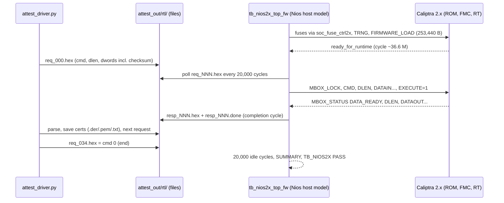

# Caliptra 2.x + Nios glue — Simulation Guide

> **Where the files are.** All paths in this guide are repo-relative ([pwilliam282/caliptra-a5e-quartus](https://github.com/pwilliam282/caliptra-a5e-quartus)):
> - 2.x glue RTL, sim, firmware, fuse script and Quartus project: [`caliptra2x/`](../../caliptra2x/) (`caliptra2x/rtl_2x/`, `caliptra2x/sim_2x/`, `caliptra2x/sim/`, `caliptra2x/fw_2x/`, `caliptra2x/scripts/`, `caliptra2x/quartus_a5e_2x/`)
> - Upstream RTL: `external/caliptra-rtl-2x/` = chipsalliance/caliptra-rtl v2.1.2 (`49370266`) with `submodules/adams-bridge` (`b77e3d8`), a pinned git submodule, unmodified. Fetch it with `scripts/get_caliptra_a5e.sh` or `git clone --recursive` + `scripts/fetch_deps.sh`. See [NIOS_CALIPTRA_2X_INTEGRATION.md §16](NIOS_CALIPTRA_2X_INTEGRATION.md#16-getting-the-sources).
> - Companion docs `P1_FIT_RESULT_2X_A5E.md` and `CALIPTRA_2X_INTEGRATION_PLAN.md`: this folder (`docs/caliptra-2x/`). The 1.x guide is [`docs/NIOS_CALIPTRA_INTEGRATION.md`](../NIOS_CALIPTRA_INTEGRATION.md).
>
> caliptra-sw is not vendored (only the built ROM/bundle in `caliptra2x/fw_2x/`).

- **Scope:** Verilator simulation of the **real** 2.x glue RTL (`caliptra2x/rtl_2x/`) around caliptra-rtl v2.1.2 (`49370266`) core-only. It runs the real ROM `rom-2.1.3-1` and the real FW bundle `fw-2.1.4` (FMC + runtime), and boots from cold power-on to `ready_for_runtime`.
- **Result:** **PASS**: `TB_NIOS2X PASS cyc=36617987 trng=217 (prod, debug locked)`.
- **Attestation and DPE:** `+test=attest` continues after `ready_for_runtime` with 34 runtime mailbox commands (DICE cert chain, `STASH_MEASUREMENT`, PCR quotes, DPE GetProfile/CertifyKey/GetCertificateChain): **PASS** at cycle 59,280,395, certificates byte-identical to the sw-emulator. See [§8](#8-rom-boot-firmware-load-attestation-and-dpe-in-simulation). What the Nios model covers: [§8.1](#81-what-this-simulation-covers-nios-model). Quick start: [§8.2](#82-quick-start-run-it-yourself).
- **Related:** [NIOS_CALIPTRA_2X_INTEGRATION.md](NIOS_CALIPTRA_2X_INTEGRATION.md) (design), [FIRMWARE_AND_KEYS_2X.md](FIRMWARE_AND_KEYS_2X.md) (ROM, bundle, fuse image). The raw record is in `caliptra2x/sim_2x/BOOT_NIOS2X.md` and `caliptra2x/sim_2x/nios2x_top_fw_run.log`.

---

## 1. What is simulated

| Part | Real RTL or model |
|---|---|
| `nios_caliptra2x_top` (window decode, `soc_fw_store`, `soc_fuse_ctrl2x`, `avmm_to_axi`, AXI write mux, 2FF reset syncs, straps) | **Real** (`caliptra2x/rtl_2x/`) |
| `caliptra_passive_top` + `caliptra_top` v2.1.2 (VeeR, soc_ifc, crypto, Adams-Bridge, memories) | **Real** (`external/caliptra-rtl-2x/`, `caliptra2x/rtl_2x/caliptra_passive_top.sv`) |
| Caliptra ROM / FMC / runtime | **Real** binaries: `caliptra2x/fw_2x/caliptra-rom.hex`, `caliptra2x/fw_2x/caliptra-fw-bundle.hex` |
| Fuse image | **Real** generator output: `caliptra2x/fw_2x/fuse_image_2x.hex` |
| Agilex Reset Release IP | Stub `caliptra2x/sim/rst_release_stub.sv` (`ninit_done` = 1 for 25 ns) |
| Platform Designer system `nios_caliptra2x_sys` (Nios V + PIOs + window) | **Behavioral model** `module nios_caliptra2x_sys` in `tb_nios2x_top_fw.sv`. Ports: `clk_clk`, `reset_reset_n`, `caliptra_axi_address[19:0]`, `_read`, `_write`, `_writedata[31:0]`, `_byteenable[3:0]` (always `4'hF`), `_readdata[31:0]`, `_readdatavalid`, `_waitrequest`, `_burstcount`, `_debugaccess`, `ctrl_pio_export[31:0]` (out, initialized to 0), `status_pio_export[31:0]` (in), `magic_pio_export[31:0]` (out, initialized to 0). It issues the Avalon accesses the 2.x Nios firmware is meant to issue |

The Nios V CPU, Platform Designer interconnect and C firmware are **not** in this sim. Compare the 1.x sim, which also used a behavioral host. §8.1 describes what the attestation run covers and what it does not, and the next step that would exercise the real Nios V.

---

## 2. Tools and inputs

| Item | Value |
|---|---|
| Simulator | **Verilator 5.054** (2026-11-01, conda-forge build), on `PATH` (set `VERILATOR_BIN=<dir>` to prepend a specific install; the build box used a conda env). Verilator 5.040 also works with the fixes in §7 |
| C++ compiler | Verilator's `--timing` support needs C++20 coroutines. GCC 13 or newer and clang work as is. **GCC 10–12 need `-fcoroutines`**: the run scripts call `scripts/verilator_cflags.sh`, which adds `-CFLAGS -fcoroutines` automatically when `${CXX:-c++}` is GCC 10–12. Override with `VERILATOR_CFLAGS="…"` (empty to pass nothing) or pick a compiler with `CXX=…` |
| Build flags (`run_nios2x_top_fw.sh`) | `--binary --threads ${THREADS:-4} -j 8 -O3 -Wno-fatal -Wno-lint -Wno-style -Wno-UNOPTFLAT -Wno-MULTIDRIVEN -Wno-TIMESCALEMOD --top-module tb_nios2x_top_fw -Mdir obj_nios2x -f boot2x.f -o Vtb_nios2x` |
| Caliptra RTL | `external/caliptra-rtl-2x/` = v2.1.2 `49370266d12cb0c4a8f71b3a0ff7e54ba7d4866e`, with submodule `adams-bridge` `b77e3d8`. Pinned git submodule; run `scripts/fetch_deps.sh` (or clone with `--recursive`) |
| File list | `caliptra2x/sim_2x/boot2x.f` (641 lines): `+incdir+` paths and 588 caliptra-rtl source files (`../../external/caliptra-rtl-2x/...`, relative to `caliptra2x/sim_2x/`), plus the repo files listed below |
| Repo sources in the file list | `caliptra2x/sim_2x/patches/decompress_top.sv`, `caliptra2x/rtl_2x/caliptra_veer_sram_export.sv`, `caliptra2x/rtl_2x/caliptra_passive_top.sv`, `caliptra2x/sim/rst_release_stub.sv`, `caliptra2x/rtl_2x/reset_sync.sv`, `caliptra2x/rtl_2x/avmm_to_axi.sv`, `caliptra2x/rtl_2x/soc_fuse_ctrl2x.sv`, `caliptra2x/rtl_2x/soc_fw_store.sv`, `caliptra2x/rtl_2x/nios_caliptra2x_top.sv`, `caliptra2x/sim_2x/tb_nios2x_top_fw.sv` |
| Verilator patch | `caliptra2x/sim_2x/patches/decompress_top.sv` replaces the adams-bridge original. It passes the `abr_piso_multi` rate arrays as indexed patterns with a default (`'{0:64, 1:64, 2:64, 3:64, default:0}` and `'{0:4, 1:20, 2:44, 3:48, default:0}`), so it elaborates whether a Verilator version sizes the array from `NUM_MODES` (4) or from the module default (5). Earlier 4-entry positional patterns failed on Verilator 5.040 with `Assignment pattern missed initializing elements: 4`; fixed in `bc3a381` |
| Data files (via RTL parameter defaults, relative to `caliptra2x/sim_2x/`) | `../fw_2x/caliptra-rom.hex`, `../fw_2x/caliptra-fw-bundle.hex`, `../fw_2x/fuse_image_2x.hex` |

All paths in `caliptra2x/sim_2x/boot2x.f` are relative to `caliptra2x/sim_2x/` (the run script `cd`s there): repo files as `../rtl_2x/…`, upstream RTL as `../../external/caliptra-rtl-2x/…`. The checkout can live anywhere; no path rewriting is needed.

---

## 3. Build and run

**Run long sims detached.** A full boot takes about 1.4 h of wall time, and a foreground shell or agent session can be interrupted.

```bash
scripts/fetch_deps.sh            # once, from the repo root: external/caliptra-rtl-2x must be present
cd caliptra2x/sim_2x
# build (~6 min) + run, detached; output in nios2x_top_fw_run.log, wrapper output in run.out
nohup setsid ./run_nios2x_top_fw.sh +test=all > run.out 2>&1 &

# re-run without rebuilding
BUILD=0 nohup setsid ./run_nios2x_top_fw.sh +test=all > run.out 2>&1 &

# watch progress
tail -f nios2x_top_fw_run.log          # LOG lines, TRNG services, heartbeats, milestones
grep -E 'MILESTONE|PASS|FAIL|TIMEOUT' nios2x_top_fw_run.log
```

| Env var | Default | Meaning |
|---|---|---|
| `BUILD` | `1` | `0` skips the Verilator build |
| `THREADS` | `4` | Verilator `--threads` |
| `VERILATOR_BIN` | unset | Directory prepended to `PATH` if set; otherwise `verilator` from `PATH` |
| `LOG` | `nios2x_top_fw_run.log` | Sim log file name (the attestation flow uses `LOG=attest_run.log`) |

- The script runs the binary under `stdbuf -oL -eL`, so the log is line-buffered and `tail -f` works. When the run ends, it appends `wall_time_s=<s> end <date>`.
- **Measured costs** on this box:
  - Build: Verilator walltime **358 s** (elab 4.9 s, convert 204.8 s, C++ build 143.9 s); 2,185 MB allocated; 134 C++ files.
  - Run: **5,069 s wall (1 h 24 m 29 s)** in the wrapper. Verilator reported walltime 4,452.7 s, cpu 17,793.6 s on 4 threads, 18 MB allocated, about 82 µs of sim time per wall second.

### 3.1 Plusargs

| Plusarg | Default | Effect |
|---|---|---|
| `+test=axiuser` | — | Cold release, `ready_for_fuses`, AxUSER programming, then the AxUSER checks (§4.1), then `$finish`. Takes a few hundred cycles |
| `+test=prod` | — | Cold boot to `ready_for_runtime` **without** the AxUSER checks |
| `+test=all` | **default** | AxUSER checks, then the prod cold boot. **Not** a multi-boot suite: there is no warm or fatal second boot, unlike 1.x `+test=all` |
| `+test=attest` | — | Prod cold boot, then the file-driven runtime mailbox loop for `attest/attest_driver.py` (§8) |
| `+attest_dir=DIR` | `attest_out/rtl` | Folder for the `req_NNN.hex` / `resp_NNN.hex` protocol files (`+test=attest`) |
| `+max_cycles=N` | 300,000,000 | Prints `TB_NIOS2X TIMEOUT magic=… trng=…` and stops |
| `+hb=N` | 1,000,000 | Heartbeat line period: `[cyc] heartbeat status=<pio[7:0]> trng=<n>` |

The TB clock is 100 MHz (`always #5`), so 1 cycle = 10 ns of sim time. `$finish` at 366 ms equals 36.6 M cycles.

---

## 4. What the testbench checks

### 4.1 AxUSER test (`test_axiuser`, run by `axiuser` and `all`)

This runs after the host programs and locks the AxUSERs (fuse = 2, TRNG = 1, mailbox[0] = 1). The TB `force`s `dut.nios_axi_user` and reads the bridge's `err_q` (SLVERR).

| Access | AxUSER | Expected | Result (log) |
|---|---|---|---|
| Write `MBOX_LOCK` | 3 | SLVERR | `[115] MBOX write AxUSER=3 -> SLVERR OK` |
| Write `FUSE_UDS_SEED[0]` | 3 | SLVERR | `[121] fuse write AxUSER=3 -> SLVERR OK` |
| Write `FUSE_UDS_SEED[0]` | 1 (Nios) | SLVERR (only user 2 may touch fuses) | `[127] … SLVERR OK` |
| Read `CPTRA_HW_REV_ID` | 1 | Accepted | `[132] AxUSER=1 HW_REV_ID=00000212 accepted OK` → `TB_AXIUSER PASS` |

### 4.2 Boot checks (`prod`, `all`)

| Check | FAIL message if it fails |
|---|---|
| `generic_input_wires === 0` | `TB_NIOS2X FAIL generic_input_wires` |
| Fuse ctrl ID = `0x46555345` | `FAIL fuse id` |
| Fuse ctrl ends DONE, not ERR | `FAIL fuse ctrl ERR (SLVERR on a fuse write?)` |
| Fuse ctrl `COUNT == 118` (104 fuse + 13 owner hash/lock + WR_DONE) | `FAIL expected COUNT=118 …` |
| `CPTRA_FUSE_WR_DONE[0] == 1` | `FAIL FUSE_WR_DONE not set` |
| `CPTRA_OWNER_PK_HASH_LOCK[0] == 1` | `FAIL owner PK hash not locked` |
| `MBOX_USER == 1` after the lock is acquired | `FAIL MBOX_USER` |
| `MBOX_STATUS == 2` (CMD_COMPLETE) after FIRMWARE_LOAD | `FAIL mbox status` (plus a register dump) |
| No `cptra_error_fatal` at any time | `FAIL unexpected cptra_error_fatal` (plus a dump) |
| `etrng_req` drops within 100,000 cycles after each `DATA_WR_DONE` | `FAIL etrng_req stuck …` |
| `ready_for_runtime` before `max_cycles` | `TIMEOUT` |

The TB also **prints, without checking**: `HW_REV_ID`, `HW_CONFIG`, `CPTRA_SECURITY_STATE`, `FUSE_PQC_KEY_TYPE` readback, `CPTRA_OWNER_PK_HASH[0]`, and a final dump of BOOT/FLOW status and all four error registers.

**PASS criteria:** every check above holds, `ready_for_runtime` is reached, and then 20,000 more cycles run with no fatal error. The TB prints `SUMMARY …` and `TB_NIOS2X PASS cyc=<n> trng=<n> (prod, debug locked)`.

### 4.3 The `FUSE_PQC_KEY_TYPE readback=00000000` quirk

- The image writes `FUSE_PQC_KEY_TYPE = 1` at `0x3038C` (line 91 of the 117-line image, written by the fuse ctrl with AxUSER 2). The TB reads it back **as the Nios (AxUSER 1)** and gets `00000000`.
- **Cause:** in caliptra-rtl `soc_ifc_arb.sv`, `soc_reg_req` for addresses in `SOC_IFC_FUSE_START_ADDR..SOC_IFC_FUSE_END_ADDR` (`0x30200–0x305FF`) requires `valid_fuse_user`. After `CPTRA_FUSE_AXI_USER_LOCK` = 1, that means AxUSER == 2. The Nios read therefore never reaches the register block, and the read data is 0.
- The same `valid_fuse_user` gate rejects the AxUSER 1 and AxUSER 3 fuse *writes* with SLVERR in §4.1. The TB does not check the bridge error flag on this read, so whether that read also returned SLVERR was not recorded.
- **Proof the fuse was effective:** in Production lifecycle, the ROM compares the manifest PQC type with this fuse and would fail with `IMAGE_VERIFIER_ERR_PQC_KEY_TYPE_MISMATCH`. Instead it logged `[fwproc] Img verified ecc=0 MLDSA=0 svn=0 fuse_svn=0` at cycle 17,010,257.
- By contrast, `CPTRA_OWNER_PK_HASH*` (`0x30140`/`0x30170`) and `CPTRA_FUSE_WR_DONE` (`0x300B0`) are outside the fuse range, so the Nios read them back correctly.
- To read the fuse values back for debugging, issue the reads with AxUSER 2 (for example, add a read path to `soc_fuse_ctrl2x`) or before `CPTRA_FUSE_AXI_USER_LOCK` is set.

### 4.4 Log channel

- The ROM, FMC and runtime print through `generic_output_wires[7:0]`, with bit 8 toggling per character.
- The TB top assembles lines and prints them as `[cycle] LOG <text>`.
- It records the first `[fmc` / `[alias rt` line as `rom_to_fmc` and the first `[rt]` line as `fmc_to_rt`.

---

## 5. Measured results (`+test=all`, PID 227528, 2026-11-10)

Environment:
- Start 13:53:45 CST, end 15:18:14 CST.
- `HW_REV_ID = 00000212`.
- `HW_CONFIG = 00000010` (`iTRNG_en=0`, `SUBSYSTEM_MODE_en=0`).
- `CPTRA_SECURITY_STATE = 00000007` (lifecycle 3 = Production, debug_locked = 1).

| Cycle | Event (from `nios2x_top_fw_run.log`) |
|---:|---|
| 40 | `MILESTONE ready_for_fuses` |
| 132 | `TB_AXIUSER PASS` |
| 136 | `FUSE_CTRL NUM_FUSES=117` (START follows) |
| 614 | `FUSE_CTRL STATUS=00000002 COUNT=118` |
| 619 | `FUSE_WR_DONE=00000001`; `FUSE_PQC_KEY_TYPE readback=00000000` (§4.3); `OWNER_PK_HASH_LOCK=00000001`; `OWNER_PK_HASH[0]=48afdb07` |
| 634 | `MILESTONE fuses done via soc_fuse_ctrl2x (COUNT=118)` |
| 378,838 | `Running Caliptra ROM ...` |
| 379,157 | First TRNG request serviced |
| 384,577 | `[state] Starting the WD Timer 100000000 cycles` |
| 442,177 / 445,304 | `LifecycleState = Production` / `DebugLocked = Yes` |
| 794,349 | `ROM Digest: AB0AEDDBE4F660DC3CDB6F3221DCE2ADA1F6D0593A403B0B12D9EB5CC5C632EB` |
| 5,524,388 | `[kat] --` (ROM KATs done) |
| 5,542,288 | `MILESTONE ready_for_mb_processing trng=21` |
| 6,049,774 | `MILESTONE FIRMWARE_LOAD issued, 253440 bytes from soc_fw_store` |
| 14,288,568 | `[fwproc] Recv command 0x46574c44` |
| 17,010,257 | `[fwproc] Img verified ecc=0 MLDSA=0 svn=0 fuse_svn=0` |
| 17,085,903 | `Load FMC at address 0x40000000 len 30760` |
| 17,304,364 | `Load Runtime at address 0x40008000 len 205516` |
| 21,319,080 | `MILESTONE MBOX_STATUS=2 (2=CMD_COMPLETE)` |
| 27,820,645 | `[exit] Launching FMC @ 0x40000000` |
| 27,875,426 | `Running Caliptra FMC ...` |
| 30,035,513 | First FMC log line (ROM → FMC) |
| 36,003,133 | `Caliptra RT` (RT KATs incl. MLKEM1024 follow) |
| 36,217,560 | First RT log line `[rt] OCP LOCK Unsupported` (FMC → RT) |
| 36,596,602 | `[rt] Disable entropy source` |
| 36,597,923 | `[rt] RT listening for mailbox commands...` |
| **36,597,957** | **`MILESTONE ready_for_runtime`** |
| 36,617,987 | `TB_NIOS2X PASS cyc=36617987 trng=217 (prod, debug locked)` |

**Summary line:** `SUMMARY ready_for_fuses=40 fuses_done=614 first_trng=379157 ready_for_mb_processing=5542288 fw_load_issued=6049774 mbox_complete=21319080 rom_to_fmc=30035513 fmc_to_rt=36217560 ready_for_runtime=36597957 trng_fills=217 fuse_writes=118`

**Final dump:** `CPTRA_BOOT_STATUS=00000000`, `CPTRA_FLOW_STATUS=b8000000`, `HW_ERROR_FATAL = FW_ERROR_FATAL = HW_ERROR_NON_FATAL = FW_ERROR_NON_FATAL = 00000000`.

**Not covered by this run:** warm reset (START_DONE), fatal-error pwrgood recovery, mailbox commands after runtime (see §8 for the `+test=attest` run that covers them), the real Nios V / PD interconnect, and the A5E Reset Release IP model.

---

## 6. Waveforms

**The 2.x TB does not dump waveforms as built.** `boot2x.f` / `run_nios2x_top_fw.sh` do not pass `--trace`/`--trace-fst` (the build log shows `-DVM_TRACE=0 -DVM_TRACE_FST=0`), and `tb_nios2x_top_fw.sv` has no `$dumpfile`/`$dumpvars`.

To get waves (untested for 2.x; a full 36.6 M-cycle dump of the whole design would be very large and much slower):

1. Add `--trace-fst --trace-structs` (optionally `--trace-depth 3`) to the `verilator` line in `run_nios2x_top_fw.sh`.
2. In `module tb_nios2x_top_fw`, add a windowed dump so only the interesting part is recorded, for example around the fuse push:
   ```systemverilog
   initial begin
     $dumpfile("nios2x.fst");
     $dumpvars(2, tb_nios2x_top_fw.dut);   // glue level; raise depth for Caliptra internals
     #20us $dumpoff;                         // fuses + start of ROM; move/extend as needed
   end
   ```
3. Rebuild (`BUILD=1`) and run with a smaller `+max_cycles` if you only need the beginning.
4. View with GTKWave: `gtkwave caliptra2x/sim_2x/nios2x.fst`. Useful signals:
   - `dut.status_in[7:0]`, `dut.ctrl_out[2:0]`, `dut.cptra_pwrgood`, `dut.cptra_rst_b`
   - `dut.fuse_busy`, `dut.u_fuse_ctrl.st`, `dut.u_fuse_ctrl.idx`
   - `dut.awaddr`, `dut.awuser`, `dut.awvalid`/`awready`, `dut.bresp`, `dut.u_bridge.st`, `dut.u_bridge.err_q`
   - `dut.etrng_req`, `dut.generic_output_wires[8:0]`

The 1.x project's waveform flow (FST + GTKWave screenshots) is in the 1.x repo history; this guide makes no claim that it has been redone for 2.x.

---

## 7. Troubleshooting

| Symptom | Likely cause |
|---|---|
| `FAIL fuse ctrl ERR` / `COUNT` < 118 | A fuse write got SLVERR: fuse AxUSER not programmed/locked to 2 before START, or a bad address in the image |
| `FAIL etrng_req stuck` | TRNG AxUSER not 1/locked, or `DATA_WR_DONE` (2) not written |
| ROM fatal around image verification | Fuse image doesn't match the bundle: regenerate with `caliptra2x/scripts/gen_fuse_image_2x.py` after every bundle rebuild ([FIRMWARE_AND_KEYS_2X.md §5](FIRMWARE_AND_KEYS_2X.md)) |
| Mailbox command rejected / `0x01020009` | Mailbox used with the reserved AxUSER `0xFFFFFFFF` or an unlocked user (see the integration plan) |
| Build: `coroutine header requires -fcoroutines`, `'coroutine_handle' in namespace 'std' does not name a template type` (in `verilated_timing.h`) | Host GCC is 10–12 and the flag was not added (Verilator calls a different compiler than `${CXX:-c++}`). Run with `VERILATOR_CFLAGS=-fcoroutines ./run_nios2x_top_fw.sh …`, or `CXX=/path/to/g++-13`. Then `rm -rf obj_nios2x` and rebuild |
| Build: `Vtb_nios2x_top_fw__pch.h.fast` (or `.slow`): `linker input file not found` on every `.o` | The site Verilator was configured with an empty `CFG_CXXFLAGS_PCH_I`, so the precompiled header is passed as a bare file instead of `-include`. `scripts/verilator_cflags.sh` now adds `-MAKEFLAGS CFG_CXXFLAGS_PCH_I=-include` for GCC (disable with `VERILATOR_PCH_FIX=0`). `git pull`, `rm -rf obj_nios2x`, rebuild |
| Link: `undefined reference to 'pthread_create'` / `pthread_setaffinity_np` in `verilated_threads.o` | Site Verilator configured without `CFG_LDLIBS_THREADS`. `scripts/verilator_cflags.sh` now adds `-CFLAGS -pthread -LDFLAGS -pthread -LDFLAGS -lpthread` (disable with `VERILATOR_PTHREAD_FIX=0`). `git pull`, `rm -rf obj_nios2x`, rebuild |
| Build: `decompress_top.sv:84: Assignment pattern missed initializing elements: 4` | Old copy of `patches/decompress_top.sv` from before `bc3a381`; `git pull` and rebuild |
| `TIMEOUT` with no progress | Check heartbeats (`status=` bits) and `trng=` count; the run is long (≈ 36.6 M cycles) |

---

## 8. ROM boot, firmware load, attestation and DPE in simulation

This flow runs the same cold boot as §3 (real ROM `rom-2.1.3-1`, real FW bundle `fw-2.1.4`, production straps, debug locked), then keeps the runtime alive and acts as the Nios host: it sends **34 runtime mailbox commands** that dump the full DICE certificate chain, stash a Nios measurement, quote the PCRs and drive DPE. It is the `+test=attest` mode of `tb_nios2x_top_fw.sv`. The detailed record (command payloads, certificate decode, measurement path) is [`caliptra2x/sim_2x/ATTEST_2X.md`](../../caliptra2x/sim_2x/ATTEST_2X.md).

**Reference result (RTL, Verilator 5.054, 2026-11-10):** `TB_NIOS2X PASS cyc=59280395 trng=379 (prod, debug locked)`. All 34 commands returned `DATA_READY` with `fwerr=00000000` and a valid checksum. Every certificate is **byte-identical** to the caliptra-sw sw-emulator run, and both the ECC P-384 and ML-DSA-87 chains verify strictly with `openssl verify` up to a TEST manufacturing CA.

### 8.1 What this simulation covers (Nios model)

The design under the Nios is the **real** RTL you would compile in Quartus: `caliptra2x/rtl_2x/nios_caliptra2x_top.sv`. That includes:

- the window decode
- `soc_fw_store`, which holds the 253,440-byte firmware bundle
- the `soc_fuse_ctrl2x` fuse controller
- the `avmm_to_axi` bridge, the AXI write-channel mux, and the 2FF reset synchronizers
- `caliptra_passive_top`
- unmodified Caliptra 2.x **v2.1.2** RTL, running the real ROM **2.1.3** and the FMC and runtime firmware **2.1.4**

The Platform Designer system `nios_caliptra2x_sys` — the Nios V CPU, its on-chip RAM, the JTAG UART and the PIOs — is **not** simulated as RTL. In its place is a behavioral SystemVerilog module of the same name and ports, in `tb_nios2x_top_fw.sv`. It drives the Avalon window directly with read and write tasks, following the same register sequence as the Nios firmware:

- AxUSER, timer and watchdog setup
- fuse programming through the fuse controller
- TRNG service
- `FIRMWARE_LOAD` over the mailbox
- the 34 runtime mailbox commands, which come from `attest/attest_driver.py`

So the bus traffic Caliptra sees matches what the firmware should produce, but no Nios instructions execute. This run does **not** cover Nios V instruction execution, the 2.x `caliptra2x/quartus_a5e_2x_nios/sw/app/main.c` or `onchip_mem.hex`, or the JTAG UART. TRNG data is testbench `$urandom` (not a real entropy source). All keys are TEST/STUDY values. DPE Sign is not exercised.

**Reference result.** `TB_NIOS2X PASS` at 59,280,395 cycles. All 34 mailbox commands returned status OK (`DATA_READY`, `fwerr=0`). There were no fatal or non-fatal errors. All 17 certificates were byte-identical to the caliptra-sw emulator. The three `QUOTE_PCRS` digest/signature values differ only because the emulator hashes the nonce in the opposite word order (see §8.8); that is not an RTL failure.

| Milestone | Cycle |
|---|---:|
| Fuses done | 611 |
| `ready_for_mb_processing` | 5,542,265 |
| `FIRMWARE_LOAD` issued | 6,049,751 |
| Firmware load complete | 21,319,057 |
| ROM → FMC | 30,035,490 |
| FMC → RT | 36,217,537 |
| `ready_for_runtime` | 36,597,934 |

The later mailbox-command cycles are in the §8.4 table.

To close the gap and exercise the real Nios V and the 2.x `onchip_mem.hex`, the next step is a co-simulation that uses the Platform Designer simulation files for `nios_caliptra2x_sys` in place of the behavioral module. That will likely need Questa rather than Verilator, because the Nios V simulation model is typically encrypted.

### 8.2 Quick start: run it yourself

**Prerequisites.** Verilator 5.x (5.040 is fine), GCC, Python 3 and OpenSSL 3 (ideally ≥ 3.5, for ML-DSA-87) on `PATH`. On GCC 10–12 (for example SLES15 with GCC 12.2), set `export VERILATOR_CFLAGS=-fcoroutines`. The run script also applies the PCH and `-pthread` fixes in `scripts/verilator_cflags.sh` automatically (§7). You need a clone with the `external/caliptra-rtl-2x` submodule fetched.

```bash
# 1. Get the repo with its submodules (pinned 2.x RTL).
git clone --recursive https://github.com/pwilliam282/caliptra-a5e-quartus.git
cd caliptra-a5e-quartus
# If you already have a clone:
#   git pull && git submodule update --init --recursive

# 2. Start the sim. The first run builds first (a few minutes).
cd caliptra2x/sim_2x
rm -rf attest_out/rtl && mkdir -p attest_out/rtl
export VERILATOR_CFLAGS=-fcoroutines
LOG=attest_run.log nohup setsid ./run_nios2x_top_fw.sh +test=attest +max_cycles=4000000000 > attest_run.out 2>&1 &
# Optional: VERILATOR_BIN=/path/to/verilator/bin  (if verilator is not on PATH)
#           THREADS=8                               (if you have the cores)
#           BUILD=0                                 (skip the rebuild)

# 3. Start the mailbox driver in the same folder, right after the sim.
nohup setsid python3 attest/attest_driver.py attest_out/rtl > attest_out/rtl_driver.log 2>&1 &

# 4. Watch the progress.
grep -E 'MILESTONE|ATTEST (phase|resp|done)|PASS|FAIL|TIMEOUT' attest_run.log
# Expect the fuse / ROM / firmware-load / FMC / runtime milestones, then 34
# 'ATTEST resp ... status=1' lines, ending with TB_NIOS2X PASS at about
# 59.3 M cycles (~8–9 h wall time on a typical 4-thread box).

# 5. Check the result (after TB_NIOS2X PASS).
python3 attest/analyze.py attest_out/rtl attest_ref/emu
# Expect ANALYZE PASS, 17 matching certificates, and one expected
# QUOTE_PCRS raw-response warning (the emulator nonce-order bug, §8.8).
```

Certificates and raw responses land in `attest_out/rtl/`. The default `+max_cycles` (300 M) covers the 59.3 M-cycle run, but the TB keeps clocking while it waits for the driver, so use `4000000000` so a late or slow driver never trips `TIMEOUT`. Keep the `attest_out/rtl` path the same for the TB (`+attest_dir=…`, default `attest_out/rtl`) and the driver.

**Troubleshooting (short).** Build errors: look in `nios2x_build.log` (and §7 / §8.9). If the driver stops with a timeout (it waits at most six hours for any single response, for example if the machine slept), just rerun step 3; the sim picks up where it left off. More symptoms are in §8.9.

**Other inputs already in the clone.**

| Item | Notes |
|---|---|
| Sources | `git clone --recursive` (or `git submodule update --init --recursive`) fetches `external/caliptra-rtl-2x`. You can also run `scripts/fetch_deps.sh` or `scripts/get_caliptra_a5e.sh` from the repo root |
| ROM / FW bundle / fuses | Prebuilt and committed: `caliptra2x/fw_2x/caliptra-rom.hex`, `caliptra-fw-bundle.hex`, `fuse_image_2x.hex` (checksums in `caliptra2x/fw_2x/SHA256SUMS`). To rebuild them, see [FIRMWARE_AND_KEYS_2X.md](FIRMWARE_AND_KEYS_2X.md). If you rebuild, the certificates change and will not match `attest_ref/` |
| TEST mfg CA | Committed in `caliptra2x/sim_2x/attest/testca/`: CA certificates plus the IDevID TBS/certs cached by IDevID public key. With the committed fuses **no private key is needed**. The CA `*.key` files are never committed; see §8.8 to make a new local CA |

### 8.3 How it works



The Nios host in this diagram is the behavioral model described in §8.1.

- The testbench and the Python driver talk through files in `+attest_dir` (default `attest_out/rtl`, relative to `caliptra2x/sim_2x/`). The driver builds every request (header checksum `0 − Σ bytes`, DPE packets, IDevID TBS) and decodes every response. The TB only does the Nios register sequence, so the same driver also runs against the sw-emulator (`attest/emu/attest_emu.rs`).
- Start the driver together with the sim. It waits for `resp_NNN.done` (up to 6 h per command), and it deletes stale `req_*`/`resp_*` files from an earlier run when it starts.
- The TB keeps servicing `etrng_req` (TRNG) and checking `cptra_error_fatal` while it waits.

### 8.4 What each phase does and what to expect in the log

Cycle numbers are from the reference run (`attest_ref/rtl_tb_run.log`); a rerun should match within a few hundred cycles (TRNG timing). The boot milestones through `ready_for_runtime` are also summarized in §8.1.

| Phase | What happens | Expected log line(s) | Cycle |
|---|---|---|---:|
| Power-on, fuses | Cold release; Nios programs and locks AxUSERs (fuse = 2, TRNG = 1, mailbox = 1); `soc_fuse_ctrl2x` writes 117 fuse words + owner PK hash/lock + `FUSE_WR_DONE` | `MILESTONE ready_for_fuses`, `FUSE_CTRL STATUS=00000002 COUNT=118`, `MILESTONE fuses done via soc_fuse_ctrl2x (COUNT=118)` | 40 / 611 |
| ROM boot | ROM starts, takes TRNG from the host, checks lifecycle (Production, debug locked), runs KATs, derives IDevID/LDevID (ECC + ML-DSA) | `LOG Running Caliptra ROM ...`, `TRNG request 1 serviced`, `LOG LifecycleState = Production`, `MILESTONE ready_for_mb_processing trng=21` | 5,542,265 |
| FIRMWARE_LOAD | Nios streams the 253,440-byte bundle from `soc_fw_store` into the mailbox (`FWLD`); ROM verifies the manifest (vendor ECC+ML-DSA keys, owner key, PQC type, SVN) and loads FMC + RT | `MILESTONE FIRMWARE_LOAD issued, 253440 bytes`, `LOG [fwproc] Img verified ecc=0 MLDSA=0 …`, `MILESTONE MBOX_STATUS=2 (2=CMD_COMPLETE)` | 6,049,751 / 21,319,057 |
| ROM → FMC | ROM builds the LDevID→FMC Alias certs and jumps to FMC | `MILESTONE first FMC log line (ROM -> FMC handoff)` | 30,035,490 |
| FMC → RT | FMC derives the RT Alias, launches the runtime; RT runs KATs, initializes DPE (default context) | `MILESTONE first RT log line (FMC -> RT handoff)`, `LOG [rt] RT listening for mailbox commands...` | 36,217,537 |
| Runtime ready | `ready_for_runtime`; the TB enters the attestation loop | `MILESTONE ready_for_runtime`, `=== ATTEST phase: waiting for requests in attest_out/rtl ===` | 36,597,934 |
| Firmware info, identity keys | `FW_INFO`, `GET_IDEV_ECC384_INFO`, `GET_IDEV_MLDSA87_INFO` | `ATTEST req 0 cmd=494e464f ('INFO')` … `ATTEST resp 2 status=1 dlen=2600` | 36,624,580 – 36,739,042 |
| Cert chain | `GET_LDEV_*_CERT`, `GET_FMC_ALIAS_*_CERT`, `GET_RT_ALIAS_*_CERT` (ECC P-384 and ML-DSA-87) | `ATTEST req 3 … ('LDEV')` … `ATTEST resp 8` | 36,789,582 – 37,387,350 |
| PCR quote (before) | `QUOTE_PCRS_ECC384` with nonce 1; PCR31 = 0 | `ATTEST req 9 … ('PCRQ')` | 38,327,090 |
| DPE (ECC) | `INVOKE_DPE_ECC384` **GetProfile** (0x01), **CertifyKey** (0x09, default context, X.509) | `ATTEST req 10/11 … ('DPEC')` | 38,375,977 / 42,659,941 |
| Measurement | `STASH_MEASUREMENT` of the Nios image digest M (tag `NIOS`, svn 1): extends PCR31 and runs a DPE **DeriveContext** (make-default, locality = AxUSER 1) inside Caliptra | `ATTEST req 12 … ('MEAS')`, `LOG [rt] Received command=0x4d454153 (MEAS)` | 42,720,549 |
| PCR quote + DPE (after) | `QUOTE_PCRS_ECC384` nonce 2 (PCR31 = SHA-384(0⁴⁸‖M)); `CertifyKey` again (leaf now has TCB `NIOS`); **GetCertificateChain** (0x10) ×2 (2,586 B) | `ATTEST req 13 … 16` | 43,660,293 – 48,097,509 |
| DPE (ML-DSA) | `INVOKE_DPE_MLDSA87` GetProfile, CertifyKey, GetCertificateChain ×12 (23,658 B), `QUOTE_PCRS_MLDSA87` | `ATTEST req 17 … ('DPEM')` … `req 31 … ('PCRM')` | 48,765,037 – 58,932,857 |
| IDevID certs | Driver signs the IDevID TBS with the TEST mfg CA; `GET_IDEV_ECC384_CERT` / `GET_IDEV_MLDSA87_CERT` assemble the certs | `ATTEST req 32 … ('IDEC')`, `req 33 … ('IDMC')` | 58,991,424 / 59,240,360 |
| End | Driver writes cmd 0; TB idles 20,000 cycles, dumps status and error registers (all 0) | `ATTEST done, 34 commands`, `SUMMARY …`, **`TB_NIOS2X PASS cyc=59280395 trng=379 (prod, debug locked)`** | 59,280,395 |

The longest commands are the two ECC `CertifyKey` calls (≈ 4.3 M cycles each) and ML-DSA `CertifyKey` (≈ 1.3 M cycles). The driver log shows each command as `[driver]   -> status=1 len=… fwerr=00000000 chk=True`, ending with `[driver] done, 34 commands`.

**DPE commands exercised:** GetProfile, CertifyKey (before and after the stash), GetCertificateChain, plus DeriveContext through `STASH_MEASUREMENT`. InitializeContext is done by the runtime at boot (default context). DPE **Sign**, an explicit DeriveContext/RotateContext/DestroyContext, `CERTIFY_KEY_EXTENDED` and exported CDIs are **not** issued by this testbench.

### 8.5 Outputs

| Path (under `caliptra2x/sim_2x/`) | Content |
|---|---|
| `attest_run.log` | Sim log: milestones, ROM/FMC/RT `LOG` lines, `ATTEST req/resp` per command, `SUMMARY`, PASS line, Verilator stats, `wall_time_s` |
| `attest_out/rtl/req_NNN.hex`, `resp_NNN.hex`, `resp_NNN.done` | Raw protocol files (`.done` = completion cycle) |
| `attest_out/rtl/resp_NNN_<name>.bin` | Raw response bytes per command |
| `attest_out/rtl/{idevid,ldevid,fmc_alias,rt_alias}_{ecc384,mldsa87}.{der,pem,txt}` | DICE certificate chain (both algorithms) |
| `attest_out/rtl/dpe_{ecc,mldsa}_leaf_*.{der,pem,txt}`, `dpe_*_chain_N.*`, `dpe_*_cert_chain.bin` | DPE leaves and the DPE GetCertificateChain output |
| `attest_out/rtl/attest_summary.json` | Measurement, nonces, quotes (PCRs, digest, signature), per-command log |
| `attest_out/rtl/analysis.json` | Written by `analyze.py`: decoded DICE extensions, verification, compare |
| `attest_ref/{rtl,emu}/` | Committed reference results (RTL run and sw-emulator run) |

`attest_out/`, `attest_run.log` and `attest_run.out` are git-ignored.

### 8.6 Verify the certificate chain

`analyze.py` does all of the following and prints `ANALYZE PASS` (exit 0) or `ANALYZE FAIL: …` (exit 1). To check by hand:

```bash
cd caliptra2x/sim_2x/attest_out/rtl
CA=../../attest/testca
for alg in ecc384:ecc mldsa87:mldsa; do a=${alg%%:*}; c=${alg##*:}
  dpe=dpe_${c}_leaf_after.pem
  # each link
  openssl verify -partial_chain -CAfile $CA/test_mfg_ca_$c.pem idevid_$a.pem
  openssl verify -partial_chain -CAfile idevid_$a.pem    ldevid_$a.pem
  openssl verify -partial_chain -CAfile ldevid_$a.pem    fmc_alias_$a.pem
  openssl verify -partial_chain -CAfile fmc_alias_$a.pem rt_alias_$a.pem
  openssl verify -partial_chain -CAfile rt_alias_$a.pem  $dpe
  # full chain, strict: TEST CA > IDevID > LDevID > FMC Alias > RT Alias > DPE leaf
  cat idevid_$a.pem ldevid_$a.pem fmc_alias_$a.pem rt_alias_$a.pem > /tmp/untrusted_$c.pem
  openssl verify -CAfile $CA/test_mfg_ca_$c.pem -untrusted /tmp/untrusted_$c.pem $dpe
done
# DICE extensions (TcbInfo / MultiTcbInfo): the post-stash DPE leaf has a TCB entry type 'NIOS', svn 1, fwid = M
openssl x509 -in dpe_ecc_leaf_after.pem -noout -text | less
# compare with the emulator / reference run
for f in *.der; do cmp -s $f ../../attest_ref/emu/$f && echo "same $f" || echo "DIFF $f"; done
```

Expected: every `openssl verify` prints `OK`, and all 17 `.der` files are `same`. `analyze.py` also checks that the DPE GetCertificateChain certs equal the mailbox certs (3/3 per algorithm), the IDevID cert key equals `GET_IDEV_*_INFO`, PCR31 = SHA-384(0⁴⁸‖M) after the stash, M appears only in the post-stash DPE leaves, and all quote signatures verify with the **FMC Alias** key.

### 8.7 Runtime and reference numbers

| | sw-emulator (Step A) | RTL (Step B, reference) |
|---|---|---|
| Wall time | ≈ 25 s | Verilator walltime 7,518 s (cpu 29,963 s on 4 threads, 78.9 µs sim/s); wrapper `wall_time_s=10639` (5:16:55 PM – 8:14:14 PM CST) |
| Build | — | ≈ 6 min |
| Cycles | — | `ready_for_runtime` 36,597,934; first command done 36,624,580; last 59,240,360; `$finish` 59,280,395 (593 ms sim) |
| TRNG fills | — | 379 |

The reference run was ≈ 3 h wall time on the development box (wrapper `wall_time_s=10639`). Plan for **≈ 8–9 h** on a typical 4-thread machine; `ready_for_runtime` is a bit over half of that.

### 8.8 Open items and limits

- **QUOTE_PCRS digest vs emulator (resolved: emulator nonce order).** The RTL and emulator return identical PCRs, nonce and reset counters, but different `digest`/signature. Cause: the RTL hashes the 8 nonce dwords in reverse order (`pv_gen_hash.sv` line 169, `nonce[NONCE_LEN_DWORD-1-nonce_offset_i]`, i.e. NONCE[7] first), while the caliptra-sw emulator hashes NONCE[0] first. With the RTL order, all three RTL quote digests (2× ECC, 1× ML-DSA) recompute exactly and verify with the FMC Alias key. `analyze.py` checks both orders. **A verifier for Agilex hardware quotes must use the RTL order**; one validated only against the emulator will reject real quotes. The 3 `resp_*QUOTE_PCRS*.bin` files are still listed as raw-response differences vs the emulator (expected); this is not a failure.
- **IDevID certificate** is assembled from a TBS signed by a local **TEST** mfg CA (Caliptra holds only the key). A product IDevID comes from the manufacturer's CA, usually via the Manufacturing-lifecycle CSR flow (not exercised).
- **New TEST CA.** Only needed if the IDevID key changes (other UDS/FE fuses): `ATTEST_CA_DIR=$PWD/attest_out/testca python3 attest/attest_driver.py attest_out/rtl` creates `test_mfg_ca_{ecc,mldsa}.{key,pem}` with `openssl genpkey` (P-384 / ML-DSA-87) and signs new TBSs; pass the same `ATTEST_CA_DIR` to `analyze.py`. Never commit the `*.key` files (git-ignored).
- The TB TRNG model returns `$urandom` words; key derivation is deterministic and signing uses deterministic nonces (ECDSA HMAC-DRBG, ML-DSA `sign_rnd = 0`), which is why the certificates match the emulator byte-for-byte.
- The Nios V CPU, 2.x `main.c` / `onchip_mem.hex` and JTAG UART are not in this sim (behavioral Avalon host only). A co-sim with the real Platform Designer Nios V model would close that gap; it will likely need Questa (§8.1).
- Not exercised: warm reset, ROM-time stash, `EXTEND_PCR`, DPE Sign, exported CDIs, waveforms (too long to dump).

### 8.9 Troubleshooting

| Symptom | Likely cause / fix |
|---|---|
| Build errors (`-fcoroutines`, `__pch.h.fast`, `pthread_create`) | Same as §7: `VERILATOR_CFLAGS=-fcoroutines`, `git pull`, `rm -rf obj_nios2x`, rebuild |
| Sim sits at `=== ATTEST phase: waiting …` with only heartbeats | Driver not running or writing to another folder. Start `attest_driver.py attest_out/rtl` from `caliptra2x/sim_2x/` (or pass the same path with `+attest_dir=`) |
| Driver times out after six hours on one response | The driver waits at most 6 h per response. If the machine slept, or the sim was slower than expected, just rerun the driver (step 3 in §8.2); the sim resumes from the next request |
| Driver log stays at `req 000 FW_INFO` for over an hour | Normal: the runtime is only ready at ≈ 36.6 M cycles. Check `MILESTONE` lines in `attest_run.log` |
| `TB_NIOS2X TIMEOUT` | Raise `+max_cycles` (use `4000000000`) |
| `ATTEST resp N status=3` or `fwerr` ≠ 0 | Command rejected. Check the `LOG [rt]` lines just before it; mailbox AxUSER must be 1 and locked; the request checksum must be correct (driver computes it) |
| Driver: `IDevID key not in the TBS cache … TEST CA private key … not available` | UDS/FE or ROM/bundle changed, so the IDevID key changed. Use a new local TEST CA with `ATTEST_CA_DIR` (§8.8); certificates will no longer match `attest_ref/` |
| `openssl: … ML-DSA-87 … unsupported` or ML-DSA verifies fail | OpenSSL < 3.5 on `PATH`. Install OpenSSL ≥ 3.5 and put it first on `PATH` |
| `analyze.py`: `ANALYZE FAIL: DER mismatch` | You rebuilt the ROM/bundle/fuses, or changed straps. Compare against your own emulator run instead of `attest_ref/emu` |
| `ANALYZE WARN … digest != … recomputation` (3×) | Expected: emulator hashes the nonce in the opposite word order (§8.8); not a failure |
| Second run replays old answers | Use `rm -rf attest_out/rtl` before starting (the driver also clears stale `req_*`/`resp_*` at start) |
