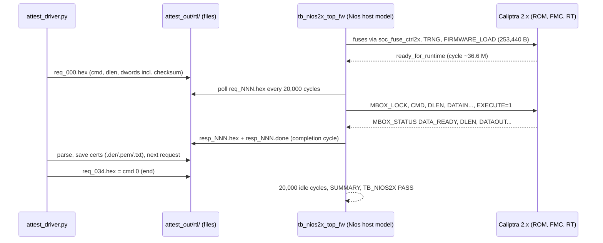

# Caliptra 2.x + Nios glue — Simulation Guide

> **Where the files are.** All paths in this guide are repo-relative ([pwilliam282/caliptra-a5e-quartus](https://github.com/pwilliam282/caliptra-a5e-quartus)):
> - 2.x glue RTL, sim, firmware, fuse script and Quartus project: [`caliptra2x/`](../../caliptra2x/) (`caliptra2x/rtl_2x/`, `caliptra2x/sim_2x/`, `caliptra2x/sim/`, `caliptra2x/fw_2x/`, `caliptra2x/scripts/`, `caliptra2x/quartus_a5e_2x/`)
> - Upstream RTL: `external/caliptra-rtl-2x/` = chipsalliance/caliptra-rtl v2.1.2 (`49370266`) with `submodules/adams-bridge` (`b77e3d8`), a pinned git submodule, unmodified. Fetch it with `scripts/get_caliptra_a5e.sh` or `git clone --recursive` + `scripts/fetch_deps.sh`. See [NIOS_CALIPTRA_2X_INTEGRATION.md §16](NIOS_CALIPTRA_2X_INTEGRATION.md#16-getting-the-sources).
> - Companion docs `P1_FIT_RESULT_2X_A5E.md` and `CALIPTRA_2X_INTEGRATION_PLAN.md`: this folder (`docs/caliptra-2x/`). The 1.x guide is [`docs/NIOS_CALIPTRA_INTEGRATION.md`](../NIOS_CALIPTRA_INTEGRATION.md).
>
> caliptra-sw is not vendored (only the built ROM/bundle in `caliptra2x/fw_2x/`).

- **Scope:** Verilator simulation of the **real** 2.x glue RTL (`caliptra2x/rtl_2x/`) around caliptra-rtl v2.1.2 (`49370266`) core-only. It runs the real ROM `rom-2.1.3-1` and the real FW bundle `fw-2.1.4` (FMC + runtime), and boots from cold power-on to `ready_for_runtime`.
- **Result:** **PASS**: `TB_NIOS2X PASS cyc=36617987 trng=217 (prod, debug locked)`.
- **Attestation and DPE:** `+test=attest` continues after `ready_for_runtime` with 34 runtime mailbox commands (DICE cert chain, `STASH_MEASUREMENT`, PCR quotes, DPE GetProfile/CertifyKey/GetCertificateChain): **PASS** at cycle 59,280,395, certificates byte-identical to the sw-emulator. See [§8](#8-rom-boot-firmware-load-attestation-and-dpe-in-simulation). What the Nios model covers: [§8.1](#81-what-this-simulation-covers-nios-model). Quick start: [§8.2](#82-quick-start-run-it-yourself).
- **Crypto exercise:** the same mode with `attest/crypto_driver.py` has Caliptra generate keys, sign and verify with ML-DSA-87 and ECDSA P-384, and verify LMS (31 commands, negative cases included, OpenSSL cross-check). Emulator: **CRYPTO PASS**; RTL: **CRYPTO PASS** (`TB_NIOS2X PASS cyc=82446678`, outputs match the emulator). EdDSA is not supported by Caliptra 2.x. See [§9](#9-crypto-exercise-ml-dsa-87-ecdsa-p-384-and-lms).
- **Crypto exercise 2:** `attest/crypto2_driver.py` covers SHA-384/512, SHAKE256, HMAC, AES-256 CBC/CTR/GCM, the SP 800-108 counter KDF, HKDF, ECDH P-384 and ML-KEM-1024 (100 commands, negative cases included, OpenSSL cross-check). Emulator: **CRYPTO2 PASS**; RTL not run yet. See [§10](#10-crypto-exercise-2-aes-sha-hmac-kdf-ecdh-ml-kem).
- **Attestation exercise 3:** `attest/attest3_driver.py` covers `EXTEND_PCR`, `INCREMENT_PCR_RESET_COUNTER`, `DPE_TAG_TCI`, `DPE_GET_TAGGED_TCI`, `CERTIFY_KEY_EXTENDED_ECC384`/`_MLDSA87` (X.509 and CSR), `CERTIFY_KEY_CHUNKS`, `ADD_SUBJECT_ALT_NAME`, `REALLOCATE_DPE_CONTEXT_LIMITS` and `DISABLE_ATTESTATION` (95 commands, 128 checks, negative cases included, OpenSSL cross-check). Emulator: **ATTEST3 PASS**; RTL not run yet. See [§11](#11-attestation-exercise-3-pcrs-dpe-tagging-certifykey-extended-san-context-limits-disable).
- **Attestation exercise 4:** `attest/attest4_driver.py` runs an end-to-end use case with `POPULATE_IDEV_ECC384_CERT`/`_MLDSA87_CERT` (vendor CA → IDevID → … → DPE leaf), `VERIFY_AUTH_MANIFEST`, `SET_AUTH_MANIFEST` and `AUTHORIZE_AND_STASH` (a real signed SoC auth manifest, stash into DPE and PCR31, 29 tampered or mis-signed manifests), and `SIGN_WITH_EXPORTED_ECDSA`/`_MLDSA` and `REVOKE_EXPORTED_CDI_HANDLE` (161 commands, 164 checks, OpenSSL cross-check). Emulator: **ATTEST4 PASS**; RTL not run yet. See [§12](#12-attestation-exercise-4-idevid-provisioning-soc-image-authorization-exported-cdi-signing).
- **Related:** [NIOS_CALIPTRA_2X_INTEGRATION.md](NIOS_CALIPTRA_2X_INTEGRATION.md) (design), [FIRMWARE_AND_KEYS_2X.md](FIRMWARE_AND_KEYS_2X.md) (ROM, bundle, fuse image). The raw record is in `caliptra2x/sim_2x/BOOT_NIOS2X.md` and `caliptra2x/sim_2x/nios2x_top_fw_run.log`.

---

## 1. What is simulated

| Part | Real RTL or model |
|---|---|
| `nios_caliptra2x_top` (window decode, `soc_fw_store`, `soc_fuse_ctrl2x`, `avmm_to_axi`, AXI write mux, 2FF reset syncs, straps) | **Real** (`caliptra2x/rtl_2x/`) |
| `caliptra_passive_top` + `caliptra_top` v2.1.2 (VeeR, soc_ifc, crypto, Adams-Bridge, memories) | **Real** (`external/caliptra-rtl-2x/`, `caliptra2x/rtl_2x/caliptra_passive_top.sv`) |
| Caliptra ROM / FMC / runtime | **Real** binaries: `caliptra2x/fw_2x/caliptra-rom.hex`, `caliptra2x/fw_2x/caliptra-fw-bundle.hex` |
| Fuse image | **Real** generator output: `caliptra2x/fw_2x/fuse_image_2x.hex` |
| Agilex Reset Release IP | Stub `caliptra2x/sim/rst_release_stub.sv` (`ninit_done` = 1 for 25 ns) |
| Platform Designer system `nios_caliptra2x_sys` (Nios V + PIOs + window) | **Behavioral model** `module nios_caliptra2x_sys` in `tb_nios2x_top_fw.sv`. Ports: `clk_clk`, `reset_reset_n`, `caliptra_axi_address[19:0]`, `_read`, `_write`, `_writedata[31:0]`, `_byteenable[3:0]` (always `4'hF`), `_readdata[31:0]`, `_readdatavalid`, `_waitrequest`, `_burstcount`, `_debugaccess`, `ctrl_pio_export[31:0]` (out, initialized to 0), `status_pio_export[31:0]` (in), `magic_pio_export[31:0]` (out, initialized to 0). It issues the Avalon accesses the 2.x Nios firmware is meant to issue |

The Nios V CPU, Platform Designer interconnect and C firmware are **not** in this sim. Compare the 1.x sim, which also used a behavioral host. §8.1 describes what the attestation run covers and what it does not, and the next step that would exercise the real Nios V.

---

## 2. Tools and inputs

| Item | Value |
|---|---|
| Simulator | **Verilator 5.054** (2026-11-01, conda-forge build), on `PATH` (set `VERILATOR_BIN=<dir>` to prepend a specific install; the build box used a conda env). Verilator 5.040 also works with the fixes in §7 |
| C++ compiler | Verilator's `--timing` support needs C++20 coroutines. GCC 13 or newer and clang work as is. **GCC 10–12 need `-fcoroutines`**: the run scripts call `scripts/verilator_cflags.sh`, which adds `-CFLAGS -fcoroutines` automatically when `${CXX:-c++}` is GCC 10–12. Override with `VERILATOR_CFLAGS="…"` (empty to pass nothing) or pick a compiler with `CXX=…` |
| Build flags (`run_nios2x_top_fw.sh`) | `--binary --threads ${THREADS:-4} -j 8 -O3 -Wno-fatal -Wno-lint -Wno-style -Wno-UNOPTFLAT -Wno-MULTIDRIVEN -Wno-TIMESCALEMOD --top-module tb_nios2x_top_fw -Mdir obj_nios2x -f boot2x.f -o Vtb_nios2x` |
| Caliptra RTL | `external/caliptra-rtl-2x/` = v2.1.2 `49370266d12cb0c4a8f71b3a0ff7e54ba7d4866e`, with submodule `adams-bridge` `b77e3d8`. Pinned git submodule; run `scripts/fetch_deps.sh` (or clone with `--recursive`) |
| File list | `caliptra2x/sim_2x/boot2x.f` (641 lines): `+incdir+` paths and 588 caliptra-rtl source files (`../../external/caliptra-rtl-2x/...`, relative to `caliptra2x/sim_2x/`), plus the repo files listed below |
| Repo sources in the file list | `caliptra2x/sim_2x/patches/decompress_top.sv`, `caliptra2x/rtl_2x/caliptra_veer_sram_export.sv`, `caliptra2x/rtl_2x/caliptra_passive_top.sv`, `caliptra2x/sim/rst_release_stub.sv`, `caliptra2x/rtl_2x/reset_sync.sv`, `caliptra2x/rtl_2x/avmm_to_axi.sv`, `caliptra2x/rtl_2x/soc_fuse_ctrl2x.sv`, `caliptra2x/rtl_2x/soc_fw_store.sv`, `caliptra2x/rtl_2x/nios_caliptra2x_top.sv`, `caliptra2x/sim_2x/tb_nios2x_top_fw.sv` |
| Verilator patch | `caliptra2x/sim_2x/patches/decompress_top.sv` replaces the adams-bridge original. It passes the `abr_piso_multi` rate arrays as indexed patterns with a default (`'{0:64, 1:64, 2:64, 3:64, default:0}` and `'{0:4, 1:20, 2:44, 3:48, default:0}`), so it elaborates whether a Verilator version sizes the array from `NUM_MODES` (4) or from the module default (5). Earlier 4-entry positional patterns failed on Verilator 5.040 with `Assignment pattern missed initializing elements: 4`; fixed in `bc3a381` |
| Data files (via RTL parameter defaults, relative to `caliptra2x/sim_2x/`) | `../fw_2x/caliptra-rom.hex`, `../fw_2x/caliptra-fw-bundle.hex`, `../fw_2x/fuse_image_2x.hex` |

All paths in `caliptra2x/sim_2x/boot2x.f` are relative to `caliptra2x/sim_2x/` (the run script `cd`s there): repo files as `../rtl_2x/…`, upstream RTL as `../../external/caliptra-rtl-2x/…`. The checkout can live anywhere; no path rewriting is needed.

---

## 3. Build and run

**Run long sims detached.** A full boot takes about 1.4 h of wall time, and a foreground shell or agent session can be interrupted.

```bash
scripts/fetch_deps.sh            # once, from the repo root: external/caliptra-rtl-2x must be present
cd caliptra2x/sim_2x
# build (~6 min) + run, detached; output in nios2x_top_fw_run.log, wrapper output in run.out
nohup setsid ./run_nios2x_top_fw.sh +test=all > run.out 2>&1 &

# re-run without rebuilding
BUILD=0 nohup setsid ./run_nios2x_top_fw.sh +test=all > run.out 2>&1 &

# watch progress
tail -f nios2x_top_fw_run.log          # LOG lines, TRNG services, heartbeats, milestones
grep -E 'MILESTONE|PASS|FAIL|TIMEOUT' nios2x_top_fw_run.log
```

| Env var | Default | Meaning |
|---|---|---|
| `BUILD` | `1` | `0` skips the Verilator build |
| `THREADS` | `4` | Verilator `--threads` |
| `VERILATOR_BIN` | unset | Directory prepended to `PATH` if set; otherwise `verilator` from `PATH` |
| `LOG` | `nios2x_top_fw_run.log` | Sim log file name (the attestation flow uses `LOG=attest_run.log`) |

- The script runs the binary under `stdbuf -oL -eL`, so the log is line-buffered and `tail -f` works. When the run ends, it appends `wall_time_s=<s> end <date>`.
- **Measured costs** on this box:
  - Build: Verilator walltime **358 s** (elab 4.9 s, convert 204.8 s, C++ build 143.9 s); 2,185 MB allocated; 134 C++ files.
  - Run: **5,069 s wall (1 h 24 m 29 s)** in the wrapper. Verilator reported walltime 4,452.7 s, cpu 17,793.6 s on 4 threads, 18 MB allocated, about 82 µs of sim time per wall second.

### 3.1 Plusargs

| Plusarg | Default | Effect |
|---|---|---|
| `+test=axiuser` | — | Cold release, `ready_for_fuses`, AxUSER programming, then the AxUSER checks (§4.1), then `$finish`. Takes a few hundred cycles |
| `+test=prod` | — | Cold boot to `ready_for_runtime` **without** the AxUSER checks |
| `+test=all` | **default** | AxUSER checks, then the prod cold boot. **Not** a multi-boot suite: there is no warm or fatal second boot, unlike 1.x `+test=all` |
| `+test=attest` | — | Prod cold boot, then the file-driven runtime mailbox loop for `attest/attest_driver.py` (§8) |
| `+attest_dir=DIR` | `attest_out/rtl` | Folder for the `req_NNN.hex` / `resp_NNN.hex` protocol files (`+test=attest`) |
| `+max_cycles=N` | 300,000,000 | Prints `TB_NIOS2X TIMEOUT magic=… trng=…` and stops |
| `+hb=N` | 1,000,000 | Heartbeat line period: `[cyc] heartbeat status=<pio[7:0]> trng=<n>` |

The TB clock is 100 MHz (`always #5`), so 1 cycle = 10 ns of sim time. `$finish` at 366 ms equals 36.6 M cycles.

---

## 4. What the testbench checks

### 4.1 AxUSER test (`test_axiuser`, run by `axiuser` and `all`)

This runs after the host programs and locks the AxUSERs (fuse = 2, TRNG = 1, mailbox[0] = 1). The TB `force`s `dut.nios_axi_user` and reads the bridge's `err_q` (SLVERR).

| Access | AxUSER | Expected | Result (log) |
|---|---|---|---|
| Write `MBOX_LOCK` | 3 | SLVERR | `[115] MBOX write AxUSER=3 -> SLVERR OK` |
| Write `FUSE_UDS_SEED[0]` | 3 | SLVERR | `[121] fuse write AxUSER=3 -> SLVERR OK` |
| Write `FUSE_UDS_SEED[0]` | 1 (Nios) | SLVERR (only user 2 may touch fuses) | `[127] … SLVERR OK` |
| Read `CPTRA_HW_REV_ID` | 1 | Accepted | `[132] AxUSER=1 HW_REV_ID=00000212 accepted OK` → `TB_AXIUSER PASS` |

### 4.2 Boot checks (`prod`, `all`)

| Check | FAIL message if it fails |
|---|---|
| `generic_input_wires === 0` | `TB_NIOS2X FAIL generic_input_wires` |
| Fuse ctrl ID = `0x46555345` | `FAIL fuse id` |
| Fuse ctrl ends DONE, not ERR | `FAIL fuse ctrl ERR (SLVERR on a fuse write?)` |
| Fuse ctrl `COUNT == 118` (104 fuse + 13 owner hash/lock + WR_DONE) | `FAIL expected COUNT=118 …` |
| `CPTRA_FUSE_WR_DONE[0] == 1` | `FAIL FUSE_WR_DONE not set` |
| `CPTRA_OWNER_PK_HASH_LOCK[0] == 1` | `FAIL owner PK hash not locked` |
| `MBOX_USER == 1` after the lock is acquired | `FAIL MBOX_USER` |
| `MBOX_STATUS == 2` (CMD_COMPLETE) after FIRMWARE_LOAD | `FAIL mbox status` (plus a register dump) |
| No `cptra_error_fatal` at any time | `FAIL unexpected cptra_error_fatal` (plus a dump) |
| `etrng_req` drops within 100,000 cycles after each `DATA_WR_DONE` | `FAIL etrng_req stuck …` |
| `ready_for_runtime` before `max_cycles` | `TIMEOUT` |

The TB also **prints, without checking**: `HW_REV_ID`, `HW_CONFIG`, `CPTRA_SECURITY_STATE`, `FUSE_PQC_KEY_TYPE` readback, `CPTRA_OWNER_PK_HASH[0]`, and a final dump of BOOT/FLOW status and all four error registers.

**PASS criteria:** every check above holds, `ready_for_runtime` is reached, and then 20,000 more cycles run with no fatal error. The TB prints `SUMMARY …` and `TB_NIOS2X PASS cyc=<n> trng=<n> (prod, debug locked)`.

### 4.3 The `FUSE_PQC_KEY_TYPE readback=00000000` quirk

- The image writes `FUSE_PQC_KEY_TYPE = 1` at `0x3038C` (line 91 of the 117-line image, written by the fuse ctrl with AxUSER 2). The TB reads it back **as the Nios (AxUSER 1)** and gets `00000000`.
- **Cause:** in caliptra-rtl `soc_ifc_arb.sv`, `soc_reg_req` for addresses in `SOC_IFC_FUSE_START_ADDR..SOC_IFC_FUSE_END_ADDR` (`0x30200–0x305FF`) requires `valid_fuse_user`. After `CPTRA_FUSE_AXI_USER_LOCK` = 1, that means AxUSER == 2. The Nios read therefore never reaches the register block, and the read data is 0.
- The same `valid_fuse_user` gate rejects the AxUSER 1 and AxUSER 3 fuse *writes* with SLVERR in §4.1. The TB does not check the bridge error flag on this read, so whether that read also returned SLVERR was not recorded.
- **Proof the fuse was effective:** in Production lifecycle, the ROM compares the manifest PQC type with this fuse and would fail with `IMAGE_VERIFIER_ERR_PQC_KEY_TYPE_MISMATCH`. Instead it logged `[fwproc] Img verified ecc=0 MLDSA=0 svn=0 fuse_svn=0` at cycle 17,010,257.
- By contrast, `CPTRA_OWNER_PK_HASH*` (`0x30140`/`0x30170`) and `CPTRA_FUSE_WR_DONE` (`0x300B0`) are outside the fuse range, so the Nios read them back correctly.
- To read the fuse values back for debugging, issue the reads with AxUSER 2 (for example, add a read path to `soc_fuse_ctrl2x`) or before `CPTRA_FUSE_AXI_USER_LOCK` is set.

### 4.4 Log channel

- The ROM, FMC and runtime print through `generic_output_wires[7:0]`, with bit 8 toggling per character.
- The TB top assembles lines and prints them as `[cycle] LOG <text>`.
- It records the first `[fmc` / `[alias rt` line as `rom_to_fmc` and the first `[rt]` line as `fmc_to_rt`.

---

## 5. Measured results (`+test=all`, PID 227528, 2026-11-10)

Environment:
- Start 13:53:45 CST, end 15:18:14 CST.
- `HW_REV_ID = 00000212`.
- `HW_CONFIG = 00000010` (`iTRNG_en=0`, `SUBSYSTEM_MODE_en=0`).
- `CPTRA_SECURITY_STATE = 00000007` (lifecycle 3 = Production, debug_locked = 1).

| Cycle | Event (from `nios2x_top_fw_run.log`) |
|---:|---|
| 40 | `MILESTONE ready_for_fuses` |
| 132 | `TB_AXIUSER PASS` |
| 136 | `FUSE_CTRL NUM_FUSES=117` (START follows) |
| 614 | `FUSE_CTRL STATUS=00000002 COUNT=118` |
| 619 | `FUSE_WR_DONE=00000001`; `FUSE_PQC_KEY_TYPE readback=00000000` (§4.3); `OWNER_PK_HASH_LOCK=00000001`; `OWNER_PK_HASH[0]=48afdb07` |
| 634 | `MILESTONE fuses done via soc_fuse_ctrl2x (COUNT=118)` |
| 378,838 | `Running Caliptra ROM ...` |
| 379,157 | First TRNG request serviced |
| 384,577 | `[state] Starting the WD Timer 100000000 cycles` |
| 442,177 / 445,304 | `LifecycleState = Production` / `DebugLocked = Yes` |
| 794,349 | `ROM Digest: AB0AEDDBE4F660DC3CDB6F3221DCE2ADA1F6D0593A403B0B12D9EB5CC5C632EB` |
| 5,524,388 | `[kat] --` (ROM KATs done) |
| 5,542,288 | `MILESTONE ready_for_mb_processing trng=21` |
| 6,049,774 | `MILESTONE FIRMWARE_LOAD issued, 253440 bytes from soc_fw_store` |
| 14,288,568 | `[fwproc] Recv command 0x46574c44` |
| 17,010,257 | `[fwproc] Img verified ecc=0 MLDSA=0 svn=0 fuse_svn=0` |
| 17,085,903 | `Load FMC at address 0x40000000 len 30760` |
| 17,304,364 | `Load Runtime at address 0x40008000 len 205516` |
| 21,319,080 | `MILESTONE MBOX_STATUS=2 (2=CMD_COMPLETE)` |
| 27,820,645 | `[exit] Launching FMC @ 0x40000000` |
| 27,875,426 | `Running Caliptra FMC ...` |
| 30,035,513 | First FMC log line (ROM → FMC) |
| 36,003,133 | `Caliptra RT` (RT KATs incl. MLKEM1024 follow) |
| 36,217,560 | First RT log line `[rt] OCP LOCK Unsupported` (FMC → RT) |
| 36,596,602 | `[rt] Disable entropy source` |
| 36,597,923 | `[rt] RT listening for mailbox commands...` |
| **36,597,957** | **`MILESTONE ready_for_runtime`** |
| 36,617,987 | `TB_NIOS2X PASS cyc=36617987 trng=217 (prod, debug locked)` |

**Summary line:** `SUMMARY ready_for_fuses=40 fuses_done=614 first_trng=379157 ready_for_mb_processing=5542288 fw_load_issued=6049774 mbox_complete=21319080 rom_to_fmc=30035513 fmc_to_rt=36217560 ready_for_runtime=36597957 trng_fills=217 fuse_writes=118`

**Final dump:** `CPTRA_BOOT_STATUS=00000000`, `CPTRA_FLOW_STATUS=b8000000`, `HW_ERROR_FATAL = FW_ERROR_FATAL = HW_ERROR_NON_FATAL = FW_ERROR_NON_FATAL = 00000000`.

**Not covered by this run:** warm reset (START_DONE), fatal-error pwrgood recovery, mailbox commands after runtime (see §8 for the `+test=attest` run that covers them), the real Nios V / PD interconnect, and the A5E Reset Release IP model.

---

## 6. Waveforms

**The 2.x TB does not dump waveforms as built.** `boot2x.f` / `run_nios2x_top_fw.sh` do not pass `--trace`/`--trace-fst` (the build log shows `-DVM_TRACE=0 -DVM_TRACE_FST=0`), and `tb_nios2x_top_fw.sv` has no `$dumpfile`/`$dumpvars`.

To get waves (untested for 2.x; a full 36.6 M-cycle dump of the whole design would be very large and much slower):

1. Add `--trace-fst --trace-structs` (optionally `--trace-depth 3`) to the `verilator` line in `run_nios2x_top_fw.sh`.
2. In `module tb_nios2x_top_fw`, add a windowed dump so only the interesting part is recorded, for example around the fuse push:
   ```systemverilog
   initial begin
     $dumpfile("nios2x.fst");
     $dumpvars(2, tb_nios2x_top_fw.dut);   // glue level; raise depth for Caliptra internals
     #20us $dumpoff;                         // fuses + start of ROM; move/extend as needed
   end
   ```
3. Rebuild (`BUILD=1`) and run with a smaller `+max_cycles` if you only need the beginning.
4. View with GTKWave: `gtkwave caliptra2x/sim_2x/nios2x.fst`. Useful signals:
   - `dut.status_in[7:0]`, `dut.ctrl_out[2:0]`, `dut.cptra_pwrgood`, `dut.cptra_rst_b`
   - `dut.fuse_busy`, `dut.u_fuse_ctrl.st`, `dut.u_fuse_ctrl.idx`
   - `dut.awaddr`, `dut.awuser`, `dut.awvalid`/`awready`, `dut.bresp`, `dut.u_bridge.st`, `dut.u_bridge.err_q`
   - `dut.etrng_req`, `dut.generic_output_wires[8:0]`

The 1.x project's waveform flow (FST + GTKWave screenshots) is in the 1.x repo history; this guide makes no claim that it has been redone for 2.x.

---

## 7. Troubleshooting

| Symptom | Likely cause |
|---|---|
| `FAIL fuse ctrl ERR` / `COUNT` < 118 | A fuse write got SLVERR: fuse AxUSER not programmed/locked to 2 before START, or a bad address in the image |
| `FAIL etrng_req stuck` | TRNG AxUSER not 1/locked, or `DATA_WR_DONE` (2) not written |
| ROM fatal around image verification | Fuse image doesn't match the bundle: regenerate with `caliptra2x/scripts/gen_fuse_image_2x.py` after every bundle rebuild ([FIRMWARE_AND_KEYS_2X.md §5](FIRMWARE_AND_KEYS_2X.md)) |
| Mailbox command rejected / `0x01020009` | Mailbox used with the reserved AxUSER `0xFFFFFFFF` or an unlocked user (see the integration plan) |
| Build: `coroutine header requires -fcoroutines`, `'coroutine_handle' in namespace 'std' does not name a template type` (in `verilated_timing.h`) | Host GCC is 10–12 and the flag was not added (Verilator calls a different compiler than `${CXX:-c++}`). Run with `VERILATOR_CFLAGS=-fcoroutines ./run_nios2x_top_fw.sh …`, or `CXX=/path/to/g++-13`. Then `rm -rf obj_nios2x` and rebuild |
| Build: `Vtb_nios2x_top_fw__pch.h.fast` (or `.slow`): `linker input file not found` on every `.o` | The site Verilator was configured with an empty `CFG_CXXFLAGS_PCH_I`, so the precompiled header is passed as a bare file instead of `-include`. `scripts/verilator_cflags.sh` now adds `-MAKEFLAGS CFG_CXXFLAGS_PCH_I=-include` for GCC (disable with `VERILATOR_PCH_FIX=0`). `git pull`, `rm -rf obj_nios2x`, rebuild |
| Link: `undefined reference to 'pthread_create'` / `pthread_setaffinity_np` in `verilated_threads.o` | Site Verilator configured without `CFG_LDLIBS_THREADS`. `scripts/verilator_cflags.sh` now adds `-CFLAGS -pthread -LDFLAGS -pthread -LDFLAGS -lpthread` (disable with `VERILATOR_PTHREAD_FIX=0`). `git pull`, `rm -rf obj_nios2x`, rebuild |
| Build: `decompress_top.sv:84: Assignment pattern missed initializing elements: 4` | Old copy of `patches/decompress_top.sv` from before `bc3a381`; `git pull` and rebuild |
| `TIMEOUT` with no progress | Check heartbeats (`status=` bits) and `trng=` count; the run is long (≈ 36.6 M cycles) |

---

## 8. ROM boot, firmware load, attestation and DPE in simulation

This flow runs the same cold boot as §3 (real ROM `rom-2.1.3-1`, real FW bundle `fw-2.1.4`, production straps, debug locked), then keeps the runtime alive and acts as the Nios host: it sends **34 runtime mailbox commands** that dump the full DICE certificate chain, stash a Nios measurement, quote the PCRs and drive DPE. It is the `+test=attest` mode of `tb_nios2x_top_fw.sv`. The detailed record (command payloads, certificate decode, measurement path) is [`caliptra2x/sim_2x/ATTEST_2X.md`](../../caliptra2x/sim_2x/ATTEST_2X.md).

**Reference result (RTL, Verilator 5.054, 2026-11-10):** `TB_NIOS2X PASS cyc=59280395 trng=379 (prod, debug locked)`. All 34 commands returned `DATA_READY` with `fwerr=00000000` and a valid checksum. Every certificate is **byte-identical** to the caliptra-sw sw-emulator run, and both the ECC P-384 and ML-DSA-87 chains verify strictly with `openssl verify` up to a TEST manufacturing CA.

### 8.1 What this simulation covers (Nios model)

The design under the Nios is the **real** RTL you would compile in Quartus: `caliptra2x/rtl_2x/nios_caliptra2x_top.sv`. That includes:

- the window decode
- `soc_fw_store`, which holds the 253,440-byte firmware bundle
- the `soc_fuse_ctrl2x` fuse controller
- the `avmm_to_axi` bridge, the AXI write-channel mux, and the 2FF reset synchronizers
- `caliptra_passive_top`
- unmodified Caliptra 2.x **v2.1.2** RTL, running the real ROM **2.1.3** and the FMC and runtime firmware **2.1.4**

The Platform Designer system `nios_caliptra2x_sys` — the Nios V CPU, its on-chip RAM, the JTAG UART and the PIOs — is **not** simulated as RTL. In its place is a behavioral SystemVerilog module of the same name and ports, in `tb_nios2x_top_fw.sv`. It drives the Avalon window directly with read and write tasks, following the same register sequence as the Nios firmware:

- AxUSER, timer and watchdog setup
- fuse programming through the fuse controller
- TRNG service
- `FIRMWARE_LOAD` over the mailbox
- the 34 runtime mailbox commands, which come from `attest/attest_driver.py`

So the bus traffic Caliptra sees matches what the firmware should produce, but no Nios instructions execute. This run does **not** cover Nios V instruction execution, the 2.x `caliptra2x/quartus_a5e_2x_nios/sw/app/main.c` or `onchip_mem.hex`, or the JTAG UART. TRNG data is testbench `$urandom` (not a real entropy source). All keys are TEST/STUDY values. DPE Sign is not exercised.

**Reference result.** `TB_NIOS2X PASS` at 59,280,395 cycles. All 34 mailbox commands returned status OK (`DATA_READY`, `fwerr=0`). There were no fatal or non-fatal errors. All 17 certificates were byte-identical to the caliptra-sw emulator. The three `QUOTE_PCRS` digest/signature values differ only because the emulator hashes the nonce in the opposite word order (see §8.8); that is not an RTL failure.

| Milestone | Cycle |
|---|---:|
| Fuses done | 611 |
| `ready_for_mb_processing` | 5,542,265 |
| `FIRMWARE_LOAD` issued | 6,049,751 |
| Firmware load complete | 21,319,057 |
| ROM → FMC | 30,035,490 |
| FMC → RT | 36,217,537 |
| `ready_for_runtime` | 36,597,934 |

The later mailbox-command cycles are in the §8.4 table.

To close the gap and exercise the real Nios V and the 2.x `onchip_mem.hex`, the next step is a co-simulation that uses the Platform Designer simulation files for `nios_caliptra2x_sys` in place of the behavioral module. That will likely need Questa rather than Verilator, because the Nios V simulation model is typically encrypted.

### 8.2 Quick start: run it yourself

**Prerequisites.** Verilator 5.x (5.040 is fine), GCC, Python 3 and OpenSSL 3 (ideally ≥ 3.5, for ML-DSA-87) on `PATH`. On GCC 10–12 (for example SLES15 with GCC 12.2), set `export VERILATOR_CFLAGS=-fcoroutines`. The run script also applies the PCH and `-pthread` fixes in `scripts/verilator_cflags.sh` automatically (§7). You need a clone with the `external/caliptra-rtl-2x` submodule fetched.

```bash
# 1. Get the repo with its submodules (pinned 2.x RTL).
git clone --recursive https://github.com/pwilliam282/caliptra-a5e-quartus.git
cd caliptra-a5e-quartus
# If you already have a clone:
#   git pull && git submodule update --init --recursive

# 2. Start the sim. The first run builds first (a few minutes).
cd caliptra2x/sim_2x
rm -rf attest_out/rtl && mkdir -p attest_out/rtl
export VERILATOR_CFLAGS=-fcoroutines
LOG=attest_run.log nohup setsid ./run_nios2x_top_fw.sh +test=attest +max_cycles=4000000000 > attest_run.out 2>&1 &
# Optional: VERILATOR_BIN=/path/to/verilator/bin  (if verilator is not on PATH)
#           THREADS=8                               (if you have the cores)
#           BUILD=0                                 (skip the rebuild)

# 3. Start the mailbox driver in the same folder, right after the sim.
nohup setsid python3 attest/attest_driver.py attest_out/rtl > attest_out/rtl_driver.log 2>&1 &

# 4. Watch the progress.
grep -E 'MILESTONE|ATTEST (phase|resp|done)|PASS|FAIL|TIMEOUT' attest_run.log
# Expect the fuse / ROM / firmware-load / FMC / runtime milestones, then 34
# 'ATTEST resp ... status=1' lines, ending with TB_NIOS2X PASS at about
# 59.3 M cycles (~8–9 h wall time on a typical 4-thread box).

# 5. Check the result (after TB_NIOS2X PASS).
python3 attest/analyze.py attest_out/rtl attest_ref/emu
# Expect ANALYZE PASS, 17 matching certificates, and one expected
# QUOTE_PCRS raw-response warning (the emulator nonce-order bug, §8.8).
```

Certificates and raw responses land in `attest_out/rtl/`. The default `+max_cycles` (300 M) covers the 59.3 M-cycle run, but the TB keeps clocking while it waits for the driver, so use `4000000000` so a late or slow driver never trips `TIMEOUT`. Keep the `attest_out/rtl` path the same for the TB (`+attest_dir=…`, default `attest_out/rtl`) and the driver.

**Troubleshooting (short).** Build errors: look in `nios2x_build.log` (and §7 / §8.9). If the driver stops with a timeout (it waits at most six hours for any single response, for example if the machine slept), just rerun step 3; the sim picks up where it left off. More symptoms are in §8.9.

**Other inputs already in the clone.**

| Item | Notes |
|---|---|
| Sources | `git clone --recursive` (or `git submodule update --init --recursive`) fetches `external/caliptra-rtl-2x`. You can also run `scripts/fetch_deps.sh` or `scripts/get_caliptra_a5e.sh` from the repo root |
| ROM / FW bundle / fuses | Prebuilt and committed: `caliptra2x/fw_2x/caliptra-rom.hex`, `caliptra-fw-bundle.hex`, `fuse_image_2x.hex` (checksums in `caliptra2x/fw_2x/SHA256SUMS`). To rebuild them, see [FIRMWARE_AND_KEYS_2X.md](FIRMWARE_AND_KEYS_2X.md). If you rebuild, the certificates change and will not match `attest_ref/` |
| TEST mfg CA | Committed in `caliptra2x/sim_2x/attest/testca/`: CA certificates plus the IDevID TBS/certs cached by IDevID public key. With the committed fuses **no private key is needed**. The CA `*.key` files are never committed; see §8.8 to make a new local CA |

### 8.3 How it works



The Nios host in this diagram is the behavioral model described in §8.1.

- The testbench and the Python driver talk through files in `+attest_dir` (default `attest_out/rtl`, relative to `caliptra2x/sim_2x/`). The driver builds every request (header checksum `0 − Σ bytes`, DPE packets, IDevID TBS) and decodes every response. The TB only does the Nios register sequence, so the same driver also runs against the sw-emulator (`attest/emu/attest_emu.rs`).
- Start the driver together with the sim. It waits for `resp_NNN.done` (up to 6 h per command), and it deletes stale `req_*`/`resp_*` files from an earlier run when it starts.
- The TB keeps servicing `etrng_req` (TRNG) and checking `cptra_error_fatal` while it waits.

### 8.4 What each phase does and what to expect in the log

Cycle numbers are from the reference run (`attest_ref/rtl_tb_run.log`); a rerun should match within a few hundred cycles (TRNG timing). The boot milestones through `ready_for_runtime` are also summarized in §8.1.

| Phase | What happens | Expected log line(s) | Cycle |
|---|---|---|---:|
| Power-on, fuses | Cold release; Nios programs and locks AxUSERs (fuse = 2, TRNG = 1, mailbox = 1); `soc_fuse_ctrl2x` writes 117 fuse words + owner PK hash/lock + `FUSE_WR_DONE` | `MILESTONE ready_for_fuses`, `FUSE_CTRL STATUS=00000002 COUNT=118`, `MILESTONE fuses done via soc_fuse_ctrl2x (COUNT=118)` | 40 / 611 |
| ROM boot | ROM starts, takes TRNG from the host, checks lifecycle (Production, debug locked), runs KATs, derives IDevID/LDevID (ECC + ML-DSA) | `LOG Running Caliptra ROM ...`, `TRNG request 1 serviced`, `LOG LifecycleState = Production`, `MILESTONE ready_for_mb_processing trng=21` | 5,542,265 |
| FIRMWARE_LOAD | Nios streams the 253,440-byte bundle from `soc_fw_store` into the mailbox (`FWLD`); ROM verifies the manifest (vendor ECC+ML-DSA keys, owner key, PQC type, SVN) and loads FMC + RT | `MILESTONE FIRMWARE_LOAD issued, 253440 bytes`, `LOG [fwproc] Img verified ecc=0 MLDSA=0 …`, `MILESTONE MBOX_STATUS=2 (2=CMD_COMPLETE)` | 6,049,751 / 21,319,057 |
| ROM → FMC | ROM builds the LDevID→FMC Alias certs and jumps to FMC | `MILESTONE first FMC log line (ROM -> FMC handoff)` | 30,035,490 |
| FMC → RT | FMC derives the RT Alias, launches the runtime; RT runs KATs, initializes DPE (default context) | `MILESTONE first RT log line (FMC -> RT handoff)`, `LOG [rt] RT listening for mailbox commands...` | 36,217,537 |
| Runtime ready | `ready_for_runtime`; the TB enters the attestation loop | `MILESTONE ready_for_runtime`, `=== ATTEST phase: waiting for requests in attest_out/rtl ===` | 36,597,934 |
| Firmware info, identity keys | `FW_INFO`, `GET_IDEV_ECC384_INFO`, `GET_IDEV_MLDSA87_INFO` | `ATTEST req 0 cmd=494e464f ('INFO')` … `ATTEST resp 2 status=1 dlen=2600` | 36,624,580 – 36,739,042 |
| Cert chain | `GET_LDEV_*_CERT`, `GET_FMC_ALIAS_*_CERT`, `GET_RT_ALIAS_*_CERT` (ECC P-384 and ML-DSA-87) | `ATTEST req 3 … ('LDEV')` … `ATTEST resp 8` | 36,789,582 – 37,387,350 |
| PCR quote (before) | `QUOTE_PCRS_ECC384` with nonce 1; PCR31 = 0 | `ATTEST req 9 … ('PCRQ')` | 38,327,090 |
| DPE (ECC) | `INVOKE_DPE_ECC384` **GetProfile** (0x01), **CertifyKey** (0x09, default context, X.509) | `ATTEST req 10/11 … ('DPEC')` | 38,375,977 / 42,659,941 |
| Measurement | `STASH_MEASUREMENT` of the Nios image digest M (tag `NIOS`, svn 1): extends PCR31 and runs a DPE **DeriveContext** (make-default, locality = AxUSER 1) inside Caliptra | `ATTEST req 12 … ('MEAS')`, `LOG [rt] Received command=0x4d454153 (MEAS)` | 42,720,549 |
| PCR quote + DPE (after) | `QUOTE_PCRS_ECC384` nonce 2 (PCR31 = SHA-384(0⁴⁸‖M)); `CertifyKey` again (leaf now has TCB `NIOS`); **GetCertificateChain** (0x10) ×2 (2,586 B) | `ATTEST req 13 … 16` | 43,660,293 – 48,097,509 |
| DPE (ML-DSA) | `INVOKE_DPE_MLDSA87` GetProfile, CertifyKey, GetCertificateChain ×12 (23,658 B), `QUOTE_PCRS_MLDSA87` | `ATTEST req 17 … ('DPEM')` … `req 31 … ('PCRM')` | 48,765,037 – 58,932,857 |
| IDevID certs | Driver signs the IDevID TBS with the TEST mfg CA; `GET_IDEV_ECC384_CERT` / `GET_IDEV_MLDSA87_CERT` assemble the certs | `ATTEST req 32 … ('IDEC')`, `req 33 … ('IDMC')` | 58,991,424 / 59,240,360 |
| End | Driver writes cmd 0; TB idles 20,000 cycles, dumps status and error registers (all 0) | `ATTEST done, 34 commands`, `SUMMARY …`, **`TB_NIOS2X PASS cyc=59280395 trng=379 (prod, debug locked)`** | 59,280,395 |

The longest commands are the two ECC `CertifyKey` calls (≈ 4.3 M cycles each) and ML-DSA `CertifyKey` (≈ 1.3 M cycles). The driver log shows each command as `[driver]   -> status=1 len=… fwerr=00000000 chk=True`, ending with `[driver] done, 34 commands`.

**DPE commands exercised:** GetProfile, CertifyKey (before and after the stash), GetCertificateChain, plus DeriveContext through `STASH_MEASUREMENT`. InitializeContext is done by the runtime at boot (default context). DPE **Sign**, an explicit DeriveContext/RotateContext/DestroyContext, `CERTIFY_KEY_EXTENDED` and exported CDIs are **not** issued by this testbench.

### 8.5 Outputs

| Path (under `caliptra2x/sim_2x/`) | Content |
|---|---|
| `attest_run.log` | Sim log: milestones, ROM/FMC/RT `LOG` lines, `ATTEST req/resp` per command, `SUMMARY`, PASS line, Verilator stats, `wall_time_s` |
| `attest_out/rtl/req_NNN.hex`, `resp_NNN.hex`, `resp_NNN.done` | Raw protocol files (`.done` = completion cycle) |
| `attest_out/rtl/resp_NNN_<name>.bin` | Raw response bytes per command |
| `attest_out/rtl/{idevid,ldevid,fmc_alias,rt_alias}_{ecc384,mldsa87}.{der,pem,txt}` | DICE certificate chain (both algorithms) |
| `attest_out/rtl/dpe_{ecc,mldsa}_leaf_*.{der,pem,txt}`, `dpe_*_chain_N.*`, `dpe_*_cert_chain.bin` | DPE leaves and the DPE GetCertificateChain output |
| `attest_out/rtl/attest_summary.json` | Measurement, nonces, quotes (PCRs, digest, signature), per-command log |
| `attest_out/rtl/analysis.json` | Written by `analyze.py`: decoded DICE extensions, verification, compare |
| `attest_ref/{rtl,emu}/` | Committed reference results (RTL run and sw-emulator run) |

`attest_out/`, `attest_run.log` and `attest_run.out` are git-ignored.

### 8.6 Verify the certificate chain

`analyze.py` does all of the following and prints `ANALYZE PASS` (exit 0) or `ANALYZE FAIL: …` (exit 1). To check by hand:

```bash
cd caliptra2x/sim_2x/attest_out/rtl
CA=../../attest/testca
for alg in ecc384:ecc mldsa87:mldsa; do a=${alg%%:*}; c=${alg##*:}
  dpe=dpe_${c}_leaf_after.pem
  # each link
  openssl verify -partial_chain -CAfile $CA/test_mfg_ca_$c.pem idevid_$a.pem
  openssl verify -partial_chain -CAfile idevid_$a.pem    ldevid_$a.pem
  openssl verify -partial_chain -CAfile ldevid_$a.pem    fmc_alias_$a.pem
  openssl verify -partial_chain -CAfile fmc_alias_$a.pem rt_alias_$a.pem
  openssl verify -partial_chain -CAfile rt_alias_$a.pem  $dpe
  # full chain, strict: TEST CA > IDevID > LDevID > FMC Alias > RT Alias > DPE leaf
  cat idevid_$a.pem ldevid_$a.pem fmc_alias_$a.pem rt_alias_$a.pem > /tmp/untrusted_$c.pem
  openssl verify -CAfile $CA/test_mfg_ca_$c.pem -untrusted /tmp/untrusted_$c.pem $dpe
done
# DICE extensions (TcbInfo / MultiTcbInfo): the post-stash DPE leaf has a TCB entry type 'NIOS', svn 1, fwid = M
openssl x509 -in dpe_ecc_leaf_after.pem -noout -text | less
# compare with the emulator / reference run
for f in *.der; do cmp -s $f ../../attest_ref/emu/$f && echo "same $f" || echo "DIFF $f"; done
```

Expected: every `openssl verify` prints `OK`, and all 17 `.der` files are `same`. `analyze.py` also checks that the DPE GetCertificateChain certs equal the mailbox certs (3/3 per algorithm), the IDevID cert key equals `GET_IDEV_*_INFO`, PCR31 = SHA-384(0⁴⁸‖M) after the stash, M appears only in the post-stash DPE leaves, and all quote signatures verify with the **FMC Alias** key.

### 8.7 Runtime and reference numbers

| | sw-emulator (Step A) | RTL (Step B, reference) |
|---|---|---|
| Wall time | ≈ 25 s | Verilator walltime 7,518 s (cpu 29,963 s on 4 threads, 78.9 µs sim/s); wrapper `wall_time_s=10639` (5:16:55 PM – 8:14:14 PM CST) |
| Build | — | ≈ 6 min |
| Cycles | — | `ready_for_runtime` 36,597,934; first command done 36,624,580; last 59,240,360; `$finish` 59,280,395 (593 ms sim) |
| TRNG fills | — | 379 |

The reference run was ≈ 3 h wall time on the development box (wrapper `wall_time_s=10639`). Plan for **≈ 8–9 h** on a typical 4-thread machine; `ready_for_runtime` is a bit over half of that.

### 8.8 Open items and limits

- **QUOTE_PCRS digest vs emulator (resolved: emulator nonce order).** The RTL and emulator return identical PCRs, nonce and reset counters, but different `digest`/signature. Cause: the RTL hashes the 8 nonce dwords in reverse order (`pv_gen_hash.sv` line 169, `nonce[NONCE_LEN_DWORD-1-nonce_offset_i]`, i.e. NONCE[7] first), while the caliptra-sw emulator hashes NONCE[0] first. With the RTL order, all three RTL quote digests (2× ECC, 1× ML-DSA) recompute exactly and verify with the FMC Alias key. `analyze.py` checks both orders. **A verifier for Agilex hardware quotes must use the RTL order**; one validated only against the emulator will reject real quotes. The 3 `resp_*QUOTE_PCRS*.bin` files are still listed as raw-response differences vs the emulator (expected); this is not a failure.
- **IDevID certificate** is assembled from a TBS signed by a local **TEST** mfg CA (Caliptra holds only the key). A product IDevID comes from the manufacturer's CA, usually via the Manufacturing-lifecycle CSR flow (not exercised).
- **New TEST CA.** Only needed if the IDevID key changes (other UDS/FE fuses): `ATTEST_CA_DIR=$PWD/attest_out/testca python3 attest/attest_driver.py attest_out/rtl` creates `test_mfg_ca_{ecc,mldsa}.{key,pem}` with `openssl genpkey` (P-384 / ML-DSA-87) and signs new TBSs; pass the same `ATTEST_CA_DIR` to `analyze.py`. Never commit the `*.key` files (git-ignored).
- The TB TRNG model returns `$urandom` words; key derivation is deterministic and signing uses deterministic nonces (ECDSA HMAC-DRBG, ML-DSA `sign_rnd = 0`), which is why the certificates match the emulator byte-for-byte.
- The Nios V CPU, 2.x `main.c` / `onchip_mem.hex` and JTAG UART are not in this sim (behavioral Avalon host only). A co-sim with the real Platform Designer Nios V model would close that gap; it will likely need Questa (§8.1).
- Not exercised: warm reset, ROM-time stash, `EXTEND_PCR`, DPE Sign, exported CDIs, waveforms (too long to dump).

### 8.9 Troubleshooting

| Symptom | Likely cause / fix |
|---|---|
| Build errors (`-fcoroutines`, `__pch.h.fast`, `pthread_create`) | Same as §7: `VERILATOR_CFLAGS=-fcoroutines`, `git pull`, `rm -rf obj_nios2x`, rebuild |
| Sim sits at `=== ATTEST phase: waiting …` with only heartbeats | Driver not running or writing to another folder. Start `attest_driver.py attest_out/rtl` from `caliptra2x/sim_2x/` (or pass the same path with `+attest_dir=`) |
| Driver times out after six hours on one response | The driver waits at most 6 h per response. If the machine slept, or the sim was slower than expected, just rerun the driver (step 3 in §8.2); the sim resumes from the next request |
| Driver log stays at `req 000 FW_INFO` for over an hour | Normal: the runtime is only ready at ≈ 36.6 M cycles. Check `MILESTONE` lines in `attest_run.log` |
| `TB_NIOS2X TIMEOUT` | Raise `+max_cycles` (use `4000000000`) |
| `ATTEST resp N status=3` or `fwerr` ≠ 0 | Command rejected. Check the `LOG [rt]` lines just before it; mailbox AxUSER must be 1 and locked; the request checksum must be correct (driver computes it) |
| Driver: `IDevID key not in the TBS cache … TEST CA private key … not available` | UDS/FE or ROM/bundle changed, so the IDevID key changed. Use a new local TEST CA with `ATTEST_CA_DIR` (§8.8); certificates will no longer match `attest_ref/` |
| `openssl: … ML-DSA-87 … unsupported` or ML-DSA verifies fail | OpenSSL < 3.5 on `PATH`. Install OpenSSL ≥ 3.5 and put it first on `PATH` |
| `analyze.py`: `ANALYZE FAIL: DER mismatch` | You rebuilt the ROM/bundle/fuses, or changed straps. Compare against your own emulator run instead of `attest_ref/emu` |
| `ANALYZE WARN … digest != … recomputation` (3×) | Expected: emulator hashes the nonce in the opposite word order (§8.8); not a failure |
| Second run replays old answers | Use `rm -rf attest_out/rtl` before starting (the driver also clears stale `req_*`/`resp_*` at start) |

## 9. Crypto exercise: ML-DSA-87, ECDSA P-384 and LMS

This is the same `+test=attest` run as §8, driven by a different host script, `attest/crypto_driver.py`. Instead of the attestation commands, the Nios host asks Caliptra's runtime to generate keys, sign and verify through the mailbox. Every negative case (a flipped message bit or a wrong seed size) must be **rejected**. The host then cross-checks the signatures with OpenSSL.

### 9.1 What the firmware supports (fw-2.1.4)

| Algorithm | Key generation | Sign | Verify | Mailbox commands |
|---|---|---|---|---|
| ML-DSA-87 | yes, from a 32-byte seed | yes, deterministic | yes, with an internal key or an external public key | `CM_IMPORT` (usage 4), `CM_MLDSA_PUBLIC_KEY`, `CM_MLDSA_SIGN`, `CM_MLDSA_VERIFY`, `MLDSA87_SIGNATURE_VERIFY` |
| ECDSA P-384 | yes, from a 48-byte seed (HMAC-DRBG) | yes, firmware hashes the message with SHA-384 | yes, with an internal key or an external public key (caller supplies the SHA-384 digest) | `CM_IMPORT` (usage 3), `CM_ECDSA_PUBLIC_KEY`, `CM_ECDSA_SIGN`, `CM_ECDSA_VERIFY`, `ECDSA384_SIGNATURE_VERIFY` |
| LMS | no (stateful, done on the host) | no | yes, only `LMS_SHA256_M24_H15` + `LMOTS_SHA256_N24_W4` (SHA-256/192) | `LMS_SIGNATURE_VERIFY` |
| EdDSA / Ed25519 | — | — | — | **Not available.** fw-2.1.4 has no command and Caliptra 2.x has no Ed25519 engine |

Random seeds come from `CM_RANDOM_GENERATE`. The key handle (CMK) that `CM_IMPORT` returns is a 128-byte encrypted blob that the host stores and passes back in later commands. The host never sees the private key.

### 9.2 Command sequence (31 commands)

| # | Command | Expect |
|---|---|---|
| 000–003 | `CM_RANDOM_GENERATE` 32 B; `CM_IMPORT` random ML-DSA seed, fixed seed, wrong-size seed | pass, pass, pass, reject `0x000E005D` |
| 004–009 | ML-DSA, random key: public key, sign, verify good, verify flipped bit, external verify good, external verify flipped bit | pass ×4 with rejects `0xA0050000` / `0x000E006C` on the flipped-bit cases |
| 010–012 | ML-DSA, fixed key: public key, sign, verify | pass |
| 013–014 | `CM_RANDOM_GENERATE` 48 B; `CM_IMPORT` ECDSA with a 32-byte seed | pass, reject `0x000E005D` |
| 015–024 | ECDSA, random key and fixed key: import, public key, sign, verify good, verify flipped bit | pass, reject `0xA0050000` on flipped bit |
| 025–027 | `ECDSA384_SIGNATURE_VERIFY`: host OpenSSL key good, flipped bit, and Caliptra's own signature | pass, reject `0x000E0004`, pass |
| 028–030 | `LMS_SIGNATURE_VERIFY`: host key good, flipped bit, caliptra-sw known-answer vector | pass, reject `0x000E0042`, pass |

Host-side checks after the mailbox steps:
- OpenSSL 3.5 verifies each ML-DSA signature with Caliptra's public key, re-derives both key pairs from the seeds, and checks that the fixed-seed signature is byte-identical.
- OpenSSL verifies each ECDSA signature against Caliptra's public key, good message and flipped bit.

The LMS key and signature come from `attest/lms_n24.py` (RFC 8554 / NIST SP 800-208), which also checks the caliptra-sw test vector in `attest/lms_kat_fw214.txt`.

### 9.3 Run it, step by step

There are two ways to run it. The sw-emulator takes about 25 s once the LMS key tree is cached (Step 4a) and needs no Verilator. The RTL run uses Verilator with the Nios behavioral model and takes several hours. Both use the same ROM, firmware bundle, fuse image and Python driver.

**Step 1: Prerequisites (one time)**

- `git`, Python 3, `make` and gcc.
- `openssl` 3.5 or newer on PATH, needed for the ML-DSA checks. On macOS: `brew install openssl@3`.
- Rust, for the emulator: `curl https://sh.rustup.rs -sSf | sh`, then `source ~/.cargo/env`.
- For the RTL run only: Verilator 5.040. With GCC 12 (for example on SLES15), also `export VERILATOR_CFLAGS=-fcoroutines`.

**Step 2: Get the repo**

```bash
git clone https://github.com/pwilliam282/caliptra-a5e-quartus
cd caliptra-a5e-quartus && git pull
export REPO=$PWD
```

**Step 3: Build the emulator (one time)**

`attest_emu` isn't in the repo. It's built from caliptra-sw at the `fw-2.1.4` tag, which matches the firmware in `fw_2x/`.

```bash
git clone https://github.com/chipsalliance/caliptra-sw ~/caliptra-sw
cd ~/caliptra-sw && git checkout fw-2.1.4 && git submodule update --init --recursive
export CALIPTRA_SW=$PWD
cp $REPO/caliptra2x/sim_2x/attest/emu/attest_emu.rs $CALIPTRA_SW/hw-model/examples/
cargo build --release -p caliptra-hw-model --example attest_emu
```

**Step 4a: Build the LMS key tree once (recommended)**

Caliptra can only verify LMS signatures, not generate keys, so the driver builds the host LMS key itself: a full 2^15-leaf LMS_SHA256_M24_H15 tree, about 25 million SHA-256 calls spread over all CPU cores. It prints nothing while it runs, so it looks stuck. Expect a few minutes on a laptop (for example a MacBook Air). Pressing Ctrl-C during this step gives a `KeyboardInterrupt` traceback from `threading.py` and a `resource_tracker ... leaked semaphore objects` warning. Neither is a real failure; the run was just interrupted.

The tree is cached as `lms_n24h15_testkey.tree` (about 1.5 MB) in the run folder, so `rm -rf crypto_out/emu` throws it away. Build it once and copy it in before each run:

```bash
cd $REPO/caliptra2x/sim_2x
mkdir -p lms_cache
python3 attest/lms_n24.py lms_cache/lms_n24h15_testkey.tree     # one time, a few minutes
```

**Step 4b: Run the crypto test on the emulator (about 25 s with the cached tree)**

`attest_emu` boots the caliptra-sw emulator with the same ROM, firmware bundle and fuses as the RTL, and stands in for the Nios on the mailbox. Requests and responses go through files in `crypto_out/emu`. The `&` keeps it running in the background while the driver sends the commands.

```bash
cd $REPO/caliptra2x/sim_2x
rm -rf crypto_out/emu && mkdir -p crypto_out/emu
cp lms_cache/lms_n24h15_testkey.tree crypto_out/emu/            # skip to rebuild the tree (a few minutes)
$CALIPTRA_SW/target/release/examples/attest_emu ../fw_2x/caliptra-rom.bin \
    ../fw_2x/caliptra-fw-bundle.bin ../fw_2x/fuse_image_2x.hex crypto_out/emu &
python3 attest/crypto_driver.py crypto_out/emu
```

The last line printed should be `CRYPTO PASS`, followed by the table of 31 commands.

Troubleshooting:
- **`index out of bounds: the len is 4 but the index is 4`** means `attest_emu` was given only three arguments. The fourth, the output folder (`crypto_out/emu`), is required.
- **`attest_emu` looks idle** after it starts. That's normal: it's waiting for the driver's request files.
- **After an interrupted run,** stop the leftover emulator with `pkill attest_emu` and start again from `rm -rf crypto_out/emu`.

**Step 5: Run the same test on the RTL (optional, several hours)**

This uses the same boot as §8.2: about 60 M cycles, plus the crypto steps.

```bash
cd $REPO/caliptra2x/sim_2x
rm -rf crypto_out/rtl && mkdir -p crypto_out/rtl
cp lms_cache/lms_n24h15_testkey.tree crypto_out/rtl/
LOG=crypto_rtl.log nohup setsid ./run_nios2x_top_fw.sh +test=attest +attest_dir=crypto_out/rtl \
    +max_cycles=4000000000 > crypto_rtl.out 2>&1 &
nohup setsid python3 attest/crypto_driver.py crypto_out/rtl crypto_rtl.log > crypto_out/rtl_driver.log 2>&1 &

# check progress
grep -E 'MILESTONE|STEP|CRYPTO|PASS|FAIL|TIMEOUT' crypto_out/rtl_driver.log crypto_rtl.log
```

The run is finished when `crypto_out/rtl_driver.log` ends with `CRYPTO PASS`. Its table then also shows cycle counts for each command.

**What it covers**

- **ML-DSA-87:** keygen, sign and verify.
- **ECDSA P-384:** keygen, sign and verify.
- **LMS:** verify only. The firmware has no LMS keygen or sign.
- **Negative tests:** each tampered message is rejected with the expected error code.
- **OpenSSL cross-checks:** every key and signature is also checked with OpenSSL.

EdDSA isn't included because Caliptra 2.x doesn't support it (see §9.1). A new host ECDSA key is generated on each run.

Success is the line `CRYPTO PASS` at the end of the driver log, followed by a per-command table (with RTL cycle counts when the TB log is given). Outputs in the run folder:
- `crypto_summary.json`
- the public keys and signatures (`mldsa87_*`, `ecdsa384_*`, `lms_host_*`)
- the request and response files

The LMS tree cache `lms_n24h15_testkey.tree` (1.5 MB) is also written there. It's ignored by git.

`attest/mldsa_driver.py` is the ML-DSA-only subset (commands 000–012).

### 9.3.1 Verify the output files yourself

The driver already runs these checks. To repeat them by hand, `cd` into the run folder (`crypto_out/emu` or `crypto_out/rtl`) and use OpenSSL 3.5 or newer (check with `openssl version`).

| File | What it is |
|---|---|
| `mldsa87_{fixed,rand}_pub.der` | ML-DSA-87 public key from Caliptra `CM_MLDSA_PUBLIC_KEY`, wrapped as a SubjectPublicKeyInfo |
| `mldsa87_{fixed,rand}_sig.bin` | ML-DSA-87 signature from `CM_MLDSA_SIGN` (4627 B) over `mldsa_msg.bin` |
| `ecdsa384_{fixed,rand}_pub.der` | P-384 public key from `CM_ECDSA_PUBLIC_KEY` |
| `ecdsa384_{fixed,rand}_sig.der` | ECDSA r and s from `CM_ECDSA_SIGN`, DER-encoded, over SHA-384(`ecdsa_msg.bin`) |
| `ecdsa384_host_pub.der` | host P-384 key used for the `ECDSA384_SIGNATURE_VERIFY` test |
| `lms_host_pub.bin`, `lms_host_sig.bin` | host LMS key and signature that Caliptra `LMS_SIGNATURE_VERIFY` checked |
| `crypto_summary.json` | every command's result, error code and the OpenSSL check results |
| `req_*.hex`, `resp_*.hex` | raw mailbox requests and responses |

**ML-DSA-87.** Each command should print `Signature Verified Successfully`.

```bash
openssl pkeyutl -verify -pubin -keyform DER -inkey mldsa87_fixed_pub.der -rawin -in mldsa_msg.bin -sigfile mldsa87_fixed_sig.bin
openssl pkeyutl -verify -pubin -keyform DER -inkey mldsa87_rand_pub.der  -rawin -in mldsa_msg.bin -sigfile mldsa87_rand_sig.bin
```

**ECDSA P-384.** OpenSSL hashes the message with SHA-384, as Caliptra does. Each command should print `Verified OK`.

```bash
openssl dgst -sha384 -keyform DER -verify ecdsa384_fixed_pub.der -signature ecdsa384_fixed_sig.der ecdsa_msg.bin
openssl dgst -sha384 -keyform DER -verify ecdsa384_rand_pub.der  -signature ecdsa384_rand_sig.der  ecdsa_msg.bin
```

**Negative check.** A changed message must fail with `Verification failure`.

```bash
printf tamper > bad.bin
openssl dgst -sha384 -keyform DER -verify ecdsa384_fixed_pub.der -signature ecdsa384_fixed_sig.der bad.bin
```

**Inspect the keys and signatures**

```bash
openssl pkey -pubin -inform DER -in mldsa87_fixed_pub.der  -noout -text   # ML-DSA-87 public key
openssl pkey -pubin -inform DER -in ecdsa384_fixed_pub.der -noout -text   # P-384 x, y
openssl asn1parse -inform DER -in ecdsa384_fixed_sig.der                  # r and s
```

**LMS.** OpenSSL 3.5 has no LMS verify, so use the repo's RFC 8554 checker (`attest/lms_n24.py`). Run it from `caliptra2x/sim_2x`; it should print `True | True`. The first value is the good message, the second is a tampered message being rejected.

```bash
python3 -c "
import sys,hashlib; sys.path.insert(0,'attest'); import lms_n24 as L
d='crypto_out/emu/'; pub=open(d+'lms_host_pub.bin','rb').read(); sig=open(d+'lms_host_sig.bin','rb').read()
m=b'Nios V -> Caliptra 2.x: LMS SHA256/192 H15 W4 verify test, A5E-065'
print(L.verify(pub,sig,hashlib.sha384(m).digest()), '|', not L.verify(pub,sig,hashlib.sha384(b'X'+m[1:]).digest()))"
```

The LMS signature is made on the host. What this test proves on the Caliptra side is that `LMS_SIGNATURE_VERIFY` accepted it and rejected the tampered copies, and both results are recorded in `crypto_summary.json`. To check the RTL output, change `d='crypto_out/emu/'` to `d='crypto_out/rtl/'`.

### 9.4 Results

| Backend | Result | Notes |
|---|---|---|
| sw-emulator (`attest_emu`, same ROM, bundle and fuses) | **CRYPTO PASS**: 31 commands, 42 checks, about 25 s | All rejects return the expected error codes; all OpenSSL cross-checks pass |
| RTL (Verilator, `tb_nios2x_top_fw`) | **CRYPTO PASS**: 31 commands, 42 checks; `TB_NIOS2X PASS cyc=82446678 trng=269 (prod, debug locked)` | `ready_for_runtime` at cycle 36,597,934, then the 31 commands in 41,848,551 cycles. Wall time 104,390 s (about 29 h) on 4 threads. Every status, error code and response length equals the emulator run. The fixed-seed outputs (`mldsa87_fixed_pub.der`, `mldsa87_fixed_sig.bin`, `ecdsa384_fixed_pub.der`, `ecdsa384_fixed_sig.der`) and the LMS files are byte-identical to the emulator's. The random-seed keys and signatures differ, as expected, and all of them verify with OpenSSL. |

**RTL cycles per command** (`crypto_run.log`, cycles from the request to the response at the TB clock):

| # | Command | Result | Cycles |
|---|---|---|---|
| 000 | `CM_RANDOM_GENERATE_32` | pass | 24,126 |
| 001 | `CM_IMPORT_rand` | pass | 29,237 |
| 002 | `CM_IMPORT_fixed` | pass | 29,033 |
| 003 | `CM_IMPORT_bad_size` | reject `0x000E005D` | 23,397 |
| 004 | `CM_MLDSA_PUBLIC_KEY_rand` | pass | 341,738 |
| 005 | `CM_MLDSA_SIGN_rand` | pass | 608,028 |
| 006 | `CM_MLDSA_VERIFY_rand_good_msg` | pass | 428,401 |
| 007 | `CM_MLDSA_VERIFY_rand_flipped_bit_msg` | reject `0xA0050000` | 427,580 |
| 008 | `MLDSA87_SIG_VERIFY_rand_good_msg` | pass | 157,957 |
| 009 | `MLDSA87_SIG_VERIFY_rand_flipped_bit_msg` | reject `0x000E006C` | 157,533 |
| 010 | `CM_MLDSA_PUBLIC_KEY_fixed` | pass | 613,670 |
| 011 | `CM_MLDSA_SIGN_fixed` | pass | 1,098,657 |
| 012 | `CM_MLDSA_VERIFY_fixed_good_msg` | pass | 701,555 |
| 013 | `CM_RANDOM_GENERATE_48` | pass | 24,140 |
| 014 | `CM_IMPORT_EC_bad_size` | reject `0x000E005D` | 22,964 |
| 015 | `CM_IMPORT_EC_rand` | pass | 29,283 |
| 016 | `CM_ECDSA_PUBLIC_KEY_rand` | pass | 2,447,650 |
| 017 | `CM_ECDSA_SIGN_rand` | pass | 4,151,715 |
| 018 | `CM_ECDSA_VERIFY_rand_good_msg` | pass | 3,416,570 |
| 019 | `CM_ECDSA_VERIFY_rand_flipped_bit_msg` | reject `0xA0050000` | 3,415,149 |
| 020 | `CM_IMPORT_EC_fixed` | pass | 30,101 |
| 021 | `CM_ECDSA_PUBLIC_KEY_fixed` | pass | 2,447,644 |
| 022 | `CM_ECDSA_SIGN_fixed` | pass | 4,151,503 |
| 023 | `CM_ECDSA_VERIFY_fixed_good_msg` | pass | 3,416,161 |
| 024 | `CM_ECDSA_VERIFY_fixed_flipped_bit_msg` | reject `0xA0050000` | 3,416,172 |
| 025 | `ECDSA384_SIG_VERIFY_host_OpenSSL_key_good` | pass | 988,384 |
| 026 | `ECDSA384_SIG_VERIFY_host_OpenSSL_key_flipped_bit_msg` | reject `0x000E0004` | 987,982 |
| 027 | `ECDSA384_SIG_VERIFY_Caliptra_CMES_sig_rand_key` | pass | 988,588 |
| 028 | `LMS_SIG_VERIFY_host_key_good` | pass | 2,565,701 |
| 029 | `LMS_SIG_VERIFY_host_key_flipped_bit_msg` | reject `0x000E0042` | 2,355,385 |
| 030 | `LMS_SIG_VERIFY_caliptra_sw_KAT_MSG_1_key1_sig1` | pass | 2,352,547 |
| | **Total, 31 commands** | | **41,848,551** |

The run used `+attest_dir=mldsa_out/rtl` and the logs `mldsa_run.log` (TB) and `crypto_run.log` (driver), instead of the `crypto_out/rtl` and `crypto_rtl.log` names in Step 5. The emulator labels request 027 `..._sig_(rand_key)`. That is a label change only, and the command is the same. Most of the time goes to ECDSA in the PKA (about 2.4–4.2 M cycles per key generation, sign or verify) and to LMS verify (about 2.4–2.6 M). ML-DSA-87 on Adams Bridge takes 0.16–1.1 M cycles.

TEST material only: the seeds, the host ECDSA key and the LMS tree are for simulation and must not be used for real devices.

## 10. Crypto exercise 2: AES, SHA, HMAC, KDF, ECDH, ML-KEM

This is a second host script for the same `+test=attest` run, `attest/crypto2_driver.py`. It works the same way as §9, but it exercises the rest of the fw-2.1.4 cryptographic mailbox: hashing, HMAC, AES (CBC, CTR, GCM), the key derivation functions, ECDH and ML-KEM. Every result is checked on the host with OpenSSL or the Python standard library, and every negative case must be rejected. The host side needs only `openssl` 3.5 or newer and Python 3, with no pip packages. The OpenSSL/GHASH reference code is in `attest/cm_host.py`.

### 10.1 What the firmware supports (fw-2.1.4)

| Algorithm | What the firmware offers | Mailbox commands |
|---|---|---|
| SHA-384, SHA-512 | Streaming hash: init, update, final. Each call carries up to 4096 B. The 200-byte context goes back to the host between calls. | `CM_SHA_INIT`, `CM_SHA_UPDATE`, `CM_SHA_FINAL` |
| SHA-256 | Not offered through the crypto mailbox | — |
| One-shot SHA (`CM_SHA`, "CMSH") | Defined in `api/src/mailbox.rs`, but fw-2.1.4 runtime does not dispatch it. It returns `0x000E0002` (unimplemented). | — |
| SHAKE256 | Streaming, 64-byte output | `CM_SHAKE256_INIT`, `_UPDATE`, `_FINAL` |
| HMAC-SHA384, HMAC-SHA512 | With an imported 48 or 64 B key (`CM_IMPORT` usage 1) | `CM_HMAC` |
| AES-256-CBC, AES-256-CTR | Encrypt and decrypt, init plus update. Caliptra chooses the 16-byte IV on encrypt and returns it. CBC data must be a multiple of 16 B. AES-128 is not offered. | `CM_AES_ENCRYPT_INIT`, `_UPDATE`, `CM_AES_DECRYPT_INIT`, `_UPDATE` |
| AES-256-GCM | Encrypt and decrypt with AAD, init, update and final. Caliptra chooses the 12-byte IV on encrypt. Decrypt takes the IV and the tag, and returns `tag_verified` = 1 or 0. | `CM_AES_GCM_ENCRYPT_INIT`, `_UPDATE`, `_FINAL`, `CM_AES_GCM_DECRYPT_INIT`, `_UPDATE`, `_FINAL` |
| HMAC KDF, counter mode (NIST SP 800-108) | One block, `HMAC(K, 00000001 ‖ label)`, truncated to the key size. No L or context field. The output is a new CMK. | `CM_HMAC_KDF_COUNTER` |
| HKDF (RFC 5869) | Extract with a salt CMK and an IKM CMK. Expand returns the first block `T(1)`. Both outputs are CMKs. | `CM_HKDF_EXTRACT`, `CM_HKDF_EXPAND` |
| ECDH P-384 | Caliptra makes an ephemeral key pair and returns x‖y plus an encrypted context. Finish takes the peer's x‖y and returns the shared secret as a CMK: the x-coordinate, 48 B for HMAC, or its first 32 B for AES. | `CM_ECDH_GENERATE`, `CM_ECDH_FINISH` |
| ML-KEM-1024 | Keygen from a 64-byte seed d‖z (`CM_IMPORT` usage 5) returns the 1568 B encapsulation key. Encapsulate to any encapsulation key, and decapsulate. The 32 B shared secret comes back as a CMK. | `CM_MLKEM_KEY_GEN`, `CM_MLKEM_ENCAPSULATE`, `CM_MLKEM_DECAPSULATE` |
| Key store | Number of AES key-usage slots used, delete one CMK, clear all | `CM_STATUS`, `CM_DELETE`, `CM_CLEAR` |
| DRBG | `CM_RANDOM_GENERATE` works. `CM_RANDOM_STIR` is rejected with `0x00100003` (`DRIVER_TRNG_UPDATE_NOT_SUPPORTED`) because this design uses the external TRNG (the Nios answers TRNG requests), and fw-2.1.4 can only stir its internal CSRNG. | `CM_RANDOM_GENERATE`, `CM_RANDOM_STIR` |

Secrets derived inside Caliptra (KDF, HKDF, ECDH and ML-KEM outputs) never leave it. They come back only as 128-byte encrypted CMKs. The driver checks them indirectly. It uses the CMK in `CM_HMAC` or AES-CBC, then compares the result with the host running the same KDF, ECDH or ML-KEM operation in OpenSSL and the same HMAC or AES.

Key usages and sizes accepted by `CM_IMPORT`: HMAC = 1 (48 or 64 B), AES = 2 (32 B), ECDSA = 3 (48 B), ML-DSA = 4 (32 B), ML-KEM = 5 (64 B). Any other combination returns `0x000E005D`.

One firmware quirk was found. With a 64 B HMAC key, `CM_HMAC` using SHA-384 keys the HMAC with only the **first 48 bytes** of the key (`common/src/hmac_cm.rs` uses `key_material[..48]`). Standard HMAC-SHA384 would use all 64 bytes. The driver records this as a check ("== hmac(first 48 B of key)"). Use 48 B keys with SHA-384 and 64 B keys with SHA-512 to get standard results.

### 10.2 Command sequence (100 commands)

| # | Command | Expect |
|---|---|---|
| 000–002 | `CM_STATUS`; `CM_RANDOM_STIR` 48 B; `CM_RANDOM_GENERATE` 64 B | pass; reject `0x00100003` (external TRNG); pass |
| 003–012 | SHA-384, then SHA-512: init (5 B), update (200 B, 1 B, 3001 B), final (77 B) | pass; digest equals `hashlib` |
| 013–016 | SHA-384 of an empty message; `CM_SHA_INIT` with algorithm 3; one-shot `CM_SHA` | pass; reject `0x000E0009`; reject `0x000E0002` |
| 017–019 | SHAKE256 init (10 B), update (150 B), final (33 B) | pass; 64 B output equals `hashlib.shake_256` |
| 020–022 | `CM_IMPORT` HMAC keys of 48 B and 64 B, and one of 32 B | pass, pass, reject `0x000E005D` |
| 023–028 | `CM_HMAC`: 48 B key with SHA-384, 64 B key with SHA-512, 64 B key with SHA-384 (quirk), flipped-bit message, a different key, 48 B key with SHA-512 | MACs equal Python `hmac`; the negative cases differ from the reference; the last is rejected with `0xA0055024` |
| 029–037 | `CM_IMPORT` AES; CBC encrypt init (64 B) + update (64 B), CBC decrypt init (48 B) + update (80 B); the same for CTR with 37 + 63 B and 50 + 50 B | ciphertext equals `openssl enc` with the IV Caliptra returned; decryption round-trips |
| 038–040 | CBC with 20 B; AES with an HMAC CMK; `CM_IMPORT` AES with a 16 B key | reject `0x000E0009`, `0x000E005D`, `0x000E005D` |
| 041–043 | GCM encrypt: init (20 B AAD), update (40 B), final (37 B) | ciphertext and tag equal the reference (OpenSSL AES + GHASH) |
| 044–055 | GCM decrypt (init, update, final ×4): Caliptra's ciphertext, a host-encrypted ciphertext with a host IV, a tampered tag, a tampered AAD | `tag_verified=1` and the plaintext matches for the first two; `tag_verified=0` for the tampered cases (status 1, no error code) |
| 056–064 | `CM_HMAC_KDF_COUNTER`: SHA-384 → HMAC key, used in `CM_HMAC`; SHA-384 → AES key, used in AES-CBC; SHA-384 asking for a 64 B HMAC key; SHA-512 → 64 B HMAC key, used in `CM_HMAC` | outputs equal host SP 800-108 + HMAC/AES; the invalid size is rejected with `0x000E0009` |
| 065–078 | HKDF: import salt and IKM (48 B and 64 B); extract (SHA-384), PRK used in `CM_HMAC`; expand → HMAC key and → AES key; extract and expand with SHA-512; extract with an AES CMK as salt | outputs equal host RFC 5869 + HMAC/AES; the AES salt is rejected with `0x000E0009` |
| 079–084 | `CM_ECDH_GENERATE`; finish with the host OpenSSL P-384 key as an HMAC key and as an AES key, each used once; finish with the invalid point (1,1) | HMAC/AES equal the host values computed with `openssl pkeyutl -derive`; the invalid point is rejected with `0x00050011` (`DRIVER_ECC384_HW_ERROR`, emulator) |
| 085–093 | `CM_IMPORT` ML-KEM seed (64 B), and one of 32 B; `CM_MLKEM_KEY_GEN`; decapsulate an OpenSSL ciphertext → AES key; decapsulate a tampered ciphertext; encapsulate to a host OpenSSL key → ciphertext + AES key | pass, reject `0x000E005D`; the encapsulation key equals OpenSSL keygen from the same seed, byte for byte; both shared secrets match OpenSSL (used via AES-CBC); the tampered ciphertext gives a different secret (ML-KEM implicit rejection, no error) |
| 094–099 | `CM_STATUS`; `CM_DELETE` of the AES CMK; `CM_STATUS`; GCM with the deleted CMK; `CM_CLEAR`; `CM_STATUS` | used slots drop by 1; the deleted key is rejected with `0x000E0009`; used = 0 after clear |

On RTL, the error code for the invalid ECDH point may differ from the emulator's. The driver accepts any failure status for that step and records the code in `crypto2_summary.json`.

### 10.3 Run it, step by step

It reuses the `attest_emu` build from §9.3 Step 3, and the prerequisites from §9.3 Step 1. Nothing else needs to be installed, and there is no LMS tree step.

**On the emulator (about 12 s, boot included)**

```bash
cd $REPO/caliptra2x/sim_2x
rm -rf crypto2_out/emu && mkdir -p crypto2_out/emu
$CALIPTRA_SW/target/release/examples/attest_emu ../fw_2x/caliptra-rom.bin \
    ../fw_2x/caliptra-fw-bundle.bin ../fw_2x/fuse_image_2x.hex crypto2_out/emu &
python3 attest/crypto2_driver.py crypto2_out/emu
```

Each check prints a `STEP ... PASS` line. At the end the driver prints the per-command table, a per-group count (`misc 8/8, sha 6/6, hmac 9/9, aes 8/8, gcm 6/6, kdf 23/23, ecdh 7/7, mlkem 9/9`) and finally `CRYPTO2 PASS`. If a check fails it prints `FAILED: <step>` lines and `CRYPTO2 FAIL (n)`. The troubleshooting notes in §9.3 apply here as well. In particular, all four `attest_emu` arguments are required, and a leftover emulator can be stopped with `pkill attest_emu`.

**On the RTL (optional, several hours)**

```bash
cd $REPO/caliptra2x/sim_2x
rm -rf crypto2_out/rtl && mkdir -p crypto2_out/rtl
LOG=crypto2_rtl.log nohup setsid ./run_nios2x_top_fw.sh +test=attest +attest_dir=crypto2_out/rtl \
    +max_cycles=4000000000 > crypto2_rtl.out 2>&1 &
nohup setsid python3 attest/crypto2_driver.py crypto2_out/rtl crypto2_rtl.log > crypto2_out/rtl_driver.log 2>&1 &

# check progress
grep -E 'MILESTONE|STEP|CRYPTO2|PASS|FAIL|TIMEOUT' crypto2_out/rtl_driver.log crypto2_rtl.log
```

The driver waits up to 72 h for each response. Set `CRYPTO_TIMEOUT_H` to change that; the §9 driver reads the same variable. The run is finished when `crypto2_out/rtl_driver.log` ends with `CRYPTO2 PASS`. The table then includes cycle counts for each command.

**What it covers**

- **SHA-384, SHA-512 and SHAKE256:** multi-part input with lengths that are not multiples of 4, crossing the 128-byte block size.
- **HMAC-SHA384 and HMAC-SHA512.**
- **AES-256:** CBC, CTR, and GCM with AAD, in both directions. Ciphertexts made by Caliptra are checked against OpenSSL, and ciphertexts made on the host are decrypted by Caliptra.
- **Key derivation:** the SP 800-108 counter KDF and HKDF extract/expand, with SHA-384 and SHA-512, deriving HMAC and AES keys.
- **ECDH P-384:** with a fresh host OpenSSL key on each run.
- **ML-KEM-1024:** keygen (byte-exact against OpenSSL from the same seed), decapsulation of an OpenSSL ciphertext, and encapsulation to an OpenSSL key.
- **Key store:** status, delete and clear.
- **Negative tests:** wrong key sizes and usages, a non-block-multiple CBC length, an unknown hash algorithm, tampered GCM tag and AAD, an invalid ECDH point, a tampered ML-KEM ciphertext, and use of a deleted key.

Outputs in the run folder:
- `crypto2_summary.json`, with every command, status and error code, every check, the per-group counts and the wall time
- the host-checkable files listed in §10.3.1
- the raw `req_*.hex` and `resp_*.hex` files

### 10.3.1 Verify the output files yourself

The driver already runs these checks. To repeat them by hand, `cd` into the run folder (`crypto2_out/emu` or `crypto2_out/rtl`) and paste the commands below. Each should print its `OK` line. They were run as written on the emulator output. They need OpenSSL 3.5 or newer and work with the stock tools on Linux and macOS.

| File | What it is |
|---|---|
| `sha_msg.bin`, `sha384_caliptra.bin`, `sha512_caliptra.bin` | 3284 B message and Caliptra's streamed digests |
| `shake256_msg.bin`, `shake256_caliptra.bin` | SHAKE256 input and Caliptra's 64 B output |
| `hmac_key48.bin`, `hmac_key64.bin`, `hmac_msg.bin`, `hmac_sha{384,512}_caliptra.bin` | imported HMAC keys, message and Caliptra's MACs |
| `aes_key.bin`, `aes_pt.bin`, `aes_{cbc,ctr}_iv.bin`, `aes_{cbc,ctr}_ct.bin` | imported AES key, plaintext (CTR uses the first 100 B), Caliptra's IVs and ciphertexts |
| `gcm_aad.bin`, `gcm_pt.bin`, `gcm_iv.bin`, `gcm_ct.bin`, `gcm_tag.bin` | GCM input, Caliptra's IV, ciphertext and tag (key = `aes_key.bin`) |
| `kdf_key48.bin`, `hkdf_{salt,ikm}{48,64}.bin` | imported KDF input keys |
| `probe_pt.bin`, `{kdfc,hkdf,ecdh,mlkem_decap,mlkem_encap}_aes_{iv,ct}.bin` | 32 B plaintext that Caliptra AES-CBC encrypted with each derived key, and the resulting IV and ciphertext |
| `ecdh_host_priv.pem`, `ecdh_host_pub.der`, `ecdh_caliptra_pub.der`, `ecdh_hmac_caliptra.bin` | host ECDH key, Caliptra's ECDH public key, HMAC of `hmac_msg.bin` keyed with the ECDH secret |
| `mlkem_seed.bin`, `mlkem_caliptra_ek.der`, `mlkem_host_ct.bin` | Caliptra ML-KEM seed, its encapsulation key, and the OpenSSL ciphertext Caliptra decapsulated |
| `mlkem_host_priv.pem`, `mlkem_host_ek.der`, `mlkem_caliptra_ct.bin` | host ML-KEM key and the ciphertext Caliptra encapsulated to it |

First define a helper that prints a file as hex, used for `-K`, `-iv` and `hexkey:`:

```bash
hex() { od -An -tx1 -v "$1" | tr -d ' \n'; }
```

**SHA, SHAKE and HMAC**

```bash
openssl dgst -sha384 -binary sha_msg.bin | cmp - sha384_caliptra.bin && echo "SHA-384 OK"
openssl dgst -sha512 -binary sha_msg.bin | cmp - sha512_caliptra.bin && echo "SHA-512 OK"
openssl dgst -shake256 -xoflen 64 -binary shake256_msg.bin | cmp - shake256_caliptra.bin && echo "SHAKE256 OK"
openssl mac -digest SHA384 -macopt hexkey:$(hex hmac_key48.bin) -in hmac_msg.bin -binary HMAC | cmp - hmac_sha384_caliptra.bin && echo "HMAC-SHA384 OK"
openssl mac -digest SHA512 -macopt hexkey:$(hex hmac_key64.bin) -in hmac_msg.bin -binary HMAC | cmp - hmac_sha512_caliptra.bin && echo "HMAC-SHA512 OK"
```

**AES-256-CBC and CTR**, with the IV Caliptra chose:

```bash
openssl enc -aes-256-cbc -nopad -K $(hex aes_key.bin) -iv $(hex aes_cbc_iv.bin) -in aes_pt.bin | cmp - aes_cbc_ct.bin && echo "AES-256-CBC OK"
head -c 100 aes_pt.bin | openssl enc -aes-256-ctr -K $(hex aes_key.bin) -iv $(hex aes_ctr_iv.bin) | cmp - aes_ctr_ct.bin && echo "AES-256-CTR OK"
openssl enc -d -aes-256-cbc -nopad -K $(hex aes_key.bin) -iv $(hex aes_cbc_iv.bin) -in aes_cbc_ct.bin | cmp - aes_pt.bin && echo "AES-256-CBC decrypt OK"
```

**AES-256-GCM.** `openssl enc` has no GCM mode, so this uses the driver's reference code (`attest/cm_host.py`: OpenSSL AES plus GHASH in Python). It should print `AES-256-GCM ct OK | tag OK`.

```bash
python3 -c "
import sys; sys.path.insert(0, '../../attest'); import cm_host as H
r = lambda f: open(f, 'rb').read()
ct, tag = H.gcm_encrypt(r('aes_key.bin'), r('gcm_iv.bin'), r('gcm_aad.bin'), r('gcm_pt.bin'))
print('AES-256-GCM ct', 'OK' if ct == r('gcm_ct.bin') else 'MISMATCH', '| tag', 'OK' if tag == r('gcm_tag.bin') else 'MISMATCH')"
```

**KDF counter and HKDF.** OpenSSL derives the same AES key that Caliptra derived (and kept to itself), then encrypts `probe_pt.bin` with it. `use-l:0` and `use-separator:0` match the firmware's one-block format.

```bash
openssl kdf -keylen 32 -kdfopt mac:HMAC -kdfopt digest:SHA384 -kdfopt hexkey:$(hex kdf_key48.bin) \
  -kdfopt salt:"A5E crypto2 KDF label: aes" -kdfopt use-l:0 -kdfopt use-separator:0 -binary -out kdfc_aes_key.bin KBKDF
openssl enc -aes-256-cbc -nopad -K $(hex kdfc_aes_key.bin) -iv $(hex kdfc_aes_iv.bin) -in probe_pt.bin | cmp - kdfc_aes_ct.bin && echo "KDF counter OK"

openssl kdf -keylen 32 -kdfopt digest:SHA384 -kdfopt hexkey:$(hex hkdf_ikm48.bin) -kdfopt hexsalt:$(hex hkdf_salt48.bin) \
  -kdfopt info:"A5E crypto2 HKDF info: aes" -binary -out hkdf_aes_key.bin HKDF
openssl enc -aes-256-cbc -nopad -K $(hex hkdf_aes_key.bin) -iv $(hex hkdf_aes_iv.bin) -in probe_pt.bin | cmp - hkdf_aes_ct.bin && echo "HKDF OK"
```

**ECDH P-384.** The host derives the shared secret from its private key and Caliptra's public key. It then checks both uses of the secret: as an HMAC key (48 B) and as an AES key (first 32 B).

```bash
openssl pkeyutl -derive -inkey ecdh_host_priv.pem -peerkey ecdh_caliptra_pub.der -peerform DER -out ecdh_secret.bin
openssl mac -digest SHA384 -macopt hexkey:$(hex ecdh_secret.bin) -in hmac_msg.bin -binary HMAC | cmp - ecdh_hmac_caliptra.bin && echo "ECDH (HMAC key) OK"
head -c 32 ecdh_secret.bin > ecdh_secret32.bin
openssl enc -aes-256-cbc -nopad -K $(hex ecdh_secret32.bin) -iv $(hex ecdh_aes_iv.bin) -in probe_pt.bin | cmp - ecdh_aes_ct.bin && echo "ECDH (AES key) OK"
```

**ML-KEM-1024.** First, OpenSSL rebuilds Caliptra's key pair from the same seed, and its public key must match byte for byte. Then two shared secrets are checked: the one Caliptra decapsulated from the host's ciphertext, and the one Caliptra encapsulated to the host's key.

```bash
openssl genpkey -algorithm ML-KEM-1024 -pkeyopt hexseed:$(hex mlkem_seed.bin) -out mlkem_caliptra_twin.pem
openssl pkey -in mlkem_caliptra_twin.pem -pubout -outform DER | cmp - mlkem_caliptra_ek.der && echo "ML-KEM keygen OK"
openssl pkeyutl -decap -inkey mlkem_caliptra_twin.pem -in mlkem_host_ct.bin -secret mlkem_ss_decap.bin
openssl enc -aes-256-cbc -nopad -K $(hex mlkem_ss_decap.bin) -iv $(hex mlkem_decap_aes_iv.bin) -in probe_pt.bin | cmp - mlkem_decap_aes_ct.bin && echo "ML-KEM decapsulate OK"
openssl pkeyutl -decap -inkey mlkem_host_priv.pem -in mlkem_caliptra_ct.bin -secret mlkem_ss_encap.bin
openssl enc -aes-256-cbc -nopad -K $(hex mlkem_ss_encap.bin) -iv $(hex mlkem_encap_aes_iv.bin) -in probe_pt.bin | cmp - mlkem_encap_aes_ct.bin && echo "ML-KEM encapsulate OK"
```

**Negative check.** A changed input must not match. This should print nothing:

```bash
printf tamper > bad.bin
openssl dgst -sha384 -binary bad.bin | cmp -s - sha384_caliptra.bin && echo "unexpected match"
```

The negative cases inside Caliptra (rejected commands, `tag_verified=0`, the ML-KEM implicit rejection) are recorded with their status and error code in `crypto2_summary.json`.

### 10.4 Results

| Backend | Result | Notes |
|---|---|---|
| sw-emulator (`attest_emu`, same ROM, bundle and fuses) | **CRYPTO2 PASS**: 100 commands, 76 checks, about 12 s including boot | misc 8/8, sha 6/6, hmac 9/9, aes 8/8, gcm 6/6, kdf 23/23, ecdh 7/7, mlkem 9/9. Every reject returned the expected code. `CM_RANDOM_STIR` is rejected (external TRNG). One-shot `CM_SHA` is not dispatched. HMAC-SHA384 with a 64 B key uses the first 48 B (quirk, §10.1). |
| RTL (Verilator, `tb_nios2x_top_fw`) | *not run yet* | Same command stream. Per-command cycle counts will be added here. |

TEST material only: all keys, seeds and the host ECDH and ML-KEM keys are for simulation and must not be used for real devices.

## 11. Attestation exercise 3: PCRs, DPE tagging, CertifyKey extended, SAN, context limits, disable

This is a third host script for the same `+test=attest` run, `attest/attest3_driver.py`. It covers the 10 runtime attestation and DPE commands that §8 does not send. Every result is checked on the host with OpenSSL or Python, and every negative case must be rejected with the exact error code. `DISABLE_ATTESTATION` runs last, because it cannot be undone until the next cold boot. The host side needs only `openssl` 3.5 or newer and Python 3, with no pip packages. For a teaching walk-through of DPE concepts and of each command, with worked examples from this run, see [DPE_LEARNING_GUIDE.md](DPE_LEARNING_GUIDE.md) (PDF: `DPE_LEARNING_GUIDE.pdf`; it is also the last appendix of the combined guide PDF).

### 11.1 What each command does (fw-2.1.4)

| Command (ID) | What it does | Rules found in the source and the run |
|---|---|---|
| `EXTEND_PCR` (`PCRE`, `0x50435245`) | Extends one PCR with 48 bytes: PCR = SHA-384(PCR ‖ data) | PL0 only. PCR0–3 are reserved for ROM, FMC and RT (`0x000E003C`). An index of 32–255 gives `0x000E003D`, and above 255 gives `0x000E0009`. A wrong data length gives `0x000E0003`. |
| `INCREMENT_PCR_RESET_COUNTER` (`PCRR`, `0x50435252`) | Adds 1 to a PCR's reset counter. The counters are returned in every `QUOTE_PCRS`. | Any index from 0 to 31, **including PCR0–3**. Index 32 or above gives `0x000E0009`. |
| `DPE_TAG_TCI` (`0x54514754`) | Gives a DPE context a 32-bit tag | One tag per context (`0x000E0020`). A tag cannot be used twice (`0x000E001F`). An unknown handle gives `0x000E001E`. |
| `DPE_GET_TAGGED_TCI` (`GTGD`, `0x47544744`) | Returns the tagged context's `tci_cumulative`, `tci_current` and SVN | An unknown tag gives `0x000E001E` |
| `CERTIFY_KEY_EXTENDED_ECC384` (`CKEX`, `0x434B4558`) | DPE CertifyKey (P-384) as a mailbox command. It returns the derived key and an X.509 cert or a CSR signed by the RT Alias key. Flag bit 31 (`DMTF_OTHER_NAME`) adds the stored SAN. | PL0 only. Any DPE error comes back as `0x000E0040`. |
| `CERTIFY_KEY_EXTENDED_MLDSA87` (`CKXM`, `0x434B584D`) | The same for ML-DSA-87. It has an extra 12-byte AXI response field. | Flag bit 30 (`EXTERNAL_AXI_RESPONSE`) is subsystem-only. In passive mode it gives `0x000E0009`. |
| `CERTIFY_KEY_CHUNKS` (`CKCH`, `0x434B4348`) | The same CertifyKey response, returned in chunks of `max_size` bytes from `offset` | Flag bit 31 selects ML-DSA. `max_size` 0 means 15 KiB. An offset past the end returns `chunk_len` 0. X.509 needs PL0. |
| `ADD_SUBJECT_ALT_NAME` (`ALTN`, `0x414C544E`) | Stores a DMTF device-info string. Later CertifyKey-extended certs with flag bit 31 carry it as SAN otherName `1.3.6.1.4.1.412.274.1` (UTF8String). | ASCII only, exactly two `:`, at most 128 B. A bad string gives `0x000E003E`, and a size above 128 gives `0x000E0009`. A new call replaces the old value. A rejected call keeps the old value. |
| `REALLOCATE_DPE_CONTEXT_LIMITS` (`RCTX`, `0x52435458`) | Splits the 64 DPE contexts between PL0 and PL1, returning the new limits | PL0 only. PL0 must be from 2 to 64 (`0x000E0070`, `0x000E0071`). It cannot go below the contexts in use (`0x000E0072`, PL1: `0x000E0073`). |
| `DISABLE_ATTESTATION` (`DSBL`, `0x4453424C`) | Erases the RT CDI and the RT ECC and ML-DSA keys. It replaces the CDI with a KDF of zeros, derives new keys from it, and sets `FW_INFO.attestation_disabled` = 1. | PL0 only. It stays set until a cold reset, and an update reset keeps it. |

The Nios is PL0 because the bundle's `pl0_pauser` = 1 matches the Nios AXI user (`FW_INFO` step 000).

**Firmware quirks found (fw-2.1.4):**

1. **`DPE_TAG_TCI` ID.** `api/src/mailbox.rs` labels it `"TAGT"`, but the value is `0x54514754` (ASCII `TQGT`). Sending ASCII `TAGT` (`0x54414754`) returns `0x000E0002` (unimplemented command). The driver uses `0x54514754` and records the wrong-ID reject as a check.
2. **A short request reports "insufficient memory".** A wrong request length gives `0x000E0003` (`RUNTIME_INSUFFICIENT_MEMORY`), not `0x000E0009`. The same mapping is used by the other fixed-size commands here.
3. **Reset counters ignore the reserved list.** `INCREMENT_PCR_RESET_COUNTER` accepts PCR0–3, which `EXTEND_PCR` refuses.
4. **TCB `type` byte order.** The firmware writes the 4-byte `tci_type` little-endian into the DICE MultiTcbInfo. Its own contexts `RTMR` and `CCIV` therefore show as `RMTR` and `VICC`. The driver passes its own types (`NIO3`, `F000`…) little-endian, so they read correctly in the cert.
5. **CSR CMS signer ID.** With format 1 (CSR), DPE returns a CMS SignedData (no signed attributes) around a PKCS#10 CSR. The SignerInfo `sid` is encoded as `[0] { OCTET STRING SKI }` (`80 16 04 14 …`) instead of `[0] IMPLICIT SKI` (`80 14 …`). As a result, `openssl cms -verify` fails with *signer certificate not found* even with the RT Alias cert supplied. The SKI value itself is right. The signature verifies when it is checked directly (§11.3.1).
6. **DPE errors are hidden.** CertifyKey-extended and chunk failures always return `0x000E0040`. The DPE error code goes to the firmware extended-error register, which the file protocol does not capture.
7. **CertifyKey still works after `DISABLE_ATTESTATION`.** It answers with status 0 and a well-formed cert, but the key and signature come from the zero CDI, so the cert no longer chains to RT Alias. `QUOTE_PCRS` is still signed by the FMC Alias key, PCRs and reset counters are kept, `DPE_GET_TAGGED_TCI` still works, and a second `DISABLE_ATTESTATION` is accepted.
8. **A retired context keeps its tag.** After a `MAKE_DEFAULT` DeriveContext, the old default context is retired, but its tag still returns its old TCI values.

### 11.2 Command sequence (95 commands)

Besides the 10 commands, the driver uses `FW_INFO`, the FMC/RT Alias cert getters, `QUOTE_PCRS_ECC384`/`_MLDSA87` (to read PCRs and counters) and DPE `DeriveContext` (to create contexts with a known measurement and to fill the PL0 context budget) through `INVOKE_DPE_ECC384`.

| # | Command | Expect |
|---|---|---|
| 000–004 | `FW_INFO`; FMC and RT Alias certs (ECC, ML-DSA) | `pl0_pauser` = 1, `attestation_disabled` = 0 |
| 005–010 | quote; `EXTEND_PCR` PCR10 twice (D1, D2) and PCR4 (D3); ECC quote; ML-DSA quote | PCR10 = SHA-384(SHA-384(old ‖ D1) ‖ D2), PCR4 = SHA-384(old ‖ D3), the other 30 PCRs unchanged, both quote signatures verify with FMC Alias |
| 011–018 | `EXTEND_PCR` PCR0, 1, 2, 3; index 32; index 256; 47 B data; quote | `0x000E003C` ×4, `0x000E003D`, `0x000E0009`, `0x000E0003`; no PCR changed |
| 019–025 | `INCREMENT_PCR_RESET_COUNTER` PCR10 ×2, PCR31 ×1; quote; index 32; PCR0; quote | counters 10: 0→2, 31: 0→1, others and PCRs unchanged; `0x000E0009`; PCR0 accepted (0→1) |
| 026–032 | tag with ID `TAGT`; get an unknown tag; tag the default (CCIV) context `A5E1`; get it; tag it again; reuse `A5E1` on another handle; tag an unknown handle | `0x000E0002`; `0x000E001E`; pass; cumulative = SHA-384(0⁴⁸ ‖ current), SVN 0; `0x000E0020`; `0x000E001F`; `0x000E001E` |
| 033–036 | DeriveContext (`MAKE_DEFAULT`, measurement M, type `NIO3`, SVN 3); tag it `A5E2`; get `A5E2`; get `A5E1` | `tci_current` = M, `tci_cumulative` = SHA-384(0⁴⁸ ‖ M), SVN 3; the retired parent still returns its TCI |
| 037–040 | `CERTIFY_KEY_EXTENDED` ECC and ML-DSA, X.509, then CSR | certs verify against RT Alias, cert key = returned key, MultiTcbInfo has `NIO3`/fwid M/SVN 3, no SAN; the CSR CMS signature verifies with RT Alias, the inner CSR self-signature verifies, CSR key = cert key |
| 041–043 | ECC format 2; ECC unknown handle; ML-DSA with `EXTERNAL_AXI_RESPONSE` | `0x000E0040`, `0x000E0040`, `0x000E0009` |
| 044–054 | `CERTIFY_KEY_CHUNKS` ECC with 256 B chunks (6 chunks), single-shot ECC; ML-DSA with 4096 B chunks (3 chunks), single-shot ML-DSA | reassembled = single-shot response byte for byte (1305 B, 10823 B); the cert verifies against RT Alias; every chunk carries the default handle |
| 055–057 | ECC `max_size` 0; offset 100000; format 2 | one chunk; `chunk_len` 0 and `remaining` 0; `0x000E0040` |
| 058–061 | `ADD_SUBJECT_ALT_NAME` `Intel:A5EC065BB32AE6S:NIOSV-A5E-0001`; CertifyKey ECC and ML-DSA with `DMTF_OTHER_NAME`; ECC without the flag | SAN otherName `1.3.6.1.4.1.412.274.1` = the string (UTF8String, not critical), certs verify; no SAN without the flag |
| 062–069 | one `:`; three `:`; non-ASCII; empty; size 129; cert; a new value `…-0002`; cert | `0x000E003E` ×4, `0x000E0009`; the first value kept; then replaced |
| 070–078 | `REALLOCATE` 1; 65; 8; DeriveContext until refused | `0x000E0070`, `0x000E0071`, limits 8/56; 5 succeed, the 6th gives `0x000E0037` (PL0 threshold reached) |
| 079–084 | `REALLOCATE` 7; 8; 64; 32; DeriveContext; CertifyKey ECC | `0x000E0072`; 8/56; 64/0; 32/32; pass; the leaf MultiTcbInfo lists the whole chain `RMTR, VICC, NIO3, F000…F004, F999` |
| 085–094 | CertifyKey ML-DSA (before); `DISABLE_ATTESTATION`; `FW_INFO`; RT Alias certs; CertifyKey ECC and ML-DSA; quote; get `A5E2`; `DISABLE_ATTESTATION` again | `attestation_disabled` = 1; RT Alias certs byte-identical; new derived keys, and the leaves **fail** to verify against RT Alias; the quote is still FMC Alias-signed, PCRs and counters kept; TCI still readable; the second disable is accepted |

The 5 successful derives plus the reallocation results show how many contexts PL0 had in use: 2 base contexts (the `RTMR` root and `CCIV`) plus `NIO3` = 3. `REALLOCATE 7` failing and `8` passing after the fill confirm 8 in use.

### 11.3 Run it, step by step

It reuses the `attest_emu` build from §9.3 Step 3 and the prerequisites from §9.3 Step 1. There is no LMS tree step.

**On the emulator (about 17 s, boot included)**

```bash
cd $REPO/caliptra2x/sim_2x
rm -rf attest3_out/emu && mkdir -p attest3_out/emu
$CALIPTRA_SW/target/release/examples/attest_emu ../fw_2x/caliptra-rom.bin \
    ../fw_2x/caliptra-fw-bundle.bin ../fw_2x/fuse_image_2x.hex attest3_out/emu &
python3 attest/attest3_driver.py attest3_out/emu | tee attest3_emu.log
```

Each check prints a `STEP ... PASS` line. At the end the driver prints the per-command table, the per-group count (`info 5/5, pcr 17/17, pcrrst 9/9, tag 14/14, ckx 24/24, chunks 13/13, san 19/19, ctx 13/13, disable 14/14`) and finally `ATTEST3 PASS`. The exit code is 0 on pass and 1 on fail. If a check fails it prints `FAILED: <step>` lines and `ATTEST3 FAIL (n)`. The §9.3 troubleshooting applies here too: all four `attest_emu` arguments are required, and a leftover emulator can be stopped with `pkill attest_emu`. Because the run ends with `DISABLE_ATTESTATION`, start a fresh emulator for each run. The driver cannot be re-run against the same emulator.

**On the RTL (optional, several hours)**

```bash
cd $REPO/caliptra2x/sim_2x
rm -rf attest3_out/rtl && mkdir -p attest3_out/rtl
LOG=attest3_rtl.log nohup setsid ./run_nios2x_top_fw.sh +test=attest +attest_dir=attest3_out/rtl \
    +max_cycles=4000000000 > attest3_rtl.out 2>&1 &
nohup setsid python3 attest/attest3_driver.py attest3_out/rtl attest3_rtl.log > attest3_out/rtl_driver.log 2>&1 &

# check progress
grep -E 'MILESTONE|STEP|ATTEST3|PASS|FAIL|TIMEOUT' attest3_out/rtl_driver.log attest3_rtl.log
```

The driver waits up to 72 h for each response (`CRYPTO_TIMEOUT_H` changes it, as in §9 and §10). The run is finished when `attest3_out/rtl_driver.log` ends with `ATTEST3 PASS`. The per-command table then includes cycle counts.

Outputs in the run folder:
- `attest3_summary.json`, with every command, status and error code, every check, the per-group counts, the TCB types found in the leaves, the CSR signer IDs and the wall time
- the host-checkable files listed in §11.3.1
- the raw `req_*.hex`, `resp_*.hex` and `resp_NNN_<name>.bin` files

### 11.3.1 Verify the output files yourself

The driver already runs these checks. To repeat them by hand, `cd` into the run folder (`attest3_out/emu` or `attest3_out/rtl`) and paste the commands below. They were run as written on the emulator output, and they work with the stock tools on Linux and macOS (OpenSSL 3.5 or newer for ML-DSA).

| File | What it is |
|---|---|
| `pcr_extend_d{1,2,3}.bin`, `pcr{4,10}_{before,after}.bin` | extend data, and PCR4/PCR10 from the quotes before and after |
| `quote_ext_pcrs.bin`, `quote_ext_digest.bin`, `quote_ext_sig.der`, `fmc_alias_ecc384_pub.pem` | the 32 PCRs, digest and DER signature of the post-extend ECC quote, and the FMC Alias public key |
| `tci_measurement.bin`, `tci_a5e2_{current,cumulative}.bin` | measurement M given to DeriveContext, and the TCIs read back with `DPE_GET_TAGGED_TCI` |
| `rt_alias_{ecc384,mldsa87}.pem`, `rt_alias_*_pub.pem` | RT Alias certs and public keys (the DPE issuer) |
| `ckx_{ecc,mldsa}_x509.pem` | `CERTIFY_KEY_EXTENDED` X.509 leaves |
| `ckx_{ecc,mldsa}_csr.p7b`, `ckx_*_csr.der`, `ckx_*_csr_sig.bin` | CSR-format output (CMS), the inner PKCS#10 CSR, and the CMS signature |
| `chunks_{ecc,mldsa}_resp.bin`, `ckx_*_single_resp.bin`, `chunks_*.pem` | reassembled `CERTIFY_KEY_CHUNKS` response, the single-shot response, and the cert from the chunks |
| `san_{ecc,mldsa}_dmtf.pem`, `san_ecc_noflag.pem`, `san_ecc_replaced.pem` | leaves with and without the DMTF SAN, and after the replacement |
| `ckx_ecc_after_fill.pem` | leaf after the context fill (long MultiTcbInfo chain) |
| `disabled_{ecc,mldsa}.pem` | leaves made after `DISABLE_ATTESTATION` |

```bash
hex() { od -An -tx1 -v "$1" | tr -d ' \n'; }
```

**EXTEND_PCR and the quote**

```bash
cat pcr10_before.bin pcr_extend_d1.bin | openssl dgst -sha384 -binary > t1.bin
cat t1.bin pcr_extend_d2.bin | openssl dgst -sha384 -binary | cmp - pcr10_after.bin && echo "PCR10 extend OK"
cat pcr4_before.bin pcr_extend_d3.bin | openssl dgst -sha384 -binary | cmp - pcr4_after.bin && echo "PCR4 extend OK"
tail -c +$((10*48+1)) quote_ext_pcrs.bin | head -c 48 | cmp - pcr10_after.bin && echo "PCR10 is in the quote"
openssl pkeyutl -verify -pubin -inkey fmc_alias_ecc384_pub.pem -in quote_ext_digest.bin -sigfile quote_ext_sig.der
rm -f t1.bin
```

**DPE tagging (TCI = measurement chain)**

```bash
cmp tci_measurement.bin tci_a5e2_current.bin && echo "TCI current == M"
head -c 48 /dev/zero | cat - tci_measurement.bin | openssl dgst -sha384 -binary | cmp - tci_a5e2_cumulative.bin && echo "TCI cumulative OK"
hex ckx_ecc_x509.der | grep -q $(hex tci_measurement.bin) && echo "M is in the ECC leaf MultiTcbInfo"
```

**CERTIFY_KEY_EXTENDED: X.509 and CSR**

```bash
openssl verify -partial_chain -CAfile rt_alias_ecc384.pem ckx_ecc_x509.pem
openssl verify -partial_chain -CAfile rt_alias_mldsa87.pem ckx_mldsa_x509.pem
openssl req -inform DER -in ckx_ecc_csr.der -verify -noout
openssl dgst -sha384 -verify rt_alias_ecc384_pub.pem -signature ckx_ecc_csr_sig.bin ckx_ecc_csr.der
openssl req -inform DER -in ckx_mldsa_csr.der -verify -noout
openssl pkeyutl -verify -pubin -inkey rt_alias_mldsa87_pub.pem -rawin -in ckx_mldsa_csr.der -sigfile ckx_mldsa_csr_sig.bin
```

`openssl cms -verify -binary -inform DER -in ckx_ecc_csr.p7b -certfile rt_alias_ecc384.pem -noverify` fails with *signer certificate not found* (quirk 5). Use the two direct checks above instead. To see the DICE TCB entries, run `openssl x509 -in ckx_ecc_after_fill.pem -noout -text`. The MultiTcbInfo extension (`2.23.133.5.4.5`) appears as a hex dump.

**CERTIFY_KEY_CHUNKS**

```bash
cmp chunks_ecc_resp.bin ckx_ecc_single_resp.bin && echo "ECC chunks == single shot"
cmp chunks_mldsa_resp.bin ckx_mldsa_single_resp.bin && echo "ML-DSA chunks == single shot"
openssl verify -partial_chain -CAfile rt_alias_ecc384.pem chunks_ecc.pem
openssl verify -partial_chain -CAfile rt_alias_mldsa87.pem chunks_mldsa.pem
```

**ADD_SUBJECT_ALT_NAME**

```bash
openssl x509 -in san_ecc_dmtf.pem -noout -ext subjectAltName
openssl x509 -in san_mldsa_dmtf.pem -noout -ext subjectAltName
openssl x509 -in san_ecc_noflag.pem -noout -ext subjectAltName     # prints "No extensions in certificate"
openssl x509 -in san_ecc_replaced.pem -noout -ext subjectAltName   # ...:NIOSV-A5E-0002
```

The first two print `othername: 1.3.6.1.4.1.412.274.1:Intel:A5EC065BB32AE6S:NIOSV-A5E-0001`.

**DISABLE_ATTESTATION: these must FAIL**

```bash
openssl verify -partial_chain -CAfile rt_alias_ecc384.pem disabled_ecc.pem      # error ... verification failed
openssl verify -partial_chain -CAfile rt_alias_mldsa87.pem disabled_mldsa.pem   # error ... verification failed
```

The other expected results print `OK`, `Verified OK`, `Signature Verified Successfully` or `Certificate request self-signature verify OK`.

### 11.4 Results

| Backend | Result | Notes |
|---|---|---|
| sw-emulator (`attest_emu`, same ROM, bundle and fuses) | **ATTEST3 PASS**: 95 commands, 128 checks, about 17 s including boot | info 5/5, pcr 17/17, pcrrst 9/9, tag 14/14, ckx 24/24, chunks 13/13, san 19/19, ctx 13/13, disable 14/14. All 10 commands work as the source describes. Every reject returned the expected code. The eight quirks are listed in §11.1. |
| RTL (Verilator, `tb_nios2x_top_fw`) | *not run yet* | Same command stream. Per-command cycle counts will be added here. |

TEST material only: the labels, measurements and the DMTF device-info string are simulation values.

## 12. Attestation exercise 4: IDevID provisioning, SoC image authorization, exported-CDI signing

This is a fourth host script for the same `+test=attest` run, `attest/attest4_driver.py`. It tests the last 8 attestation-related runtime commands as **one end-to-end attestation use case**, in the order a real product would use them:

1. **Provisioning (factory).** The vendor's manufacturing CA (a TEST CA) certifies the IDevID keys. The SoC hands both certs to Caliptra with `POPULATE_IDEV_ECC384_CERT` / `POPULATE_IDEV_MLDSA87_CERT`, and a verifier checks the full chain with OpenSSL: vendor CA → IDevID → LDevID → FMC Alias → RT Alias → DPE leaf.
2. **Image authorization (every boot).** A real SoC auth manifest (`ATM2`, built with the caliptra-sw `caliptra-auth-man-gen` crate and signed with the vendor and owner ECC P-384 and ML-DSA-87 keys) goes through `VERIFY_AUTH_MANIFEST` and `SET_AUTH_MANIFEST`. The Nios then asks `AUTHORIZE_AND_STASH` to approve its application image and an FPGA bitstream before using them. An approved image is measured into DPE and PCR31.
3. **Exported CDI (runtime).** DPE `DeriveContext` with `EXPORT_CDI | CREATE_CERTIFICATE` gives the Nios an exported-CDI handle plus a cert chaining to RT Alias. The Nios signs a challenge with `SIGN_WITH_EXPORTED_ECDSA` / `SIGN_WITH_EXPORTED_MLDSA`, a verifier checks the signatures, and the handle is then destroyed with `REVOKE_EXPORTED_CDI_HANDLE`.

Every result is checked on the host with OpenSSL or Python, and every negative case must be rejected with the exact error code. The host side needs `openssl` 3.5 or newer, Python 3 (no pip packages) and, once, a Rust build of the small manifest generator in §12.3. The concepts and a per-command walk-through are in [DPE_LEARNING_GUIDE.md](DPE_LEARNING_GUIDE.md) §6–§8.

### 12.1 What each command does (fw-2.1.4)

| Command (ID) | What it does | Rules found in the source and the run |
|---|---|---|
| `POPULATE_IDEV_ECC384_CERT` (`IDEP`, `0x49444550`) | Stores the vendor-signed IDevID ECC cert by **prepending** it to the DPE ECC cert chain, so `GetCertificateChain` returns `[IDevID, LDevID, FMC Alias, RT Alias]` | PL0 only. `cert_size` > 1024 gives `0x000E0009`. A request longer than the struct gives `0x000E0003`. No "already populated" guard (quirk 1). |
| `POPULATE_IDEV_MLDSA87_CERT` (`IDMP`, `0x49444D50`) | The same for the ML-DSA-87 cert and the ML-DSA chain | PL0 only. `cert_size` > 8192 gives `0x000E0009`. If the chain would exceed 32 KiB: `0x000E001C` (`IDEV_CERT_POPULATION_FAILED`). |
| `VERIFY_AUTH_MANIFEST` (`ATVM`, `0x4154564D`) | Runs every check of `SET_AUTH_MANIFEST` but stores nothing | `manifest_size` > 34 KiB or > the data sent gives `0x000E0009`. Check order: marker, preamble size, SVN, vendor-signed data, flags, owner keys, IMC entry count, IMC signatures, duplicate FW IDs, UEID. |
| `SET_AUTH_MANIFEST` (`ATMN`, `0x41544D4E`) | Verifies the manifest and replaces the stored image metadata collection (IMC) | A rejected `SET` keeps the previous manifest. In passive mode it creates no `SOMV`/`SOMO` DPE contexts (`UpdateExisting`). |
| `AUTHORIZE_AND_STASH` (`ATSH`, `0x41545348`) | Looks the FW ID up in the stored IMC and compares the image digest. If it is authorized and `SKIP_STASH` is clear, it stashes the digest: new DPE default context (`tci_type` = FW ID) and PCR31 extend | Result word: `0xDEADC0DE` authorized, `0x21523F21` not authorized, `0x8BFB95CB` hash mismatch (status is 1 in all three cases). Flags bit 0 `SKIP_STASH`, bits 2:1 manifest source (0 vendor+owner, 1 owner-only, other `0x000E0009`). Image source 1 InRequest, 2 LoadAddress, 3 StagingAddress, 0 `0x000E004E`. Short request `0x000E0003`. |
| `SIGN_WITH_EXPORTED_ECDSA` (`SWEE`, `0x53574545`) | Derives a P-384 key from the exported CDI (label `"Exported ECC"`) and signs a 48-byte digest. Returns the public key and r,s. | Unknown or revoked handle `0x000E0057`. Wrong length `0x000E0009`. Deterministic: the same digest gives the same r,s. |
| `SIGN_WITH_EXPORTED_MLDSA` (`SWML`, `0x53574D4C`) | Derives an ML-DSA-87 key from the exported CDI (label `"Exported ML-DSA"`) and signs up to 1024 B raw (`sign_type` 1) or a 64-byte mu (`sign_type` 0) | Unknown or revoked handle `0x000E009C`. `sign_type` 2, mu with size ≠ 64, size > 1024: `0x000E0009`. |
| `REVOKE_EXPORTED_CDI_HANDLE` (`RVCH`, `0x52564348`) | Erases the exported CDI and frees the single exported-CDI slot | Unknown or already revoked handle `0x000E0060`. Wrong length `0x000E0009`. |

The DPE side of the export is `DeriveContext` through `INVOKE_DPE_ECC384` / `_MLDSA87` with flags `EXPORT_CDI` (bit 23) + `CREATE_CERTIFICATE` (bit 22), optionally `RETAIN_PARENT` (bit 29). Without `CREATE_CERTIFICATE`, or with `CHANGE_LOCALITY`, DPE returns `InvalidArgument` (`0x3`). A second export while one is active returns the DPE crypto error `0x02000007`.

**The test keys and fuses.** The manifest is signed with the caliptra-sw default test keys. The bundle's vendor FW key 0 (ECC and ML-DSA) endorses the manifest vendor keys (`VENDOR_*_KEY_1`), and the bundle's owner key endorses the manifest owner keys (the same owner key pair). The driver first checks that `FUSE_VENDOR_PK_HASH`, `CPTRA_OWNER_PK_HASH` and the PQC type (1 = ML-DSA) match the bundle, so the manifest must be accepted on these fuses. The fuse image has `soc_manifest_max_svn` 0 in Production, so the manifest SVN must be 0.

**Manifest M1** (30,696 B: 24,292 B preamble + 4 + 80 × 80 B IMC, version 2, SVN 0, flags 1 = `VENDOR_SIGNATURE_REQUIRED`):

| FW ID | Component | Image | IMC flags | Digest |
|---|---|---|---|---|
| `0x1001` | `0x10` | Nios application `nios_app_v1.bin` | `0x1` (InRequest) | `D_app` = `4e14badfcae352fd…` |
| `0x1002` | `0x20` | FPGA bitstream `bitstream_revA.rbf` | `0x1` | `D_bit` = `67accad42ceeb004…` |
| `0x1003` | `0x30` | a component with `ignore_auth_check` | `0x5` (InRequest + bit 2) | zero, any digest accepted |
| `0x1004` | `0x40` | a LoadAddress test entry | `0x2` (LoadAddress) | SHA-384("") = `38b060a751ac9638…` |
| `0xFFF` | `0xFFFFFFFF` | device binding: the UEID read from the RT Alias cert | 0 | 17 zero bytes (emulator fuses) |

IMC entry layout (80 B): `fw_id`, `component_id`, `classification`, `flags` (bits 1:0 image source, bit 2 `ignore_auth_check`, bits 14:8 exec bit), load address (8 B), staging address (8 B), digest (48 B).

**Firmware quirks found (fw-2.1.4):**

1. **POPULATE has no guard.** A second `POPULATE_IDEV_ECC384_CERT` is accepted, and the chain then carries the IDevID twice (5 certs, 3752 B). The ML-DSA one is refused only because 31,126 B + 7,468 B exceeds the 32 KiB chain buffer (`0x000E001C`).
2. **The DPE leaf's `tcg-dice-Ueid` is not the device UEID.** DPE puts the 48-byte CertifyKey label there. The device UEID (type byte + 4 serial-number fuse words) is in the FMC/RT Alias certs. The manifest's `0xFFF` entry must use that one.
3. **The IMC signature covers all 80 slots.** The manifest must be sent at its full 30,696 B even with 5 used entries. Truncating it to the used entries gives `0x000E0047`, which looks like a key problem.
4. **The SVN is checked before any signature.** Changing the SVN field (signed data) gives `0x000B002C` (an image-verifier code: SVN greater than the fuse maximum), not a signature error.
5. **`0xFFF` and unknown IDs are just "not authorized".** `AUTHORIZE_AND_STASH` with FW ID `0xFFF` returns `0x21523F21`, like an unknown ID.
6. **LoadAddress with `image_size` 0 is authorized without DMA.** The firmware hashes zero bytes, so an entry with SHA-384("") passes. A non-zero size starts an AXI DMA. On the sw-emulator in passive mode this **panics the emulator** (`dma.rs:454 LoadAccessFault`), so the DMA image sources cannot be tested here (see §12.4).
7. **The export `data` is not measured.** The `DeriveContext` input data is not part of the exported CDI and does not appear in the exported cert. Two exports with different data give the same key (the CDI depends only on the parent's TCI chain); only the 32-byte handle is random.
8. **One exported CDI serves both algorithms.** `SIGN_WITH_EXPORTED_MLDSA` accepts an ECC-exported handle and the reverse. The derived keys equal the keys in the other algorithm's export cert.
9. **Export without `RETAIN_PARENT` removes the default context.** Afterwards `CertifyKey` returns DPE `0x81` (InvalidLocality), and `STASH_MEASUREMENT` returns status 1 with `dpe_result` 0x81, so PL0 cannot measure anything more until reset. The exported CDI itself still works.
10. **Error names.** A revoked or unknown handle in `SIGN_WITH_EXPORTED_*` reports `..._KEY_DERIVIATION_FAILED` (`0x000E0057` / `0x000E009C`, spelled this way in the source), not "handle not found".

Not testable here (documented from the source only): the PL1 rejections (the emulator and TB have one AXI user, which is PL0), the `SOMV`/`SOMO` contexts (subsystem mode), `DEBUG_IMAGE` manifests (needs subsystem mode + `SS_DEBUG_INTENT`; passive gives `0x000E00B2`) and the DMA image sources.

### 12.2 Command sequence (161 commands + 1 probe)

Besides the 8 commands, the driver uses `FW_INFO`, the LDevID/FMC/RT Alias cert getters, `GET_IDEV_*_INFO`/`GET_IDEV_*_CERT`, `QUOTE_PCRS_ECC384`, `DPE_TAG_TCI`/`DPE_GET_TAGGED_TCI`, `STASH_MEASUREMENT` (as a contrast) and DPE `GetCertificateChain`, `CertifyKey` and `DeriveContext` through `INVOKE_DPE_*`.

| # | Command | Expect |
|---|---|---|
| 000–008 | `FW_INFO`; LDevID, FMC and RT Alias certs (ECC, ML-DSA); `GET_IDEV_ECC384_INFO`, `_MLDSA87_INFO` | `pl0_pauser` = 1; IDevID public keys |
| 009–023 | quote; DPE `GetCertificateChain` ECC (2 × 2 KiB) and ML-DSA (12 × 2 KiB) | chain before = `[LDevID, FMC, RT]`, 2586 B / 23,658 B |
| 024–025 | `GET_IDEV_ECC384_CERT` / `_MLDSA87_CERT` with the TBS and signature of the vendor-CA cert | Caliptra rebuilds the vendor-CA cert byte for byte (583 B / 7468 B); OpenSSL: vendor CA → IDevID → LDevID |
| 026–028 | `POPULATE` ECC `cert_size` 1025; ECC request too long; ML-DSA `cert_size` 8193 | `0x000E0009`, `0x000E0003`, `0x000E0009` |
| 029–030 | `POPULATE_IDEV_ECC384_CERT` (583 B), `POPULATE_IDEV_MLDSA87_CERT` (7468 B) | pass |
| 031–048 | `GetCertificateChain` ECC and ML-DSA again | `[IDevID, LDevID, FMC, RT]`, 3169 B / 31,126 B |
| 049–050 | `CertifyKey` ECC and ML-DSA | `openssl verify` vendor CA → IDevID → LDevID → FMC → RT → leaf, depth 6, both algorithms |
| 051–055 | `AUTHORIZE_AND_STASH` app before any manifest; `VERIFY` M1; `AUTHORIZE_AND_STASH` app; `SET` M1; `CertifyKey` | `0x21523F21`; pass; still `0x21523F21` (VERIFY stores nothing); pass; no new TCB entries (passive) |
| 056–061 | quote; `AUTHORIZE_AND_STASH` app, `D_app`, SVN 1; quote; `CertifyKey`; tag the default context `AUTH`; get it | `0xDEADC0DE`; PCR31 = SHA-384(0⁴⁸ ‖ D_app) = `17992fd6…`, other PCRs unchanged; leaf has a TCB entry type `0x1001` (LE), fwid D_app, SVN 1; `AUTH` current = D_app, cumulative = PCR31 |
| 062–066 | bitstream `D_bit` with `SKIP_STASH`; quote; get `AUTH`; `CertifyKey` ×2 | `0xDEADC0DE`; PCR31 unchanged, `AUTH` still the default context |
| 067–070 | bitstream rev B digest; FW ID `0x2000`; FW ID `0xFFF`; quote | `0x8BFB95CB`, `0x21523F21`, `0x21523F21`; PCRs unchanged |
| 071–076 | `0x1003` arbitrary digest; `0x1004` LoadAddress size 0; owner-only source; source bits = 2; image source 0; short | `0xDEADC0DE`, `0xDEADC0DE`, `0x21523F21`, `0x000E0009`, `0x000E004E`, `0x000E0003` |
| 077–080 | bitstream `D_bit`, SVN 2 (stash); quote; `CertifyKey` ECC, ML-DSA | `0xDEADC0DE`; PCR31 = SHA-384(17992fd6… ‖ D_bit) = `d76daf34…`; both leaves list `0x1001` and `0x1002` and verify |
| 081–082 | `STASH_MEASUREMENT` arbitrary digest (`UNVF`); `STASH_MEASUREMENT` FW ID 2 | accepted without any check (the contrast); `0x000E00B0` (reserved for `AUTHORIZE_AND_STASH`) |
| 083–102 | `VERIFY` with 18 tampered copies of M1 and 2 bad `manifest_size` values | codes in the table below |
| 103–112 | `VERIFY` with manifests re-signed by the generator: SVN 1, wrong vendor key, wrong owner key, wrong UEID, duplicate FW ID, empty, flags 3, flags 2, flags 0, flags 0 + broken owner signature | `0x000B002C`, `0x000E0047`, `0x000E0049`, `0x000E00B4`, `0x000E0053`, `0x000E004D`, `0x000E00B2`, `0x000E00B3`, pass, `0x000E0049` |
| 113–120 | `SET` a tampered M1; app; `SET` M2 (bitstream rev B only); app, rev A, rev B; `SET` M1; app | `0x000E0049`; still `0xDEADC0DE` (M1 kept); pass; `0x21523F21`, `0x8BFB95CB`, `0xDEADC0DE`; pass; `0xDEADC0DE` |
| 121–126 | `CertifyKey`; export E1 (ECC, `RETAIN_PARENT`); `CertifyKey`; export while active; export without `CREATE_CERTIFICATE`; export with `CHANGE_LOCALITY` | handle all-FF, parent = default, 32-B CDI handle, cert chains to RT Alias and to the vendor CA (depth 6); TCB list = the default chain; default context kept; DPE `0x02000007`, `0x3`, `0x3` |
| 127–132 | `SWEE` E1 over SHA-384(challenge) ×2; `SWML` with the E1 handle; `SWEE` 1 B short; `SWEE`/`SWML` never-exported handle | returned key = cert key, `openssl` verifies, same r,s twice; ML-DSA verifies; `0x000E0009`; `0x000E0057` / `0x000E009C` |
| 133–138 | `REVOKE` E1; `SWEE`/`SWML` E1; `REVOKE` E1 again; `REVOKE` unknown; `REVOKE` short | pass; `0x000E0057` / `0x000E009C`; `0x000E0060`, `0x000E0060`, `0x000E0009` |
| 139–142 | export E2 (different data); `SWEE` E2; `SWEE` old E1; `REVOKE` E2 | new handle, **same key** as E1; verifies; `0x000E0057`; pass |
| 143–151 | export E3 via `INVOKE_DPE_MLDSA87`; `SWML` raw, mu; `sign_type` 2; mu size 63; size 1025; `SWEE` with E3; `REVOKE` E3; `SWML` E3 | cert chains (depth 6); raw and mu both verify as pure ML-DSA over the challenge; `0x000E0009` ×3; ECC key = E1 key; pass; `0x000E009C` |
| 152–156 | export without `RETAIN_PARENT`; `CertifyKey`; `SWEE` E4; `REVOKE` E4; `STASH_MEASUREMENT` | pass; DPE `0x81`; verifies; pass; `dpe_result` 0x81 |
| 157–160 | `POPULATE_IDEV_ECC384_CERT` again; `GetCertificateChain`; `POPULATE_IDEV_MLDSA87_CERT` again | accepted, chain has IDevID twice (3752 B); `0x000E001C` |
| (161) | `AUTHORIZE_AND_STASH` `0x1004` LoadAddress, size 4096 | **probe only, not a check.** Sent by default on the emulator (`ATTEST4_DMA_PROBE=1` to send it on the RTL). The emulator panics (quirk 6). |

**Tampered manifests (`VERIFY_AUTH_MANIFEST`, M1 = 30,696 B, one byte changed unless stated):**

| Change | Error |
|---|---|
| marker `ATM2` | `0x000E0045` `INVALID_AUTH_MANIFEST_MARKER` |
| preamble size field | `0x000E0046` `AUTH_MANIFEST_PREAMBLE_SIZE_MISMATCH` |
| cut at 24,000 B (inside the preamble) | `0x000E004B` `AUTH_MANIFEST_PREAMBLE_SIZE_LT_MIN` |
| SVN field 0 → 1 | `0x000B002C` `FIRMWARE_SVN_GREATER_THAN_MAX_SUPPORTED` |
| flags 1 → 5; vendor ECC key; vendor ML-DSA key; IMC digest; IMC vendor ECC signature zeroed; IMC truncated to 5 entries | `0x000E0047` `AUTH_MANIFEST_VENDOR_ECC_SIGNATURE_INVALID` |
| vendor ML-DSA endorsement signature; IMC vendor ML-DSA signature | `0x000E0065` `AUTH_MANIFEST_MLDSA_VENDOR_SIG_INVALID` |
| owner ECC key; IMC owner ECC signature | `0x000E0049` `AUTH_MANIFEST_OWNER_ECC_SIGNATURE_INVALID` |
| owner ML-DSA endorsement signature; IMC owner ML-DSA signature | `0x000E0068` `AUTH_MANIFEST_MLDSA_OWNER_SIG_INVALID` |
| IMC entry count 81; entry count 0 | `0x000E004D` `..._INVALID_ENTRY_COUNT` |
| `manifest_size` 34 KiB + 1; `manifest_size` > data sent | `0x000E0009` `MAILBOX_INVALID_PARAMS` |

The vendor ECC endorsement covers the vendor ML-DSA key too, so changing that key fails on ECC first (`0x47`). With flags 0 the vendor IMC signatures may be zero, but the owner IMC signatures are always checked.

### 12.3 Run it, step by step

It reuses the `attest_emu` build from §9.3 Step 3 and the prerequisites from §9.3 Step 1. The manifest generator is new and needs a one-time build in the same caliptra-sw checkout:

**Step 1. Set `CALIPTRA_SW` in this shell** (the caliptra-sw fw-2.1.4 checkout from §9.3). The driver uses it to find the tool, so it must be exported in every new terminal:

```bash
export CALIPTRA_SW=/path/to/caliptra-sw     # e.g. /Users/<you>/security/caliptra/caliptra-sw
echo $CALIPTRA_SW                           # must not be empty
```

**Step 2. Copy the example source into caliptra-sw:**

```bash
cd $REPO/caliptra2x/sim_2x
cp attest/emu/attest4_manifest.rs $CALIPTRA_SW/auth-manifest/app/examples/
```

**Step 3. Build it from inside caliptra-sw:**

```bash
cd $CALIPTRA_SW && cargo build --release -p caliptra-auth-manifest-app --example attest4_manifest
```

Wait for the `Finished` line. A warning about `coverage/Cargo.toml` and `default-features ... caliptra-drivers` comes from caliptra-sw itself and is harmless.

**Step 4. Check the tool exists, then go back to the sim directory:**

```bash
ls -l $CALIPTRA_SW/target/release/examples/attest4_manifest
cd $REPO/caliptra2x/sim_2x
```

If the driver later stops with `manifest generator not found`, either `CALIPTRA_SW` is empty in that shell (repeat Step 1) or Step 3 did not finish (repeat it). You can also point straight at the binary with `export ATTEST4_MANIFEST_TOOL=/full/path/to/attest4_manifest`.

The driver finds it at `$CALIPTRA_SW/target/release/examples/attest4_manifest`, or at `$ATTEST4_MANIFEST_TOOL`. It uses only the caliptra-sw default **test** keys. The IDevID certs come from `attest/testca/` (the cached certs match the repo's fuse image; the CA private keys are never committed, see §8).

**On the emulator (about 29 s for the checks, 59 s including the 30 s probe timeout)**

```bash
cd $REPO/caliptra2x/sim_2x
rm -rf attest4_out/emu && mkdir -p attest4_out/emu
nice -n 19 $CALIPTRA_SW/target/release/examples/attest_emu ../fw_2x/caliptra-rom.bin \
    ../fw_2x/caliptra-fw-bundle.bin ../fw_2x/fuse_image_2x.hex attest4_out/emu &
CALIPTRA_SW=$CALIPTRA_SW python3 attest/attest4_driver.py attest4_out/emu | tee attest4_emu.log
```

Each check prints a `STEP ... PASS` line. At the end the driver prints the per-command table, the per-group count (`info 8/8, keys 5/5, prov 22/22, authz 40/40, tamper 38/38, export 18/18, revoke 12/12, mldsa 14/14, lifecycle 5/5, quirks 2/2`) and finally `ATTEST4 PASS`. The exit code is 0 on pass and 1 on fail. The last thing the emulator prints is the `LoadAccessFault` panic from the DMA probe. That is expected, and the emulator exits by itself. `POPULATE` and the export without `RETAIN_PARENT` change the device state, so start a fresh emulator for each run.

**On the RTL (optional, several hours)**

```bash
cd $REPO/caliptra2x/sim_2x
rm -rf attest4_out/rtl && mkdir -p attest4_out/rtl
LOG=attest4_rtl.log nohup setsid nice ./run_nios2x_top_fw.sh +test=attest +attest_dir=attest4_out/rtl \
    +max_cycles=4000000000 > attest4_rtl.out 2>&1 &
CALIPTRA_SW=$CALIPTRA_SW nohup setsid python3 attest/attest4_driver.py attest4_out/rtl attest4_rtl.log \
    > attest4_out/rtl_driver.log 2>&1 &

grep -E 'MILESTONE|STEP|ATTEST4|PASS|FAIL|TIMEOUT' attest4_out/rtl_driver.log attest4_rtl.log
```

On the RTL the DMA probe is not sent unless `ATTEST4_DMA_PROBE=1`. The driver waits up to 72 h per response (`CRYPTO_TIMEOUT_H`). The manifest commands carry 30,700 B and the ML-DSA chain reads are 2 KiB each, so expect this run to be longer than §11.

Outputs in the run folder (gitignored with `attest4_*.log`): `attest4_summary.json` (every command, status, error code, check, the fuse comparison, the digests and PCR31 values, the tamper table, the per-group counts), the host-checkable files listed below, and the raw `req_*.hex`/`resp_*.hex` files.

### 12.3.1 Verify the output files yourself

The driver already runs these checks. To repeat them by hand, `cd attest4_out/emu` (or `rtl`). They were run as written on the emulator output (OpenSSL 3.5.7).

| File | What it is |
|---|---|
| `vendor_ca_{ecc384,mldsa87}.pem` | TEST manufacturing CA (trust anchor) |
| `idevid_*_vendor_ca.{pem,der}`, `ldevid_*`, `fmc_alias_*`, `rt_alias_*` | the device chain |
| `dpe_{ecc,mldsa}_chain_{before,after,double}_N.der` | DPE `GetCertificateChain` output, split into certs |
| `fullchain_{ecc,mldsa}_untrusted.pem`, `leaf_*_provisioned.pem` | intermediates and the DPE leaf right after `POPULATE` |
| `manifest_m1.bin`, `manifest_m2.bin`, `manifest_*.bin` | the good and the bad (re-signed) manifests |
| `nios_app_v1.bin`, `bitstream_revA.rbf`, `bitstream_revB.rbf` | the "images" whose digests are in the manifests |
| `fw_{vendor,owner}_*.pem`, `man_{vendor,owner}_*.pem` | bundle (fuse-anchored) keys and manifest keys, as public-key PEM |
| `m1_*_endorse_*.{msg,sig*}`, `m1_imc_*.{msg,sig*}` | each signed region of M1 and its signature (ECC as DER) |
| `pcr31_{before,after}_app.bin`, `leaf_*_after_{app,bit}.pem` | PCR31 around the stash and the leaves showing the stashed TCBs |
| `exported_{ecc_1,ecc_2,mldsa_3}.pem`, `exported_*_pub.pem`, `exported_*_handle.bin` | export certs, their public keys, the 32-byte handles |
| `challenge_tbs.bin`, `swee_e1.sig.der`, `swml_e3_{raw,mu}.sig` | the challenge and the signatures over it |

**Provisioning: the full chain from the vendor CA**

```bash
openssl verify -show_chain -CAfile vendor_ca_ecc384.pem -untrusted fullchain_ecc_untrusted.pem leaf_ecc_provisioned.pem
openssl verify -show_chain -CAfile vendor_ca_mldsa87.pem -untrusted fullchain_mldsa_untrusted.pem leaf_mldsa_provisioned.pem
cmp idevid_ecc384_vendor_ca.der dpe_ecc_chain_after_0.der && cmp idevid_mldsa87_vendor_ca.der dpe_mldsa_chain_after_0.der && echo "IDevID is chain[0]"
```

Each `verify` prints `OK` and a chain of depth 0–5 ending at `TEST Mfg CA ECC` (ML-DSA: `CA`).

**The manifest: structure, digests and the four signing steps**

```bash
python3 - <<'PY'
import struct
m = open("manifest_m1.bin", "rb").read()
mark, psz, ver, svn, flags = struct.unpack_from("<4sIIII", m)
n = struct.unpack_from("<I", m, psz)[0]
print(mark, len(m), "preamble", psz, "version", ver, "svn", svn, "flags", flags, "entries", n)
for i in range(n):
    e = m[psz + 4 + 80 * i: psz + 84 + 80 * i]
    fw_id, comp, cls, flg = struct.unpack_from("<IIII", e)
    print(" fw_id 0x%04x component 0x%x flags 0x%x digest %s" % (fw_id, comp, flg, e[32:80].hex()[:32]))
PY
openssl dgst -sha384 nios_app_v1.bin bitstream_revA.rbf
openssl dgst -sha384 -verify fw_vendor_ecc_key0.pem -signature m1_vendor_endorse_ecc.sig.der m1_vendor_endorse_ecc.msg
openssl pkeyutl -verify -pubin -inkey fw_owner_mldsa.pem -rawin -in m1_owner_endorse_mldsa.msg -sigfile m1_owner_endorse_mldsa.sig
openssl dgst -sha384 -verify man_vendor_ecc.pem -signature m1_imc_vendor_ecc.sig.der m1_imc_vendor_ecc.msg
openssl pkeyutl -verify -pubin -inkey man_owner_mldsa.pem -rawin -in m1_imc_owner_mldsa.msg -sigfile m1_imc_owner_mldsa.sig
```

The dump prints `b'ATM2' 30696 preamble 24292 version 2 svn 0 flags 1 entries 5`, and the digests of `0x1001`/`0x1002` match `openssl dgst`. The four signature checks print `Verified OK` or `Signature Verified Successfully`. The other four `m1_*` pairs verify the same way.

**The stash: PCR31 and the DPE leaf**

```bash
python3 -c "import hashlib;b=open('pcr31_before_app.bin','rb').read();d=hashlib.sha384(open('nios_app_v1.bin','rb').read()).digest();print(hashlib.sha384(b+d).digest()==open('pcr31_after_app.bin','rb').read())"
openssl asn1parse -in leaf_ecc_after_bit.pem | grep -c -i "$(openssl dgst -sha384 -r bitstream_revA.rbf | cut -c1-96)"
```

The first prints `True`, the second `1` (the bitstream digest is a fwid in the leaf's MultiTcbInfo).

**The exported CDI: certs and signatures**

```bash
openssl verify -partial_chain -CAfile rt_alias_ecc384.pem exported_ecc_1.pem
openssl verify -partial_chain -CAfile rt_alias_mldsa87.pem exported_mldsa_3.pem
openssl dgst -sha384 -verify exported_ecc_1_pub.pem -signature swee_e1.sig.der challenge_tbs.bin
openssl pkeyutl -verify -pubin -inkey exported_mldsa_3_pub.pem -rawin -in challenge_tbs.bin -sigfile swml_e3_raw.sig
openssl pkeyutl -verify -pubin -inkey exported_mldsa_3_pub.pem -rawin -in challenge_tbs.bin -sigfile swml_e3_mu.sig
```

**Revocation: the log**

```bash
python3 -c "
import json
for e in json.load(open('attest4_summary.json'))['log']:
    if 'REVOKE' in e['name'] or 'SIGN_WITH' in e['name']: print('%03d %-46s status=%d fwerr=%s' % (e['n'], e['name'], e['status'], e['fw_err_non_fatal']))"
```

It lists each sign and revoke with status 1 (pass) or 3 and the codes from §12.2.

### 12.4 Results

| Backend | Result | Notes |
|---|---|---|
| sw-emulator (`attest_emu`, same ROM, bundle and fuses) | **ATTEST4 PASS**: 161 commands, 164 checks, about 29 s (58.7 s with the 30 s DMA-probe timeout) | info 8/8, keys 5/5, prov 22/22, authz 40/40, tamper 38/38, export 18/18, revoke 12/12, mldsa 14/14, lifecycle 5/5, quirks 2/2. All 8 commands work as the source describes. Every reject returned the expected code. The ten quirks are listed in §12.1. The LoadAddress DMA probe (not a check) crashed the emulator with `LoadAccessFault`, so the DMA image sources remain untested. |
| RTL (Verilator, `tb_nios2x_top_fw`) | *not run yet* | Same command stream, without the DMA probe. Per-command cycle counts will be added here. |

TEST material only: the manufacturing CA, the manifest keys (caliptra-sw default test keys), the images and the challenge are simulation values.
